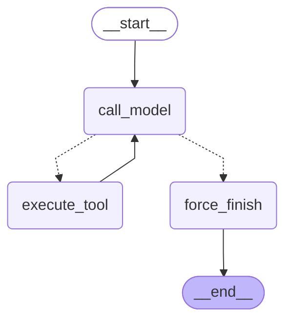

# Агент на LangGraph: кастомный граф, prebuilt и цикл блока 6.2 (блок 6.3)

ReAct-агент блока 6.2 (`app/services/agent_react.py`, цикл `for` по `max_iterations`) переписан на
LangGraph 1.x в `app/services/agent_graph.py`. Агент тот же: системный промпт, три инструмента, лимит
итераций. Собран он двумя путями: `custom_graph` — `StateGraph` руками, `prebuilt_graph` —
`langchain.agents.create_agent`. Обе сборки и цикл 6.2 сравниваются на пяти задачах блока 6.2 по
latency и токенам.

## 1. Конфигурация

| Параметр | Значение |
|---|---|
| Версии | `langgraph` 1.2.14, `langchain` 1.4.4, `langchain-core` 1.6.9, `langchain-openai` 1.7.0 (`uv.lock`) |
| Модель | `AGENT__MODEL` у всех трёх реализаций; канон задания — `gpt-5.4-mini`, прогон — `qwen3:4b-instruct` в Ollama на CPU |
| Клиент модели | `ChatOpenAI` к тому же провайдеру, что у сервиса (`LLM__BASE_URL`, ключ, прокси, сертификаты ОС), Chat Completions (`use_responses_api=False`: Responses API у Ollama нет) |
| Температура | `AGENT__TEMPERATURE`, по умолчанию 0 — у графов и у цикла 6.2 в бенчмарке |
| Лимит итераций | графы — 6 вызовов модели (`MAX_ITERATIONS`); цикл 6.2 — `AGENT__MAX_ITERATIONS` (10), таймаут итерации — `AGENT__TIMEOUT_PER_ITERATION_SEC` |
| Системный промпт | `SYSTEM_PROMPT` блока 6.2 — один текст для всех трёх |
| Инструменты | `search_knowledge_base(query)` — RAG блока 5.5 по `kb_docs`; `get_current_time(timezone)`; `send_telegram_message(chat_id, text)` — заглушка (`app/tools/graph_tools.py`) |

Инструменты — те же функции блоков 6.1–6.2, оформленные `@tool` из `langchain_core.tools`. Docstring —
это description для модели. Текст тот же, что у ReAct-агента 6.2, байт в байт: четыре вопроса — что
делает, когда вызывать, когда НЕ вызывать, что возвращает. Переносы строк docstring склеиваются в
пробелы (раздел 7.2), тест сверяет описания без нормализации. Схема
аргументов — pydantic-модель с `extra="forbid"` и шаблонами строк. Неверные аргументы дают
`ValidationError` до вызова функции. Сбой внутри функции (Qdrant не отвечает, неизвестный часовой
пояс) возвращается строкой «Ошибка инструмента …»: `ToolNode` prebuilt-агента ловит только ошибки
аргументов, остальные уронили бы граф. Один и тот же список `TOOLS` идёт в оба графа.

Проверка версии: `python -c "import langgraph; print(langgraph.__version__)"` из задания в
`langgraph` 1.2 падает с `AttributeError` — атрибута `__version__` у пакета нет. Версию показывает
`python -c "import importlib.metadata as m; print(m.version('langgraph'))"` → `1.2.14`.

## 2. State contract

```python
class AgentState(TypedDict):
    messages: Annotated[list[AnyMessage], add_messages]
    iteration_count: int
    tool_results: Annotated[list[dict], operator.add]
```

| Поле | Reducer | Что хранит и почему |
|---|---|---|
| `messages` | `add_messages` | история: задача, ответы модели с `tool_calls`, `ToolMessage` с результатами. Узел возвращает только новые сообщения — reducer дописывает их, а сообщение с тем же `id` заменяет |
| `iteration_count` | нет (замена) | число вызовов модели. `call_model` возвращает `iteration_count + 1` целиком, по нему router включает stop-кран |
| `tool_results` | `operator.add` | результаты инструментов для отчёта и трейсинга: итерация, имя, аргументы, результат (200 символов), время. Каждый `execute_tool` добавляет свои записи к списку |

В state нет клиента модели, http-сессий и ключей. Модель с привязанными инструментами и словарь
инструментов живут в замыканиях узлов, собранных `build_custom_graph(model, tools)`. Поэтому state
целиком сериализуем: checkpointer сохранит его без изменений. Системный промпт в state тоже не
кладётся — `call_model` добавляет его перед каждым вызовом, как это делает `create_agent`.

## 3. Router и stop conditions

```python
def route_after_model(state: AgentState) -> Literal["execute_tool", "force_finish"]:
    if state["iteration_count"] >= MAX_ITERATIONS:
        return "force_finish"
    last = state["messages"][-1]
    return "execute_tool" if isinstance(last, AIMessage) and last.tool_calls else "force_finish"
```

Router — чистая функция: только читает state, ничего в него не пишет, сети не трогает (тест сверяет
state до и после). Тип возврата — `Literal`.

**Условия остановки кастомного графа:**
- **Модель ответила без `tool_calls`** → `force_finish` прокидывает её ответ как есть → `END`.
- **`iteration_count >= 6`** — stop-кран, даже если модель снова просит инструмент → `force_finish`.
  Узел закрывает каждый невыполненный вызов сообщением `ToolMessage("Не выполнено: превышен лимит
  итераций.")`, чтобы история осталась валидной для продолжения, и добавляет явный финальный ответ
  «Превышен лимит итераций (6): агент не дал финального ответа.». Молча в `END` граф не уходит.
- **Ошибка инструмента** (неизвестное имя, неверные аргументы, исключение) — не остановка: она
  возвращается модели `ToolMessage`, и цикл идёт дальше до ответа или крана.

**У prebuilt-агента** выход по ответу без `tool_calls` встроен в `create_agent`. Stop-кран —
`ModelCallLimitMiddleware(run_limit=6, exit_behavior="end")`: перед седьмым вызовом модели агент уходит
в конец с сообщением «Model call limits exceeded: run limit (6/6)». `recursion_limit=50` в config —
страховка от зацикливания самого графа: одна итерация prebuilt-агента — 4 супершага (`before_model`,
`model`, `after_model`, `tools`), и лимит LangGraph по умолчанию (25) кончился бы раньше крана.

Кран проверен на задачах, где поиск сломан или заведомо бесполезен:
- **Тесты** `test_stop_tap_on_a_broken_tool` и `test_prebuilt_stops_after_six_model_calls`: подставная
  модель на каждом шаге снова просит упавший поиск, оба графа останавливаются ровно на 6-м вызове.
- **Живая модель** — `python scripts/bench_agents.py --stop-check`, два сценария на обоих графах,
  результат — `docs/agent-graph-bench/stop_check.json`:
  - `broken` — поиск всегда падает: «база знаний не ответила». В первом прогоне кран не понадобился.
    `qwen3:4b-instruct` у обоих графов сделала 3 вызова модели и 2 поиска и ответила «В базе знаний
    ничего не найдено по сроку возврата оплаты.» Модель сдаётся сама и в цикл не уходит.
  - `useless` — поиск отвечает «ничего не найдено, попробуйте другую формулировку», а задача требует не
    меньше восьми попыток. Модели нужно больше 6 вызовов, остановить граф должен кран. Результат — после
    повторного прогона.

## 4. Схема кастомного графа

`python scripts/visualize_graph.py` → `docs/agent-graph-custom.mmd` (ниже) и `docs/agent-graph-prebuilt.mmd`.
Тест сверяет файлы и этот блок с тем, что строит код сейчас. Открываются в https://mermaid.live;
`--png` дополнительно сохраняет `docs/agent-graph.png` через mermaid.ink (нужна сеть; на Windows сохранился).



Сплошные рёбра — безусловные, пунктир — ветки `route_after_model`. Схема prebuilt-агента — те же
`model` ⇄ `tools`, плюс узлы `ModelCallLimitMiddleware.before_model` / `.after_model` (крана).

## 5. Бенчмарк

`python scripts/bench_agents.py`: 5 задач блока 6.2 × 3 реализации × 3 повтора. Реализации:
- `b62_loop` — цикл блока 6.2: критик после каждого инструмента, проверка финального ответа;
- `custom` — `custom_graph`;
- `prebuilt` — `prebuilt_graph`.

Что измеряется:
- latency — `time.perf_counter()` вокруг вызова;
- токены — сумма `usage_metadata` ответов модели (у `b62_loop` — `usage`, вместе с критиком);
- `total_steps` — вызовы модели агентом (у `b62_loop` — итерации цикла);
- корректность — то же правило задачи, что в `scripts/compare_agents.py`.

Порядок прогонов — повтор → задача → реализация. Перед каждым прогоном, вне замера, кеш промпта
сбрасывается (`reset_cache`): короткий посторонний запрос к той же модели. Зачем — в разборе первого
прогона ниже. Графы вызываются с `config={"configurable": {"thread_id": f"bench-{task_id}"}}`. Журнал —
`docs/agent-graph-bench/runs.jsonl`, сводка — `summary.json`. Таблицы ниже скрипт вписывает сам.

<!-- bench:start -->
Заполняется `python scripts/bench_agents.py`.
<!-- bench:end -->

### Первый прогон: latency исказил кеш промпта

Первый прогон (18.10, без сброса кеша) лежит в `docs/agent-graph-bench/run1-no-cache-reset/`. По нему
prebuilt выходил в 2,5–4,5 раза быстрее custom. При этом ответы, вызовы инструментов и токены у двух
графов совпали во всех 15 парах прогонов: модель получала одни и те же запросы. А разница во времени
почти постоянная:

| Задача | Вызовов модели | Токенов | custom, с | prebuilt, с | Разница, с |
|---|---|---|---|---|---|
| `simple_kb` | 2 | 2 534 | 48,2 | 16,9 | 31,3 |
| `simple_time` | 2 | 2 407 | 42,8 | 11,7 | 31,0 |
| `compose_kb_send` | 4 | 5 770 | 75,7 | 42,3 | 33,4 |
| `compose_time_kb_send` | 2 | 2 798 | 65,0 | 30,7 | 34,3 |
| `provocation_call` | 1 | 1 238 | 42,2 | 9,3 | 32,9 |

Разница 31–34 с и при одном вызове модели, и при четырёх, и при 1,2 тыс. токенов, и при 5,8 тыс. Это
разовая плата за прогон, а не накладные расходы фреймворка на шаг. В `provocation_call` запрос один и
тот же, байт в байт, а идёт он 42 с у custom и 9 с у prebuilt.

**Причина — кеш промпта Ollama.** Ollama держит KV-кеш последнего запроса и в следующем пересчитывает
только хвост после общего префикса. Промпт обоих графов начинается одинаково: системный промпт и
описания инструментов, около 1 100 токенов, на CPU это ~30 с префилла. Порядок в серии был
b62_loop → custom → prebuilt:
- custom шёл после цикла 6.2, у которого промпт расходился уже в описаниях инструментов (раздел 7.2), и
  платил за префилл;
- prebuilt шёл сразу за custom и брал префикс из кеша.

**Контроль** — stop-check того же дня. Там оба графа стартовали с тёплым кешем: перед ними шёл
CLI-прогон с тем же префиксом. Результат — 22,9 с у custom и 22,9 с у prebuilt.

**Исправление в `bench_agents.py`.** Перед каждым прогоном, вне замера, уходит короткий посторонний
запрос без системного промпта (`reset_cache`). При `OLLAMA_NUM_PARALLEL=1` (так по умолчанию) у модели
один слот кеша. Запрос вытесняет из него префикс агента, и каждый прогон начинается одинаково холодным.
После исправления 7.2 промпты цикла 6.2 и графов совпадают, так что без сброса кеш доставался бы уже и
custom. Флаг `--no-cache-reset` воспроизводит условия первого прогона.

## 6. Custom против prebuilt

| | `custom_graph` | `prebuilt_graph` |
|---|---|---|
| Пишется руками | `AgentState`, три узла, router, рёбра; разбор `tool_calls`, вызов инструмента, ошибки → `ToolMessage`; кран и финальный ответ при лимите; `strict=True` в `bind_tools` | одна строка `create_agent(model, tools, system_prompt)` и два middleware: кран (`ModelCallLimitMiddleware`) и `strict_tools` (`strict` в `model_settings`) |
| Делает сам фреймворк | — | цикл модель ⇄ `ToolNode`, параллельные вызовы, ошибки аргументов → сообщение модели, выход по ответу без `tool_calls`, системный промпт перед вызовом |
| State | свой: `iteration_count`, `tool_results` | свой у `create_agent` (`messages` и служебные поля middleware); `tool_results` нет — результаты берутся из `ToolMessage` |
| Лимит | 6 вызовов, шестой вызов инструмента не выполняется и закрывается `ToolMessage` | 6 вызовов, инструменты шестого вызова выполняются, седьмого вызова модели нет |
| Сообщение при лимите | своё, по-русски | «Model call limits exceeded: run limit (6/6)» |
| Схема | 3 узла | 4 узла: `model`, `tools` и два узла middleware |
| Запрос к модели | ответы модели без имени | `create_agent(name=…)` подписывает ответы модели: у assistant-сообщений в истории `name: "prebuilt_graph"`. Ollama поле не читает, токены те же; OpenAI принимает его как имя участника |

Числа и вывод «какой путь когда» — после повторного прогона: latency первого искажена (раздел 5).

## 7. Баги, найденные при отладке

### 7.1. `extra="forbid"` не доходил до модели

У схем аргументов pydantic-модели с `extra="forbid"`: в JSON Schema у них `additionalProperties: false`,
как у строгих схем блока 6.2. Граф прогнали через настоящий `ChatOpenAI` на подставном
OpenAI-совместимом сервере, который пишет каждый запрос в журнал.
В журнале у инструментов `additionalProperties` не было: `langchain-openai` при конвертации
`args_schema` в формат OpenAI выкидывает его, если не передан `strict=True`. Модель видела схему, где
лишние поля разрешены; отвергал их только pydantic уже после вызова.

Исправление:
- **`custom_graph`** — `model.bind_tools(tools, strict=True)`: в запросе появились
  `additionalProperties: false` и `strict: true`, как в 6.2.
- **`prebuilt_graph`** — так нельзя: `create_agent` связывает инструменты сам. `strict` передаётся
  только через `model_settings`, отсюда middleware `strict_tools` (`wrap_model_call`).

Тесты проверяют аргументы `bind_tools` у обеих сборок. Ollama поле `strict` не применяет, а
`ValidationError` ловит неверные аргументы в любом случае: исправление важно для облачной модели, у
которой strict-схема ограничивает саму генерацию.

### 7.2. Описания инструментов «те же», но не байт в байт

Найден по первому прогону бенчмарка. В `provocation_call` у всех реализаций один вызов модели и ни
одного инструмента, а промпт у графов — 1 161 токен, у цикла 6.2 — 1 139. Системный промпт и задача
одинаковые, отличаются инструменты: в описаниях — переносы строк, в схемах — порядок ключей. Переносы —
ошибка: `@tool` берёт docstring как есть, с переносами строк по ширине кода (15 переносов на три
описания), и в JSON запроса они уходят как `\n`. Тест сверял описания после склейки пробелов —
`" ".join(text.split())` — и различия не видел.

Исправление:
- декоратор `_one_line` в `app/tools/graph_tools.py` склеивает переносы в пробелы;
- тест сравнивает description байт в байт, в том виде, в каком его отдаёт `bind_tools`
  (`convert_to_openai_tool`).

Проверка — повторный прогон. Если промпты расходились только переносами, prompt_tokens у графов и у 6.2
на первом вызове совпадут: 1 139. Если разница останется, её даёт порядок ключей в схемах. Различие
могло менять и поведение. В `compose_kb_send` графы вызывали лишний `get_current_time`: 4 вызова модели
против 3 у 6.2. Повторный прогон покажет, связано ли это с описаниями.

## 8. Что блокирует переход к персистентности

- **`thread_id` уже передаётся.** Бенчмарк и CLI вызывают графы с
  `config={"configurable": {"thread_id": …}}`. Без checkpointer это no-op, но вызов менять не придётся.
- **Нет самого checkpointer.** `AsyncSqliteSaver` — отдельный пакет `langgraph-checkpoint-sqlite` (в
  зависимостях его нет), `AsyncPostgresSaver` — `langgraph-checkpoint-postgres`. Postgres у сервиса уже
  есть (блок 4.1), так что для сервиса естественнее второй. Подключение — `builder.compile(checkpointer=…)`
  и `create_agent(checkpointer=…)`.
- **Счётчики в одном thread.** `iteration_count` без reducer, и вход `initial_state` сбрасывает его в 0 на
  каждый запуск. Без этого второе сообщение в том же thread сразу ушло бы в `force_finish`.
  `tool_results` с `operator.add` будет копиться по всему thread — для трейсинга это нормально, но
  список растёт без ограничений. У prebuilt-агента — `run_limit`, а не `thread_limit`, по той же причине.
- **История должна быть валидной для повторной отправки.** После лимита `force_finish` закрывает
  невыполненные вызовы `ToolMessage`. Иначе в сохранённой истории остался бы `AIMessage` с
  `tool_calls` без ответов, и OpenAI отклонил бы её при продолжении диалога.
- **State сериализуем:** сообщения, числа и словари; клиентов и ключей в нём нет.
- **Human-in-the-loop не встроен.** Для `interrupt` перед `send_telegram_message` пишущий инструмент
  нужно вынести в отдельный узел, а не держать в общем `execute_tool`. Тогда можно поставить
  `interrupt_before` или вызвать `interrupt()` внутри узла.
- **Не перенесены критик и проверка финального ответа** блока 6.2. В графе это будут отдельные узлы
  после `execute_tool` и перед `END`, а не код внутри цикла.
