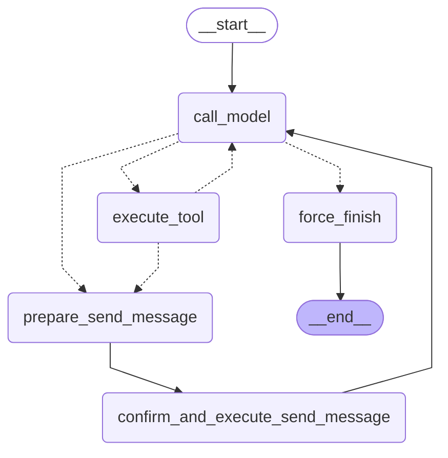

# Персистентный агент: checkpointer, подтверждение отправки, поток SSE, time travel (блок 6.4)

ReAct-граф блока 6.3 переведён из «работает в одном процессе» в «переживает рестарт, ждёт человека на
опасном действии, отдаёт прогресс наружу». Новый модуль — `app/services/agent_persistent.py`. Граф 6.3
(`app/services/agent_graph.py`) не менялся и остаётся in-memory вариантом для unit-тестов и бенчмарка.

Что сделано:
- **Checkpointer по `AGENT_CHECKPOINTER`** — memory, sqlite или postgres; `setup()` вызывается один раз на
  старте сервиса.
- **Подтверждение отправки клиенту** — `interrupt()` + `Command(resume=...)` перед
  `send_telegram_message`.
- **`POST /agent/stream`** — поток событий графа в SSE.
- **`scripts/time_travel_demo.py`** — история чек-пойнтов и две ветки решения.
- **Фильтр Alembic** — таблицы LangGraph не попадают в autogenerate.



Схема — `graph.get_graph().draw_mermaid()`, тест сверяет её с кодом. Пунктир — условные рёбра:
- `route_after_model` разводит безопасные инструменты, отправку, ответ и лимит итераций;
- `route_after_tools` отправляет вызов отправки из того же ответа модели на подтверждение уже после поиска.

Между `prepare_send_message` и `confirm_and_execute_send_message` — обычное ребро: это два узла, а не один.

## 1. Backend checkpointer'а: какой в каком режиме и почему

| `AGENT_CHECKPOINTER` | Saver | Где | Почему |
|---|---|---|---|
| `memory` | `InMemorySaver` | тесты (`tests/conftest.py`) | без файлов и базы; состояние живёт, пока жив процесс |
| `sqlite` (по умолчанию) | `AsyncSqliteSaver`, файл `AGENT_SQLITE_PATH` = `var/agent/checkpoints.sqlite` | uvicorn на хосте, разработка | один файл без сервисов, переживает рестарт; работает при любом цикле событий |
| `postgres` | `AsyncPostgresSaver` поверх `AsyncConnectionPool` (psycopg 3) | `docker compose` (задан в `compose.yaml`) | та же база `multapi`, что у чатов: несколько воркеров, общие бэкапы, никакой отдельной БД |

**Жизненный цикл.** `agent_lifespan()` открывает saver по `AGENT_CHECKPOINTER`, один раз вызывает
`setup()` и отдаёт граф. lifespan FastAPI держит граф в `app.state.agent`, эндпоинты только вызывают
его. Если checkpointer не открылся (например, Postgres недоступен), сервис всё равно стартует: в лог
пишется `agent_unavailable`, а `/agent/*` отвечают 503.

**`setup()` один раз:**
- **Postgres.** Тест `test_postgres_checkpointer_setup_once_and_tables` считает вызовы за весь цикл:
  старт, запуск до паузы, resume — ровно один.
- **SQLite.** `AsyncSqliteSaver` и сам вызывает `setup()` в начале каждой операции, но после первого раза
  выходит по флагу `is_setup`: DDL выполняется один раз.

**Зависимости.** Версии сверены с PyPI 19.10.2026:
- `langgraph-checkpoint-sqlite` 3.1.2 и `langgraph-checkpoint-postgres` 3.2.0. Обе требуют
  `langgraph-checkpoint` 4.3, поэтому в `uv.lock` он поднялся с 4.2.0;
- `aiosqlite` 0.22.1 — явно в зависимостях, без него `AsyncSqliteSaver` не импортируется;
- `psycopg[binary,pool]` 3.3.6 — psycopg 3, не psycopg2: `binary` — готовые wheel без libpq,
  `pool` — `AsyncConnectionPool`.

## 2. Postgres в docker-compose

Добавлена одна переменная окружения сервиса `app`: `AGENT_CHECKPOINTER: postgres`.

**Адрес.** Тот же `DATABASE_URL`, что у чатов: `postgresql+asyncpg://multapi:…@postgres:5432/multapi`.
psycopg драйвер в схеме не понимает, и `psycopg_database_url()` (`app/core/config.py`) превращает адрес
в `postgresql://multapi:…@postgres:5432/multapi`. Новой базы нет, отдельных переменных `POSTGRES_*` тоже.

**Пул.** `AsyncConnectionPool(min_size=1, max_size=5)`, у соединений:
- `autocommit=True` и `row_factory=dict_row` — их требует `AsyncPostgresSaver`;
- `prepare_threshold=0` — без серверных prepared statements, безопасно и за PgBouncer.

Пул открывается на старте и закрывается при остановке сервиса (`AsyncExitStack` в `app/main.py`).

**Проверка `\dt` после `setup()`.** Windows, `docker compose up -d` после пересборки образа. В логе `app` —
`agent_checkpointer_ready` с `"backend": "postgres"`, затем:

```
> docker compose exec postgres psql -U multapi -d multapi -c '\dt'
                List of relations
 Schema |         Name          | Type  |  Owner
--------+-----------------------+-------+---------
 public | alembic_version       | table | multapi
 public | broadcast_queue       | table | multapi
 public | chat_messages         | table | multapi
 public | chats                 | table | multapi
 public | checkpoint_blobs      | table | multapi
 public | checkpoint_migrations | table | multapi
 public | checkpoint_writes     | table | multapi
 public | checkpoints           | table | multapi
 public | message_feedback      | table | multapi
 public | moderation_incidents  | table | multapi
```

**Alembic.** Таблицы `checkpoint*` создаёт `setup()` LangGraph, а не миграции. В `target_metadata` их нет,
и без фильтра autogenerate предложил бы их удалить.
- В `migrations/env.py` обоим `context.configure` (онлайн и `--sql`) передан `include_name` —
  `alembic_include_name` из `app/chat/repositories/pg_models.py`. Он скрывает от autogenerate
  `checkpoints`, `checkpoint_writes`, `checkpoint_blobs` и `checkpoint_migrations`.
- Проверка на той же базе, уже с таблицами LangGraph: `alembic check` на хосте → `No new upgrade operations
  detected.`
- Тест `test_alembic_autogenerate_keeps_checkpoint_tables`: с фильтром `remove_table` для этих таблиц
  нет, без фильтра — все четыре.

Схему checkpoint'ов ведёт `setup()`, доменную — Alembic.

## 3. Опасный инструмент: `send_telegram_message`

Отправка сообщения клиенту необратима: клиент видит текст сразу, отозвать его нельзя. Неверный `chat_id`
отправит чужому клиенту чужие данные. Модель может вызвать отправку там, где её не просили, или с текстом,
в котором ошиблась (в бенчмарке 6.3 она путала дату возврата). Поэтому отправка — только через
подтверждение человеком.

Модель по-прежнему видит `send_telegram_message` в списке инструментов, с тем же описанием, что в 6.2.
Сама функция инструмента в графе не вызывается никогда: вызов модели перехватывает router и уводит в два
узла.

**Идемпотентность: что до `interrupt()` и что после.** При `Command(resume=...)` LangGraph перезапускает
прерванный узел с начала. Всё, что стоит в нём до `interrupt()`, выполнится второй раз.
- **До interrupt:**
  - `prepare_send_message` — отдельный узел, при resume не перезапускается. Он проверяет роль и
    аргументы (`SendArgs`: числовой `chat_id`, текст до 4096 символов) и кладёт в state черновик:
    `chat_id`, `text`, `request_id`, `tool_call_id`. Побочных эффектов нет.
  - В `confirm_and_execute_send_message` до `interrupt()` — только чтение черновика из state и
    сборка превью. Повтор этого кода безвреден.
- **После interrupt:** решение человека и сам побочный эффект — `await sender(chat_id=…, text=…,
  request_id=…)`, затем `ToolMessage` с результатом, `sent` и `draft=None` в state. Отказ —
  `ToolMessage` «Не отправлено: оператор отклонил отправку», `sent=False`, API не вызывается.

Если поставить отправку до `interrupt()`, каждый resume отправлял бы сообщение заново.

**Неидемпотентная часть — `request_id`.** Он не генерируется (`uuid4()`, время), а вычисляется
детерминированно: `sha256(thread_id + id вызова модели)`. Повтор того же шага thread даёт тот же ключ, а
`TelegramOutbox` по нему не отправит одно сообщение дважды. Это не перестраховка. Повторный resume
прошлого чек-пойнта (раздел 5) перезапускает узел отправки целиком, вместе с кодом после `interrupt()`:
второе сообщение клиенту не уходит только благодаря ключу.

Сама отправка — заглушка блока 6.1: печать `[TELEGRAM → chat_id] текст` в stdout, настоящий Telegram API
не вызывается.

## 4. `__interrupt__` и продолжение после `Command(resume=True)`

Вывод `python scripts/time_travel_demo.py` на Windows:

```
=== 1. Запуск до interrupt (thread demo-approve) ===
__interrupt__ payload:
{
  "type": "approve_send_message",
  "preview": {
    "chat_id": "12345",
    "text": "Напоминаем: письмо об автопродлении тарифа приходит за 3 дня до окончания периода.",
    "request_id": "e0a4a7cf26d39e9e"
  },
  "question": "Отправить это сообщение клиенту?"
}
snapshot.next = ('confirm_and_execute_send_message',), sent = False

Command(resume=True):
[TELEGRAM → 12345] Напоминаем: письмо об автопродлении тарифа приходит за 3 дня до окончания периода.
sent = True; ответ агента: Напоминание отправлено клиенту в чат 12345.
```

Демо работает офлайн:
- checkpointer — `AsyncSqliteSaver(":memory:")`;
- модель — детерминированный сценарий без сети: поиск → отправка → ответ по результату отправки;
- поиск — заглушка с фрагментом корпуса.

## 5. Time travel

**История чек-пойнтов** — `aget_state_history`, новые сверху:

```
checkpoint_id                          step  next
1f1cb8b4-5c14-698e-8007-899df91e060f      7  — (конец)
1f1cb8b4-5c13-6b31-8006-d3cff73557ee      6  force_finish
1f1cb8b4-5c0f-68d4-8005-e2a4380407dc      5  call_model
1f1cb8b4-5bfa-63e1-8004-94b766e4d776      4  confirm_and_execute_send_message
1f1cb8b4-5bf7-66f7-8003-8be72210d892      3  prepare_send_message
1f1cb8b4-5bf1-6536-8002-f73318cca391      2  call_model
1f1cb8b4-5beb-6ff6-8001-ba1938fee6da      1  execute_tool
1f1cb8b4-5be3-6bd5-8000-bd7fe37be6a1      0  call_model
1f1cb8b4-5be1-666f-bfff-f2612d60f44a     -1  __start__
```

**Состояние на прошлом чек-пойнте** — `aget_state` с `checkpoint_id` шага 4, до отправки: черновик готов,
`sent=False`, граф стоит перед узлом подтверждения.

```
next = ('confirm_and_execute_send_message',)
sent = False
draft = {"tool_call_id": "call_send_1", "chat_id": "12345", "text": "Напоминаем: …", "request_id": "e0a4a7cf26d39e9e"}
interrupts = ['approve_send_message']
```

**Две ветки из одинакового входа** — на двух `thread_id`:

```
thread         resume sent  ответ агента
demo-approve   True   True  Напоминание отправлено клиенту в чат 12345.
demo-reject    False  False Сообщение клиенту не отправлено: оператор отклонил отправку.
```

**Повторный resume того же thread с другим решением.** `Command(resume=False)` на чек-пойнт шага 4
thread `demo-approve`, где уже было `resume=True`:

```
sent = True — применилось первое решение (True), а не новое
узел отправки выполнился заново, ответ отправки: Уже отправлено ранее (request_id e0a4a7cf26d39e9e),
повторно не отправляю: Сообщение отправлено в 12345
```

Значение `Command(resume=...)` лежит в checkpointer как pending write этого чек-пойнта и детерминировано
для всей линии thread. Resume доставляет пропущенное значение в `interrupt()`, а не переигрывает
принятое решение. Поэтому две ветки строятся на двух `thread_id` (или форком через `update_state`), а
не повторным resume.

Практический вывод — из второй строки: узел отправки при таком повторе выполнился ещё раз целиком. Без
ключа идемпотентности клиент получил бы сообщение дважды. Это проверяет тест
`test_repeated_resume_keeps_the_first_decision_and_outbox_blocks_a_second_send`.

## 6. Streaming: `astream(stream_mode=["updates", "messages"])`

`POST /agent/stream` (`app/routers/agent.py`) принимает `{"thread_id", "input": {"messages": [...]}}` или
`{"thread_id", "resume": true | {"approved": false, "comment": "…"}}`. Ответ — `StreamingResponse` с
`media_type="text/event-stream"`, каждое событие — `data: {json}\n\n`:

| Событие | Откуда | Что несёт |
|---|---|---|
| `start` | эндпоинт | thread, роль, режим (input/resume) |
| `node` | `updates` | узел закончил шаг: что он записал в state (сообщения кратко, результат инструмента — 200 символов) |
| `token` | `messages` | кусок ответа модели по мере генерации |
| `interrupt` | `__interrupt__` в `updates` | превью сообщения клиенту и вопрос |
| `end` | `graph.aget_state` | на каком узле стоит граф, ждёт ли решения (`pending_approval`), ушло ли сообщение, ответ |
| `error` | эндпоинт | модель или провайдер упали посреди потока — заголовки уже отправлены, ошибка приходит событием |

**Почему эти два режима, а не `astream_events(version="v2")`:**
- **`updates`** — прогресс по узлам ровно в том объёме, что узел записал. Пауза приходит в нём же
  ключом `__interrupt__`.
- **`messages`** — токены модели.
- **`values`** отдавал бы весь state на каждом шаге. История thread растёт, и объём рос бы с каждым шагом.
- **`astream_events(v2)`** отдаёт каждое событие каждого runnable: `on_chain_start` и `on_chain_end`
  узлов и внутренних цепочек, `on_chat_model_stream`, `on_tool_*`. Деталей больше, но клиенту SSE нужны
  три вида событий, и их пришлось бы выбирать из потока, который в разы больше.

**Грабля режима `messages`.** В него приходят не только токены модели, но и сообщения, которые узлы
пишут в state, — `ToolMessage` с результатом поиска пришёл как «токен» узла `execute_tool`. В `token` идут
только `AIMessage`.

**Защита эндпоинта.** Агент умеет писать клиентам, поэтому `/agent/*` — под `X-Admin-Token`, как
`/chats/admin/*`. Новое сообщение в thread, который ждёт решения, — 409 `approval_pending`, а resume
thread без паузы — 409 `nothing_to_resume`. Роль `system` и `assistant` в `input.messages` не принимается,
текст проходит проверку входа блока 3.8. Состояние thread без запуска — `GET /agent/threads/{thread_id}`.

Поток на Windows: сервис в Docker с `AGENT_CHECKPOINTER=postgres`, модель — `qwen3:4b-instruct` в Ollama на
CPU, поиск — RAG блока 5.5. Длинные строки сокращены до «…».

```
> curl.exe -N -X POST http://127.0.0.1:8000/agent/stream -H "Content-Type: application/json" -H "X-Admin-Token: …" --data-binary "@examples/requests/agent_stream_input.json"
data: {"event": "start", "thread_id": "demo-1", "user_role": "write-with-approve", "mode": "input"}
data: {"event": "node", "node": "call_model", "update": {"messages": [{"type": "ai", "content": "", "tool_calls": [{"name": "search_knowledge_base", "args": {"query": "за сколько дней до окончания периода приходит письмо об автопродлении"}}]}], "iteration_count": 1}}
data: {"event": "node", "node": "execute_tool", "update": {"messages": [{"type": "tool", "content": "[billing/auto-renewal.docx, близость 0.71] Автопродление тарифа\n\nАвтопродление включено по умолчанию: за 3 дня до окончания периода приходит письмо, …", "name": "search_knowledge_base"}], "tool_results": […]}}
data: {"event": "node", "node": "call_model", "update": {"messages": [{"type": "ai", "content": "", "tool_calls": [{"name": "send_telegram_message", "args": {"chat_id": "12345", "text": "Вы получите письмо об автопродлении за 3 дня до окончания периода."}}]}], "iteration_count": 2}}
data: {"event": "node", "node": "prepare_send_message", "update": {"messages": [], "draft": {"tool_call_id": "call_0yxz4grc", "chat_id": "12345", "text": "Вы получите письмо об автопродлении за 3 дня до окончания периода.", "request_id": "b41115da07897b6d"}}}
data: {"event": "interrupt", "interrupts": [{"id": "7cf0b220b16359adb79bd04052f199f9", "value": {"type": "approve_send_message", "preview": {"chat_id": "12345", "text": "Вы получите письмо об автопродлении за 3 дня до окончания периода.", "request_id": "b41115da07897b6d"}, "question": "Отправить это сообщение клиенту?"}}]}
data: {"event": "end", "next": ["confirm_and_execute_send_message"], "pending_approval": true, "sent": false, "answer": null}

> curl.exe -s http://127.0.0.1:8000/agent/threads/demo-1 -H "X-Admin-Token: …"     — до и после docker compose restart app одинаково
{"thread_id":"demo-1","checkpoint_id":"1f1cb8da-beb7-689e-8004-d93c7ade6add","next":["confirm_and_execute_send_message"],"pending_approval":true,"interrupts":[…],"sent":false,"draft":{…},"messages":4}

> curl.exe -N -X POST http://127.0.0.1:8000/agent/stream … --data-binary "@examples/requests/agent_stream_approve.json"
data: {"event": "start", "thread_id": "demo-1", "user_role": "write-with-approve", "mode": "resume"}
data: {"event": "node", "node": "confirm_and_execute_send_message", "update": {"messages": [{"type": "tool", "content": "Сообщение отправлено в 12345", "name": "send_telegram_message"}], "draft": null, "sent": true, "tool_results": […]}}
data: {"event": "token", "node": "call_model", "content": "Вы"}
data: {"event": "token", "node": "call_model", "content": " получ"}
data: {"event": "token", "node": "call_model", "content": "ите"}
  … ещё 22 события token …
data: {"event": "node", "node": "call_model", "update": {"messages": [{"type": "ai", "content": "Вы получите письмо об автопродлении за 3 дня до окончания периода."}], "iteration_count": 3}}
data: {"event": "node", "node": "force_finish", "update": {}}
data: {"event": "end", "next": [], "pending_approval": false, "sent": true, "answer": "Вы получите письмо об автопродлении за 3 дня до окончания периода."}

> (thread demo-2: тот же вход до interrupt, затем agent_stream_reject.json — {"approved": false, "comment": "уточнить у менеджера"})
data: {"event": "node", "node": "confirm_and_execute_send_message", "update": {"messages": [{"type": "tool", "content": "Не отправлено: оператор отклонил отправку (уточнить у менеджера). Скажи пользователю, что сообщение не отправлено.", "name": "send_telegram_message"}], "draft": null, "sent": false, "tool_results": […]}}
  … 32 события token …
data: {"event": "end", "next": [], "pending_approval": false, "sent": false, "answer": "Сообщение не отправлено: оператор отклонил отправку. Просьба уточнить у менеджера."}

> docker compose logs app | Select-String TELEGRAM
app-1  | [TELEGRAM → 12345] Вы получите письмо об автопродлении за 3 дня до окончания периода.
```

Что видно в потоке:
- **Пауза пережила рестарт.** Между первым запросом и подтверждением контейнер `app` перезапускался.
  `GET /agent/threads/demo-1` до и после рестарта показал тот же `checkpoint_id` и `pending_approval: true`:
  состояние лежало в Postgres, resume продолжил с того же чек-пойнта.
- **Отправка — только после решения.** Заглушка Telegram сработала один раз, в одобренном thread `demo-1`. В
  отклонённом `demo-2` API не вызывался, а модель сама сообщила об отказе по `ToolMessage`.
- **Токены Ollama приходят кусками слов** (`"Вы"`, `" получ"`, `"ите"`), и только для финального ответа. На
  шагах с вызовом инструмента текста у модели нет, их видно событиями `node`.
- **Та же схема проверена в песочнице:** подставная модель со стримингом на Postgres 16, с тем же итогом.

## 7. Permission policy

Роль в `config["configurable"]["user_role"]`:
- `read-only` — отправка запрещена, подтверждать её нельзя;
- `write-with-approve` (по умолчанию) — отправка только после `Command(resume=True)`;
- `full` — `confirm_and_execute_send_message` отправляет без `interrupt()`.

Роль из тела запроса ограничена сверху `AGENT_MAX_ROLE` (по умолчанию `write-with-approve`): запрос может
сузить права, но не расширить. `full` включается только настройкой сервиса.

## 8. Что осталось хрупким и что доделать

- **Журнал идемпотентности — в памяти процесса.** `TelegramOutbox` теряет `request_id` при рестарте. Для
  production нужна таблица `UNIQUE (request_id)` в той же базе, запись «отправляю» до вызова API и «ушло»
  после. Тогда сбой между отправкой и записью чек-пойнта тоже не даст дубль.
- **Replay с шага до `call_model` — новый вызов модели.** Новый `tool_call_id`, новый `request_id`: это
  уже новое решение отправить, ключ его не остановит. Защищает только подтверждение человеком.
- **Критик и проверка финального ответа 6.2 не перенесены.** Модель может ответить «отправлено», не вызвав
  инструмент (бенчмарк 6.3); подтверждение от этого не спасает — подтверждать нечего. Следующий шаг —
  узел проверки ответа перед `END`.
- **Postgres-режим на Windows-хосте — только с `uvicorn --reload`.** Без `--reload` uvicorn запускает
  `ProactorEventLoop`, с ним psycopg в async-режиме не работает; с `--reload` — `SelectorEventLoop`. В Docker
  (Linux) ограничения нет. Неподходящий цикл сервис объясняет строкой `agent_unavailable` в логе, а не
  падает.
- **В потоке не приходит usage модели.** В логе `agent_model` у `input_tokens` и `output_tokens` — `null`:
  в режиме `messages` модель стримит, а `ChatOpenAI` без `stream_usage=True` не просит у провайдера
  `stream_options.include_usage`. Модель собирает `build_model()` блока 6.3, и `agent_graph.py` по заданию
  не менялся. Для учёта токенов агента это нужно включить.
- **Checkpoint'ы копятся.** Каждый шаг — строка, у thread нет срока жизни. Нужна чистка старых thread
  (`adelete_thread`) по расписанию. `tool_results` с `operator.add` тоже растёт по всему thread.
- **Thread, который ждёт решения, нельзя отменить иначе как `resume: false`.** Отдельного «отменить и
  начать заново» нет.
- **Права проверяются по одному `ADMIN_TOKEN`.** Роли — это ограничение на запуск, а не учётные записи
  операторов: кто подтвердил отправку, в логе не видно.
- **Интеграция с Telegram-ботом** (`thread_id = tg-<chat_id>`, кнопки «Отправить / Отклонить» по
  событию `interrupt`) — отдельная задача.
