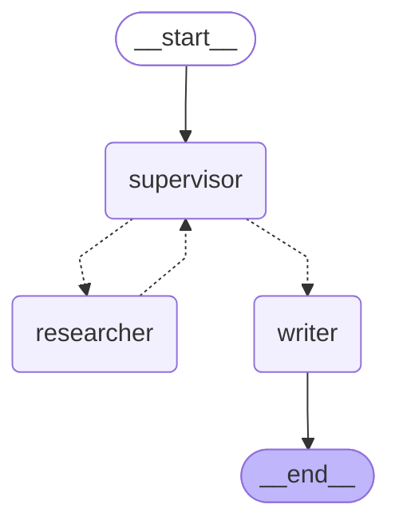
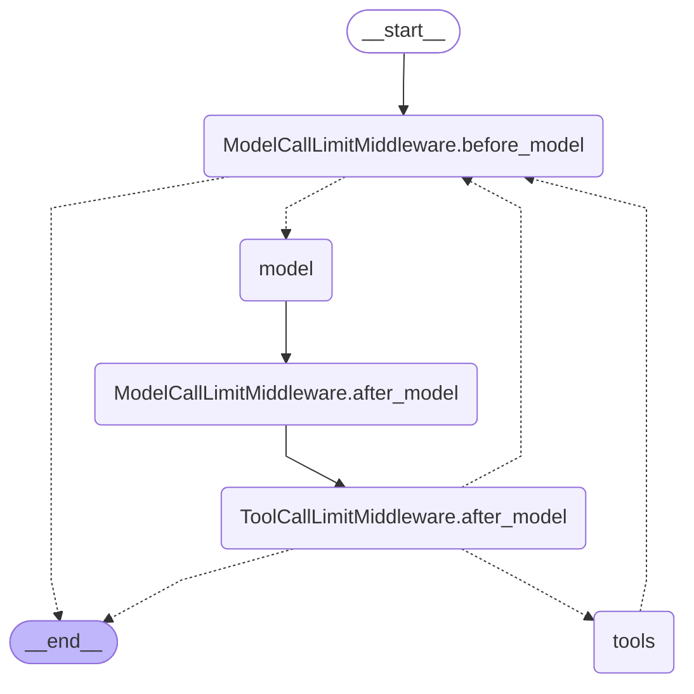

# Архитектура мультиагента (блок 6.5)

Файл пишет `python experiments/multi_agent_langgraph.py` в конце прогона: `app.get_graph().draw_mermaid()`
supervisor-графа и `get_graph().draw_mermaid()` агента researcher. Руками не править — перезапишется.
Устройство, замеры и решение — [multi-agent-report.md](multi-agent-report.md).

## Supervisor-граф

Пунктир — переходы через `Command(goto=...)`. Supervisor выбирает агента handoff-инструментом
`transfer_to_researcher(task)` или `transfer_to_writer(task)`; researcher всегда возвращает управление
supervisor, writer — последний шаг (сплошная стрелка в `__end__`). Бюджет — 5 передач управления
на вопрос; последняя зарезервирована за writer.

## Researcher изнутри

`create_agent(name="researcher", tools=[search_knowledge_base])` с бюджетами: `ToolCallLimitMiddleware` —
не больше 4 поисков, `ModelCallLimitMiddleware` — не больше 6 вызовов модели. Writer — тот же
`create_agent` без инструментов, один вызов модели. Single-agent baseline
(`experiments/single_agent_baseline.py`) устроен как researcher, с теми же бюджетами, но с промптом обеих
ролей.

