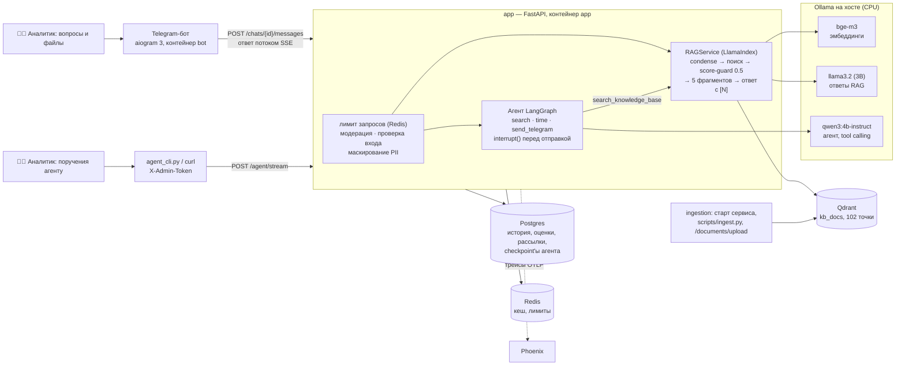

# Итоговое описание решений

Дипломный проект курса «ИИ-разработчик: от API до агентов» на тему «AI-ассистент для анализа
документов»: ассистент упрощает решение повседневных задач сотрудника-аналитика компании. Корпус —
документация B2B-сервиса «Личный кабинет». Это тот же проект, что собирался по домашним заданиям модулей 1–6. Здесь собрано обоснование:
по каждому решению — что выбрано, из чего выбиралось и почему. Подробности и замеры — в отчётах блоков,
ссылки — в каждом разделе. Презентация защиты повторяет структуру этого документа.

**Кратко.**
- **Что умеет.** Аналитик спрашивает в Telegram-боте и получает ответ по базе из 66 документов с
  источниками `[1]`, `[2]`. Если ответа в документах нет — честное «По базе не нашёл, могу
  эскалировать.». Присланный PDF, DOCX или фото ассистент разбирает прямо в чате.
- **Агент.** Три инструмента: находит факт и готовит ответ автору обращения, а отправляет его только
  после подтверждения аналитиком; пауза переживает перезапуск сервиса.
- **Где работает.** Всё — локально: модели в Ollama на CPU, стек — `docker compose up -d`.
- **Качество** подтверждено числами:
  - поиск — нужный фрагмент в пятёрке у 44 из 45 вопросов golden dataset;
  - RAGAS faithfulness 0.868, answer_relevancy 0.792, ссылка на источник — в 45 ответах из 45;
  - 1596 тестов.

## 1. Задача и пользователь

**Откуда задача.** Она выросла из работы автора: обращения пользователей, бизнес-анализ, интеграции
с ERP и 1С. Нужен был помощник, который ориентируется в большом объёме инструкций и консультирует
пользователей в оперативном режиме — отвечает сразу, а не после ручного поиска по десяткам документов.

**Чья задача.** Сотрудник-аналитик компании, которая развивает B2B-сервис «Личный кабинет». Каждый
день он разбирает обращения о тарифах и оплате, входе и безопасности, API, уведомлениях, мобильном
приложении, команде, интеграциях с 1С и календарями — и ищет ответы в документах.

**Пользователи:**
- **Сотрудник-аналитик** — основной пользователь. Спрашивает ассистента своими словами, присылает
  документы на разбор, добавляет новые в базу, поручает агенту найти факт и подготовить ответ — и сам
  подтверждает отправку.
- **Автор обращения** — пользователь сервиса: владелец небольшого бизнеса, бухгалтер, разработчик
  интеграции, администратор команды. С его вопросами приходят к аналитику; те же четыре персоны
  использовались при генерации golden dataset в блоке 5.6. Ответ ему уходит только после
  подтверждения аналитика.

| Сценарий | Где | Что видно |
|---|---|---|
| Вопрос по документам, follow-up в диалоге | Telegram-бот → `POST /chats/{id}/messages` (SSE) | ответ растёт правками сообщения, внизу — «Источники:» с файлами, 👍/👎 |
| Вопрос, ответа на который в базе нет | то же | отказ без вызова модели (score-guard) или по правилу промпта |
| Файл в чате: фото, голосовое, PDF, DOCX | бот → сервис (блок 4.3) | фото — vision-модель, документ — текст в контексте; голос — Whisper (нужен ключ OpenAI, не проверялось) |
| Новый документ в базу | `POST /documents/upload` (admin) | через 30–60 с документ в индексе, ответы ссылаются на него |
| Найти факт и ответить на обращение | `POST /agent/stream` (admin), `scripts/agent_cli.py` | поиск → черновик → **пауза до подтверждения** → отправка или отказ |
| Администрирование | `/chats/admin/*`, команды бота `/stats`, `/users`, `/broadcast` | статистика, пользователи, рассылки |

## 2. Почему здесь нужен ИИ

**Выбрано:** семантический поиск по фрагментам и ответ модели строго по найденному, со ссылками на
источники.

**Из чего выбиралось:** поиск по ключевым словам, страница частых вопросов.

**Почему не они:**
- **Вопрос — своими словами.** «Потеряла телефон с Google Authenticator — как теперь войти?» —
  а в статье «резервный код» и «приложение-аутентификатор», общих слов почти нет. В мини-бенчмарке блока
  5.1 поиск по совпадению слов поставил нужный фрагмент первым в 6 вопросах из 10 (MRR 0.717), `bge-m3` —
  в 9 из 10 (MRR 0.933).
- **Ответ часто собирается из нескольких документов.** «Не проходит оплата картой, а тариф кончается
  завтра — что делать и как быстро ответит поддержка?»: что проверить — в статье о платежах, срок ответа
  — в регламенте поддержки (PDF). FAQ так не отвечает: он даёт готовые ответы на заранее известные
  вопросы.
- **Диалог.** «А при оплате по счёту?» понятно только вместе с предыдущим вопросом. Модель переписывает
  такой follow-up в полный вопрос для поиска (condense, блок 5.5).
- **Документы в четырёх форматах** — HTML, DOCX, PDF, Markdown; у каждого свой ридер (раздел 3). Модель
  отвечает по ним одинаково.
- **Действие.** Кроме ответа нужно ещё и сделать: ответить автору обращения в Telegram. Это агент с инструментами
  (раздел 7).

**Чем платим.** Модель может ошибиться, поэтому ответ строится только по найденным фрагментам, со
ссылками; ниже порога близости модель не вызывается вовсе; качество проверяется числами (раздел 9).

## 3. База знаний

**Выбрано:** 66 документов «Личного кабинета» в `data/<категория>/` — 11 категорий, 916 КБ, 102
документа LlamaIndex (страница PDF и раздел Markdown — отдельный документ).

| Формат | Файлов | Что это | Ридер |
|---|---:|---|---|
| HTML | 26 | статьи справочного центра: шапка, меню и подвал вокруг `<article>` | `HTMLTagReader` — только статья |
| Markdown | 17 | документация API и частые вопросы по разделам | `MarkdownReader` — раздел = документ |
| DOCX | 14 | документы финансового отдела и отдела внедрения | `DocxReader` |
| PDF | 9 | регламент поддержки 2.3 (сроки таблицей), документы безопасности, заметки о выпусках | `PyMuPDFReader` — страница = документ |

**Откуда.** База знаний проекта, которая росла с модуля 3:
- 10 статей руководства (блок 3.7);
- 56 статей справки и регламента (блок 5.1);
- частые вопросы и заметки о выпусках.

`scripts/build_corpus.py` раскладывает её по форматам так, как документы лежат в компании: у каждого
формата свой автор, дата создания в свойствах файла, редакция в имени (`refunds_v2.docx`). Опись —
[`data_inventory.md`](data_inventory.md).

**Из чего выбиралось:**
- реальная документация компании — её нельзя публиковать в открытом репозитории;
- открытые датасеты вопросов и ответов — в них нет форматов и редакций, а вопросы не по одному продукту;
- учебный корпус блоков 5.3–5.4 из 10 файлов — мал для поиска: на нём все стратегии упираются в потолок
  метрик.

**Почему эти документы:**
- **Формат — от источника.** Как в настоящей поддержке: справка — сайт, финансы — Word, регламенты — PDF.
  Отсюда четыре ридера и метаданные из самих файлов.
- **Ловушки для ассистента.** Прежние редакции лежат в `data/archive/` и в индекс не идут
  (`data/.ragignore`): например, срок возврата 7 дней против 14 в новой редакции. Есть похожие статьи и
  противоречия между статьями, есть таблицы в PDF.
- **Объём.** На 102 фрагментах уже различаются стратегии нарезки и пороги, а полная индексация на CPU
  занимает 35 с.

## 4. Архитектура

**Как проходит вопрос:**
1. Бот отправляет сообщение в `POST /chats/{id}/messages`.
2. Сервис проверяет лимит запросов (Redis), модерацию, защитный слой блока 3.8 (инъекции, маскирование
   персональных данных) и сохраняет вопрос в Postgres.
3. Follow-up переписывается в полный вопрос по истории чата (condense).
4. Вопрос → эмбеддинг `bge-m3` → 10 кандидатов из Qdrant.
5. Score-guard: если лучшая близость ниже 0.5 — отказ без вызова модели.
6. Пять лучших фрагментов нумеруются, `llama3.2` отвечает только по ним, со строкой «Источники: [N]».
   Если модель её забыла, строку допишет код.
7. Токены идут потоком SSE, затем событие `sources`. Бот правит сообщение не чаще раза в 0,7 с, под
   ответом — источники и 👍/👎.
8. Ответ и оценка — в Postgres; дерево спанов (retriever, embedding, LLM) — в Phoenix.

**Из чего выбиралось:**
- **Взаимодействие.** Запрос–ответ без потока: на CPU пользователь 30–60 с видел бы только «печатает…». Очередь
  с воркерами избыточна для коротких ответов. Выбран поток SSE — ADR-001 в
  [`architecture.md`](architecture.md).
- **Интерфейс.** Веб-интерфейс против Telegram-бота. Бот — там, где обращения и так приходят и где
  аналитик работает с телефона; он тонкий: вся работа с моделью — в сервисе, бот только показывает (блок 4.2).
- **Готовый шлюз LiteLLM** против своего клиента. Проверен в блоке 3.2 и отвергнут для одного сервиса и
  одного провайдера: ещё один процесс и точка отказа на машине, где память занята Ollama.

Стек — [`compose.yaml`](../compose.yaml): `app`, `migrate` (Alembic), `bot`, `redis`, `postgres`, `qdrant`,
`phoenix`; Ollama — на хосте. Схема агента — [`agent-graph-custom.mmd`](agent-graph-custom.mmd) и
[`agent-persistent-report.md`](agent-persistent-report.md).

## 5. Выбор модели

**Выбрано:** локальные модели в Ollama.

| Роль | Модель | Размер | Почему она |
|---|---|---:|---|
| Эмбеддинги | `bge-m3` (568M) | 1,2 ГБ | лучшая на ruMTEB Retrieval среди кандидатов (74.79), окно 8192 токена, без префиксов (блок 5.1) |
| Ответы по базе | `llama3.2` (3B) | 2,0 ГБ | модель чата с модуля 3: меньше и быстрее 4B-моделей на CPU (ответ RAG — 27 с в среднем). Пороги блока 5.6 проходит, когда строку источников дописывает код |
| Агент | `qwen3:4b-instruct` | 2,5 ГБ | единственная из трёх проверенных, что выполнила оба обязательных кейса tool calling (блок 3.1); без режима рассуждений |
| Фото в чате | `gemma3:4b` (`CHAT_VISION_MODEL`) | 3,3 ГБ | vision-модель в той же Ollama (блок 4.3) |

**Из чего выбиралось:**
- **Облако** через OpenRouter: `gpt-4o-mini`, канон курса `gpt-5.4-mini`. Качество выше, ответ —
  секунды, по прикидке блока 3.2 около $0,2 в день на нагрузку ~500 сообщений. Отвергнуто:
  - оплата зарубежных API из России затруднена;
  - у учебного ключа — 50 запросов в день на группу;
  - документы компании и обращения с персональными данными ушли бы внешнему провайдеру.

  Переход — смена `LLM__BASE_URL` и модели в `.env`: клиент — OpenAI SDK.
- **Модели крупнее (7–8B)** на этой машине работали бы ещё медленнее.
- **`gemma3:4b` для ответов** — в блоке 3.7 она чуть точнее `llama3.2` (correctness 3.68 против 3.48),
  но пороги не прошла ни одна из двух. Оставлена `llama3.2`: она меньше и быстрее.

**Где работает сейчас** — ноутбук без дискретной видеокарты:
- **процессор** — AMD Ryzen 5 7530U, 6 ядер / 12 потоков;
- **память** — 16 ГБ (13,8 ГБ доступно), у Docker Desktop — 1,5 ГБ;
- **видео** — встроенная Radeon, Ollama её не использует, модели работают на CPU;
- **время** — ответ RAG 27 с в среднем, один вызов модели агента — около 50 с.

**Что нужно серверу:**

| | Минимум (как сейчас) | Рекомендуется для живой поддержки |
|---|---|---|
| Модели в памяти | `bge-m3` + `llama3.2` + `qwen3:4b-instruct` ≈ 6 ГБ весов + контекст | то же или модель 7–8B (Q4 ≈ 5 ГБ) |
| RAM | 16 ГБ (модели + Docker-стек ~1,5–2 ГБ + ОС) | 32 ГБ |
| GPU | не нужна — CPU, ответ десятки секунд | 8 ГБ VRAM — минимум для трёх моделей, 12–16 ГБ — с запасом на контекст и модель крупнее: например, GeForce RTX 5060 Ti 16 ГБ — от ~55 тыс. ₽ в рознице РФ (2025) |
| Стоимость | имеющийся ноутбук | системный блок с такой картой — по оценке 120–150 тыс. ₽; аренда GPU в облаке РФ — от ~20 ₽/ч за T4 (Immers.cloud) или от ~7 тыс. ₽/мес (Hostkey) |

Цены — ориентир по открытым источникам (3DNews, апрель 2025; Tproger, обзор GPU-хостингов, обновлён в
июле 2026), а не смета.

## 6. Хранение и поиск

| Решение | Выбрано | Из чего выбиралось | Почему |
|---|---|---|---|
| Векторная база | **Qdrant** (отдельный сервис, коллекция `kb_docs`, 1024, Cosine) | pgvector в том же Postgres (блок 5.2, задача 7) | Скорость одинакова — доли миллисекунды. У Qdrant top-k полный при любом фильтре, а в pgvector при HNSW редкие условия без `iterative_scan` молча теряют результаты. Гибридный поиск — в Query API Qdrant, индекс не делит память с историей чатов |
| Эмбеддинги | **`bge-m3`** в Ollama | multilingual-e5 (small/base/large), RoSBERTa, rubert-tiny2, OpenAI text-embedding-3 | раздел 5; 0 ₽, данные не уходят с машины |
| Нарезка | **recursive** (по абзацам и предложениям), **512 токенов, перекрытие 64** | fixed, semantic; 256 и 512 токенов; перекрытие 32 и 64 (блок 5.4, 28 вопросов) | Строгий MRR@10 у recursive — 0.964, у fixed — 0.958, у semantic — 0.946. 256 токенов хуже — 0.905. Фрагменты цельные; у semantic размер не ограничен (до 1 019 токенов), а индексация у неё в 4 раза дольше |
| Кандидаты → контекст | **10 из Qdrant → 5 модели** | 20 кандидатов; 3 фрагмента | Recall@10 = 1.000, 20 метрик не меняют; 5 фрагментов ≈ 2 000 токенов — пять разных статей |
| Re-ranker | **выключен** | `bge-reranker-v2-m3` (блоки 5.4, 5.6) | На 512 токенах MRR не меняется (0.964 → 0.964), в RAGAS — сдвиг в пределах шума. Цена: +69 % к задержке на CPU и `torch` в образе |
| Порог отказа | **0.5** по близости лучшего фрагмента | 0.3 из задания курса | 0.3 — шкала OpenAI `text-embedding-3-small`. У `bge-m3` вопросы по базе дают 0.593–0.823, посторонние — 0.242–0.448; 0.5 — в зазоре, 0 ошибок в обе стороны (`calibrate_threshold.py`) |
| Индексация | **инкрементальная:** IngestionPipeline + docstore, UPSERTS | полная переиндексация на каждый старт | Повторный запуск — «0 changed, 66 unchanged» за 1 с вместо 35 с; битый файл → `.failed` и строка в логе, остальные индексируются |

**Почему 512 токенов.** Статьи справки короткие: 78–200 токенов, медиана 135. При 512 токенах статья
целиком — один фрагмент, и заголовок-вопрос остаётся рядом с ответом. При 256 фрагмент чаще отрезан от
заголовка или содержит только часть ответа — отсюда MRR 0.905. Отчёты —
[`chunking_experiment.md`](chunking_experiment.md), [`rag.md`](rag.md),
[`vector_store.md`](vector_store.md), [`embeddings.md`](embeddings.md).

## 7. Агентный слой

**Выбрано:** **один агент с инструментами** — `StateGraph` на LangGraph (`app/services/agent_persistent.py`).

| Инструмент | Что делает | Почему он |
|---|---|---|
| `search_knowledge_base(query)` | RAG блока 5.5 — тот же поиск, score-guard и корпус, что у бота | факты для ответа на обращение — только из базы |
| `get_current_time(timezone)` | текущие дата и время в поясе IANA | сроки «до какого числа можно вернуть оплату» считаются от сегодняшнего дня, модель его не знает |
| `send_telegram_message(chat_id, text)` | ответ автору обращения — **меняет внешнее состояние** | ради этого аналитику нужен агент; в проекте — заглушка, настоящий Telegram API не вызывается |

**Как устроен:**
- **Подтверждение перед отправкой.** Подготовка и отправка — два узла. Перед отправкой — `interrupt()`:
  аналитик видит черновик и отвечает `Command(resume=True/False)`.
- **Идемпотентность.** Ключ `request_id` не даёт отправить одно сообщение дважды, даже при повторном
  resume.
- **Роли.** `read-only` — отправлять нельзя, `write-with-approve` — по умолчанию, `full` — без
  подтверждения; потолок задаёт `AGENT_MAX_ROLE`.
- **Пауза переживает перезапуск.** Checkpointer — Postgres той же базы: на Windows после
  `docker compose restart app` тот же `checkpoint_id`, а после одобрения в логе одна строка
  `[TELEGRAM → 12345]`.
- **Ограничители:** не больше 6 вызовов модели (`MAX_ITERATIONS`), лимит рекурсии, строгие
  JSON-схемы аргументов. Поток событий графа — в SSE (`POST /agent/stream`).

**Из чего выбиралось:**
- **Цикл без фреймворка** (блок 6.1) и ReAct-цикл с критиком (блок 6.2). Выбран граф: в нём явные узлы
  для подтверждения и остановки, checkpointer и time travel. С критиком ответ на CPU шёл в 2–3 раза дольше (блок 6.3).
- **`create_agent` (prebuilt) против своего `StateGraph`** — по скорости и токенам не различаются
  (блок 6.3). Свой граф — потому что узлы подготовки, подтверждения и принудительной остановки нужны
  явно.
- **Мультиагент: supervisor + researcher + writer** (блок 6.5) против одного агента. На 5 одинаковых
  вопросах мультиагент стоил ×2,42 токенов, ×2,7 вызовов модели и +73 % latency p50 (184 с против
  106). Взамен — +0,2 балла судьи и один факт на одном вопросе, причём этот факт дало число поисков, а
  не разделение ролей.
- **Ещё два довода против мультиагента.** Лишние передачи добавили ошибки: supervisor исказил лимит
  300 → 30 000. И сама задача — узкий поиск с общим контекстом и ответом в реальном времени, то есть
  случай, где, по Anthropic, мультиагент проигрывает. Отчёт —
  [`multi-agent-report.md`](multi-agent-report.md).

## 8. Поведение при сбоях

| Что отказало | Что видит пользователь | Как устроено |
|---|---|---|
| API модели не отвечает (Ollama не запущена, сеть) | бот: «Модель сейчас недоступна. Попробуйте через пару минут.» | SDK повторяет запрос (`LLM__MAX_RETRIES`), затем доменная ошибка `llm_unavailable` → HTTP 502 с JSON `{"error": {"code", "message"}}`; исходная ошибка — только в логе |
| Модель отвечает слишком долго | «Ответ занимает слишком долго…» | `LLM__REQUEST_TIMEOUT` → `llm_timeout`, 504 |
| Провайдер ограничил частоту | «Слишком много запросов, подождите минуту.» | `llm_rate_limit`, 429 с `Retry-After` |
| Запрос к `/chat` уже был | ответ из кеша — модель не нужна | Redis Cache-Aside; ответ-заглушка при сбое в кеш не попадает |
| Сбой посреди потока | событие `error` в SSE, бот показывает понятный текст | после `error` события `done` нет, частичный ответ не выдаётся за полный |
| Агент: модель или инструмент упали | событие `error` в потоке, черновик не отправлен | ошибка инструмента возвращается модели строкой; отправка — только после `interrupt()` |
| Redis недоступен | ответы есть, медленнее | недоступный кеш = промах; `/ready` → 503, `/health` → 200 |
| Qdrant или индекс недоступны | понятный текст сервиса (коды `rag_*`, `vector_store_*`), бот показывает его как есть | сервис стартует, RAG подключится при первом запросе |
| Phoenix недоступен | ничего | спаны уходят фоновым потоком, ошибки экспорта — в лог |
| Сервис перезапустили | диалог и пауза агента сохранились | история — Postgres, checkpoint'ы агента — Postgres |

**Чего в сервисе нет — и почему.** Спроектирована цепочка primary (облако) → fallback (локальная модель) →
шаблонный ответ со статьёй, с Circuit Breaker на каждого провайдера (ADR-002 в
[`architecture.md`](architecture.md)). Переключение проверено на LiteLLM: при неверном ключе OpenRouter
ответила резервная Ollama, клиент получил 200. В сервис цепочка не встроена: облачного провайдера с
оплатой нет, а резервировать единственную локальную модель ею же бессмысленно. Это первый пункт планов
(раздел 10).

## 9. Результат: как проверялось качество

| Что проверялось | Как | Результат |
|---|---|---|
| Поиск, выбор нарезки (блок 5.4) | 28 вопросов с эталонными фрагментами; Hit Rate@5, MRR@10, Recall@10 по файлу и строго — по фрагменту с ответом | recursive 512/64: Hit Rate@5 1.000, строгий MRR@10 0.964 |
| Ответы RAG (блок 5.6) | golden dataset из 45 вопросов (RAGAS `TestsetGenerator` + ручная вычитка 52 → 45), судья `qwen3:4b-instruct` | faithfulness 0.868, answer_relevancy 0.792, has_citation 1.000 — пороги 0.7 / 0.7 / 0.95 пройдены; hit@5 44/45, MRR@5 0.919 |
| Порог отказа (блок 5.5) | 28 вопросов по базе и 8 посторонних | 0 ошибок в обе стороны при 0.5 |
| Защита (блок 3.8) | NVIDIA garak, 3 пробы, до и после защитного слоя | DAN-джейлбрейк: 127 из 127 → 0; инъекция «I hate humans»: 12 из 256 → 0 |
| Агент (блоки 6.3–6.5) | 5 задач предметной области, повторы; 5 вопросов single vs multi с LLM-судьёй | single-agent: correctness 4.8 из 5, ключевые факты 8 из 9 |
| Регрессия | `python -m pytest -q` | 1596 passed, без сети и ключей |
| Трейсинг | Phoenix: дерево спанов каждого ответа, `HallucinationEvaluator` | скриншоты — `docs/screenshots/` |

Отчёты — [`chunking_experiment.md`](chunking_experiment.md), [`rag_evaluation.md`](rag_evaluation.md),
[`security/garak_after_2026-10-08.md`](security/garak_after_2026-10-08.md),
[`agent-graph-report.md`](agent-graph-report.md), [`multi-agent-report.md`](multi-agent-report.md).

## 10. Ограничения и планы

**Где ассистент ошибается** (разбор провалов блока 5.6, одни и те же во всех прогонах):
- **Числа из соседнего фрагмента.** Лимиты тарифов выданы за лимиты песочницы API.
- **Придуманные элементы интерфейса.** «Снять флажок „Автопродление“» — такого флажка в справке нет.
- **Двойной вопрос.** 3B-модель отвечает на одну половину.
- **Ссылки мимо эталона.** Ссылка есть в 45 ответах из 45, но на фрагмент файла-источника эталона
  указывают только 22. Метрика `has_citation` точность не видит.

**Где отказывается:** вопросы о продукте, ответа на которые в базе нет («оплатить криптовалютой»,
«интеграция с amoCRM»), и посторонние темы. Это ожидаемое поведение.

**Ограничения:**
- **Время на CPU** — 27 с на ответ RAG и 1–2 мин на ответ агента. Для живой поддержки нужна видеокарта
  (раздел 5).
- **Судья на 4B-модели.** Шумит: сдвиг меньше 0.05 между вариантами — не результат. Однажды поставил
  faithfulness 5 ответу с выдуманным сроком, поэтому рядом с ним — детерминированные проверки.
- **Голосовой сценарий.** Whisper и TTS написаны и проверены на моках, но не на настоящем API: нет ключа
  OpenAI.
- **Нет цепочки резервных провайдеров в сервисе** (раздел 8).
- **`send_telegram_message` — заглушка:** реальная отправка автору обращения не подключена сознательно.
- **Дефекты корпуса.** Markdown-ридер теряет `<ключ>` в «Bearer <ключ>». В двух статьях разные адреса
  тестовой среды API.

**Планы:**
1. **Резервный провайдер.** Цепочка «облако → Ollama → шаблон» с Circuit Breaker в сервисе, как в
   ADR-002.
2. **Модель ответа сильнее `llama3.2`.** На GPU — 7–8B; каждое изменение — отдельным прогоном RAGAS
   против baseline.
3. **Точность ссылок.** Метрика «ссылка ведёт на источник эталона» и список «Источники:» кодом по
   результатам поиска, а не моделью.
4. **Правила в промпте.** «Не называй кнопок, которых нет во фрагментах», «ответь на каждую часть
   вопроса».
5. **Сильный судья** — пересчитать все прогоны им.
6. **Реальная отправка в Telegram** — за той же паузой подтверждения.

**Что осталось за рамками и почему:**
- **Публичный прототип.** Модели работают на ноутбуке: стенд не может быть доступен весь период
  проверки, поэтому демонстрация — видео.
- **Мультиагент** — не нужен этой задаче (раздел 7).
- **nginx и TLS** — на одной машине стенда не нужны.
