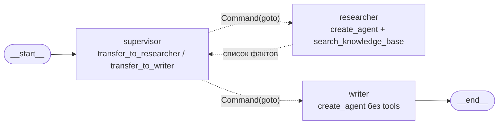

# Мультиагент или один агент с tools (блок 6.5)

Исследование с решением на выходе. На LangGraph собран supervisor-граф из двух агентов: researcher ищет
факты, writer пишет ответ с цитатами. Он сравнивается с одним `create_agent` на тех же инструментах — по
токенам, вызовам модели, latency, передачам управления и качеству ответа. Итог — секция «Решение»:
какой agent-слой идёт в диплом.

Код — в `experiments/`, отдельно от `app/`, пока решение не принято:

| Файл | Что делает |
|---|---|
| `experiments/common.py` | общее для обеих реализаций: 5 вопросов, инструмент `search_knowledge_base`, правила промптов, бюджеты, счётчик `Meter`, проверки ответа, запись `results.json` |
| `experiments/multi_agent_langgraph.py` | supervisor-граф: ручной supervisor через `Command`, researcher и writer — `create_agent` |
| `experiments/single_agent_baseline.py` | один `create_agent` с тем же инструментом и промптом обеих ролей |
| `experiments/compare.py` | LLM-судья, сводка `experiments/summary.json` и таблицы для раздела 5 |
| `experiments/results.json` | сырые замеры: одна запись на (реализация, вопрос) |
| [`architecture-multi-agent.md`](architecture-multi-agent.md) | Mermaid-схема supervisor-графа из `draw_mermaid()` |

## 1. Сценарий

Вход — один вопрос клиента «Личного кабинета» по-русски, без истории диалога: о сроках, лимитах,
оплате, настройках продукта. Researcher находит факты в базе знаний инструментом `search_knowledge_base`
и возвращает их маркированным списком с файлами-источниками, writer по этому списку пишет ответ клиенту,
supervisor решает, кому из них передать управление, а в single-agent обе роли выполняет один
`create_agent`. Ожидаемый ответ — 2–5 предложений только по фактам базы, с номером источника `[1]`, `[2]`
после утверждений и списком «Источники:» с файлами; если в базе ответа нет — честное «В базе знаний нет
информации о …» и совет обратиться в поддержку.

## 2. Тестовый набор

Пять одинаковых вопросов для обеих реализаций (`QUESTIONS` в `experiments/common.py`). Корпус — 66
документов базы знаний ассистента (`data/<категория>/`, коллекция `kb_docs`, блок 5.5). Ключевые факты —
строки, которые детерминированная проверка ищет в ответе; у каждого факта есть варианты написания.

| id | Тип | Вопрос | Где ответ | Ключевые факты |
|---|---|---|---|---|
| q1 | по корпусу | Сколько действует ссылка для сброса пароля и как быстро приходит письмо с ней? | `account/password-reset.html` | 30 минут; 10 минут |
| q2 | по корпусу | Какой лимит запросов к API на тарифе «Команда» и что ответит API, если его превысить? | `api/faq-api.md`, `api/api-limits.md` | 300; 429 |
| q3 | по корпусу | За сколько дней до окончания периода приходит письмо об автопродлении и когда спишут деньги? | `billing/auto-renewal.docx` | 3 дня; в день окончания |
| q4 | многошаговый | Не проходит оплата картой, а тариф заканчивается завтра. Что проверить, чем ещё можно оплатить и как быстро ответит поддержка, если оплатить так и не получится? | `billing/card-payment-fails.docx` + `support/support-regulation_v2.3.pdf` | баланс / срок действия; СБП / другая карта; 1 час |
| q5 | вне базы | Как подключить интеграцию личного кабинета с amoCRM? | нет: в справке только обмен с 1С и календарь сроков | честный отказ без выдуманной инструкции |

q4 многошаговый, потому что ответ лежит в двух документах разных разделов: что делать с картой — в
статье о платежах, срок ответа поддержки — в регламенте. Одним поиском его не собрать. Эталоны для
судьи — в `QUESTIONS[*].reference`.

## 3. Реализации

### 3.1. Мультиагент: ручной supervisor через `Command`



Схема из `draw_mermaid()` — в [architecture-multi-agent.md](architecture-multi-agent.md).

- **supervisor.** Вызов модели с двумя handoff-инструментами: `transfer_to_researcher(task)` и
  `transfer_to_writer(task)`. Инструменты не исполняются: узел читает `tool_call` и возвращает
  `Command(goto=<агент>, update={...})`. Лишние вызовы за ход получают `ToolMessage` «не выполнено». Если
  модель не вызвала инструмент, срабатывает запасной маршрут: researcher, если фактов ещё нет, иначе
  writer. Такие ходы считает счётчик `fallback_routes`.
- **researcher.** `create_agent(name="researcher", tools=[search_knowledge_base])` с чистым контекстом: на
  вход — вопрос клиента и задание supervisor, без его переписки. Supervisor получает обратно только
  список фактов — `ToolMessage` на свой вызов `transfer_to_researcher`. Поиски и фрагменты остаются внутри
  researcher.
- **writer.** `create_agent(name="writer", tools=[])`: вопрос и факты → ответ с цитатами. Writer — последний
  шаг, его ответ идёт сразу в `END`.
- **Бюджет — `MAX_HANDOFFS = 5` передач управления на вопрос.** Последняя передача зарезервирована за
  writer: когда остаётся одна, supervisor отдаёт управление writer без вызова модели (`forced_routes`).
  Researcher, таким образом, работает не больше двух раундов.
- **Чекпоинтер и стрим.** Чекпоинтер — `InMemorySaver`, `thread_id="exp-langgraph"`, один thread на все
  пять вопросов. Каждый вопрос начинается с `RemoveMessage(REMOVE_ALL_MESSAGES)`: история чек-пойнтов
  общая, а в контексте supervisor только текущий вопрос. Стрим — `app.stream(..., stream_mode="updates",
  subgraphs=True)`: в консоли видны шаги supervisor и шаги внутри агентов (`[researcher/model] →
  search_knowledge_base(...)`).

**Почему не `langgraph_supervisor.create_supervisor`.** Готовая сборка — это 15 строк вместо примерно
150, но для этого замера она хуже по пяти причинам:

1. Сам `langgraph-supervisor` (0.0.31) в README теперь рекомендует для большинства случаев строить
   supervisor напрямую через tools, а не через библиотеку. Довод — такой подход даёт больше контроля над
   context engineering.
2. **Контекст агентов.** В `create_supervisor` агент вызывается как `agent.invoke(state, config)` на всём
   общем состоянии. Researcher видел бы всю переписку supervisor и прошлых агентов, а токены этой
   переписки вошли бы в стоимость мультиагента. Здесь researcher получает только вопрос и задание,
   supervisor — только список фактов, без фрагментов поиска.
3. **Лишний вызов supervisor.** В `create_supervisor` каждый агент возвращает управление supervisor (ребро
   `agent → supervisor`, сообщения `transfer_back_to_supervisor`). Ответ writer становится финальным
   только после ещё одного вызова модели supervisor. Здесь writer сразу идёт в `END`, и замер показывает
   минимальную цену паттерна, а не цену библиотеки.
4. **Бюджет и подсчёт передач.** Бюджет и путь управления (`route`) лежат в state, `handoff_count`
   считается точно. Для 4B-модели, которая может не вызвать инструмент, есть запасной маршрут.
5. **Совместимость с 6.4.** Новой зависимости нет, `StateGraph` и `Command` — тот же API, что у агента
   блоков 6.3–6.4 с checkpointer и `interrupt()`.

### 3.2. Single-agent baseline

Один `create_agent(name="support_agent", tools=[search_knowledge_base])`. Промпт `SINGLE_PROMPT`
объединяет обе роли: сначала найти факты, потом ответить клиенту с цитатами. Каждый вопрос идёт в свой
thread `exp-single-<id>` в `InMemorySaver`, контекст чистый, как у мультиагента. `handoff_count = 0`.

### 3.3. Что у обеих реализаций одинаково

| Что | Как обеспечено |
|---|---|
| Инструмент | один объект `experiments.common.search_knowledge_base`; тест сверяет, что `ToolNode` researcher и baseline держат именно его. Реализация — RAG блока 5.5 (`RAGService.retrieve`: score-guard, re-ranker), до 3 фрагментов «[файл, близость] текст» |
| Правила поиска | `SEARCH_RULES` — в промпте researcher и baseline: по одному аспекту за вызов, не больше 4 поисков, ничего от себя |
| Формат ответа | `ANSWER_RULES` — в промпте writer и baseline: 2–5 предложений, `[1]`, `[2]`, «Источники:», честный отказ |
| Бюджеты `create_agent` | `limits()`: `ToolCallLimitMiddleware(run_limit=4)` — лишний поиск блокируется, `ModelCallLimitMiddleware(run_limit=6)` — страховка от зацикливания |
| Модель | `AGENT__MODEL` (`--model`), температура `AGENT__TEMPERATURE` (0), тот же `build_model` блока 6.3 |
| Кеш Ollama | перед каждым вопросом — `reset_cache` из бенчмарка 6.3: при `OLLAMA_NUM_PARALLEL=1` слот KV-кеша один, и без сброса вторая реализация получила бы готовый префилл промпта первой. В замер сброс не входит |
| Прогрев | до первого вопроса — один поиск и один вызов модели, тоже вне замера |

## 4. Как замерялось

Для каждой пары (реализация, вопрос) в `experiments/results.json` пишется одна запись:

- **`total_tokens`** — input + output по всем вызовам модели за вопрос. Callback `Meter` складывает
  `usage_metadata` каждого ответа модели и раскладывает их по агентам (`by_agent`). Чей вызов, он берёт
  из `lc_agent_name` (его ставит `create_agent`) или из узла графа (`supervisor`). Вызовы без usage
  считаются в `llm_calls_without_usage`: ненулевое значение значит, что токены занижены.
- **`llm_calls`** — все вызовы модели, у мультиагента вместе с маршрутизацией supervisor. Вызовы модели
  researcher перед поиском — тоже вызовы.
- **`latency_ms`** — `time.perf_counter()` от входа в `app.stream` до конца стрима, то есть до финального
  ответа.
- **`handoff_count`** — переходы между агентами по `route`: обычно `supervisor → researcher → supervisor →
  writer` = 3, каждый дополнительный раунд поиска добавляет 2. У single-agent — 0.
- **Ещё в записи** — запросы и результаты поиска (`queries`, `contexts`), факты researcher, ответ,
  `checks` (ключевые факты, номера цитат, отказ), модель и хост провайдера (без ключей).

**Качество** оценивают двумя способами:

- **LLM-судья** (`experiments/compare.py`): модель `RAGAS__JUDGE_*` блока 5.6, температура 0, один вызов
  на ответ и две оценки 1–5. `correctness` — совпадает ли ответ по сути с эталоном (для q5: честный отказ
  — 5, выдуманная инструкция — 1). `faithfulness` — опирается ли каждое утверждение на фрагменты,
  которые вернул поиск. Это тот же смысл, что у RAGAS faithfulness, но одной оценкой судьи, а не разбором
  на утверждения: RAGAS на `qwen3:4b-instruct` в CPU — десятки вызовов судьи на ответ.
- **Детерминированные проверки** без модели: ключевые факты эталона в ответе, цитаты `[n]`, честный отказ
  на q5.

Прогон на Windows (Ollama, Qdrant из compose):

```powershell
python experiments/single_agent_baseline.py --model qwen3:4b-instruct
python experiments/multi_agent_langgraph.py --model qwen3:4b-instruct
python experiments/compare.py
```

## 5. Сравнение single vs multi

> Заполняется по прогону на Windows: таблицы печатает `experiments/compare.py`.

| Метрика | Single-agent (среднее по 5) | Multi-agent (среднее по 5) | Δ |
|---|---:|---:|---:|
| Токены на запрос | … | … | … |
| LLM-вызовов на запрос | … | … | … |
| Latency p50 (мс) | … | … | … |
| Передач управления на запрос | 0 | … | … |
| Качество: LLM-судья, correctness (1–5) | … | … | … |
| Качество: LLM-судья, faithfulness (1–5) | … | … | … |
| Ключевые факты эталона в ответе | … | … | … |
| Ожидаемое поведение (все факты / честный отказ) | … | … | … |
| Ответы с цитатами [n] (вопросы по базе) | … | … | … |

Вывод — после прогона.

## 6. Сопоставление с Anthropic

Ориентир — Anthropic, [How we built our multi-agent research system](https://www.anthropic.com/engineering/multi-agent-research-system)
(13 июня 2025). Их цифры:

- **Качество.** Ведущий агент Claude Opus 4 с субагентами Claude Sonnet 4 обошёл одиночного Claude Opus 4
  на 90.2% на внутреннем research-eval. Сильнее всего выигрыш на breadth-first запросах — когда
  исследуется много независимых направлений параллельно.
- **Токены.** Агенты тратят примерно в 4 раза больше токенов, чем чат, мультиагент — примерно в 15 раз.
  Значит, относительно одиночного агента мультиагент дороже примерно в 15 / 4 ≈ 3.75 раза. С нашим
  сравнением multi vs single надо сопоставлять именно это число, а не 15×.
- **Что объясняет качество.** На BrowseComp объём токенов сам по себе объясняет 80% разброса качества.
  Мультиагент выигрывает прежде всего тем, что тратит больше токенов параллельно в разных окнах контекста.
- **Где проигрывает.** Задачи, где агентам нужен общий контекст или много зависимостей между ними
  (например, большинство задач кодинга). Окупается он только там, где ценность задачи покрывает
  стоимость.

Наш множитель токенов и сопоставление — после прогона.

## 7. Ограничения эксперимента

- **Пять вопросов** — сравнение порядков величин (×2 или ×5, есть ли разница в качестве), а не
  статистика: разница в 0.2 балла судьи — шум.
- **Одна модель на всё.** `qwen3:4b-instruct` на CPU играет все роли — supervisor, researcher, writer,
  baseline. У Anthropic ведущий агент сильнее субагентов, и выигрыш мультиагента во многом в этом.
- **Судья.** По умолчанию судья — та же 4B-модель. Оценки сравнимы между реализациями (судья один), но
  абсолютные значения грубые; детерминированные проверки фактов страхуют от ошибок судьи.
- **Ollama на CPU с одним слотом KV-кеша.** Смена system prompt между supervisor, researcher и writer
  каждый раз заново считает префилл. Latency мультиагента это честно увеличивает: на такой конфигурации
  он и работал бы в дипломе.

## Решение

> Принимается по числам раздела 5 после прогона на Windows.
