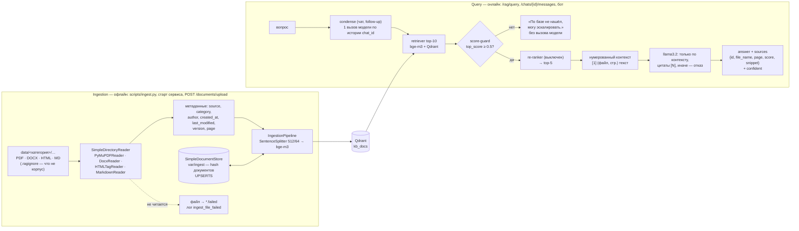
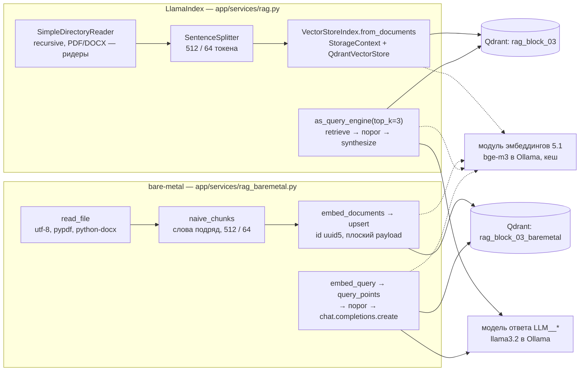

# Корпоративный RAG-ассистент (блоки 5.3–5.5)

Ассистент техподдержки «Личного кабинета» отвечает по базе знаний компании: 66 документов в PDF,
DOCX, HTML и Markdown, ответ — с цитатами [1], [2] и списком источников, а если ответа в базе нет —
«По базе не нашёл, могу эскалировать.». Работает в трёх местах: одношаговый `POST /rag/query`,
диалог `POST /chats/{id}/messages` (SSE, история в Postgres, follow-up вроде «а при оплате по
счёту?») и Telegram-бот поверх того же диалога. Новый документ загружается через
`POST /documents/upload` и находится через несколько секунд, без перезапуска и полной переиндексации.

Сборка блока 5.5 опирается на блок 5.3 (LlamaIndex-конвейер, Qdrant, модель эмбеддингов блока 5.1) и
на замеры блока 5.4 (нарезка recursive 512/64, 10 кандидатов, re-ranker выключен —
[`docs/chunking_experiment.md`](chunking_experiment.md)). Сравнение LlamaIndex и bare-metal на
учебном корпусе из 10 файлов — во второй части страницы, [«Блок 5.3»](#блок-53-две-версии-rag-на-учебном-корпусе).

## Схема: два контура



Ingestion и query разделены: тяжёлая работа (чтение файлов, эмбеддинги корпуса) — офлайн и
инкрементально, онлайн — один эмбеддинг вопроса, поиск и (если порог пройден) один вызов модели.

## Что где

| Что | Где |
|---|---|
| Корпус: 66 документов в 11 категориях, что не корпус — `data/.ragignore` | `data/<категория>/`, опись — [`docs/data_inventory.md`](data_inventory.md) |
| Генератор корпуса из базы знаний проекта (детерминированный) | `scripts/build_corpus.py` |
| Ридеры, метаданные, `IngestionService` (IngestionPipeline + docstore + UPSERTS, `.failed`) | `app/services/ingestion.py` |
| CLI индексации: «N new, M changed, K unchanged, F failed» | `scripts/ingest.py` |
| Поиск, score-guard, re-ranker, ответ с цитатами (`RAGService.retrieve` / `answer`) | `app/services/rag.py` |
| Промпт с правилом цитировать, фраза отказа, контракт ответа | `app/services/rag_common.py` |
| `POST /rag/query` | `app/routers/rag.py`, `app/schemas/rag.py` |
| `POST /documents/upload`, `GET /documents/status`, `POST /documents/reindex` | `app/routers/documents.py` |
| RAG в чате: condense, контекст, событие `sources` | `app/chat/knowledge.py`, `app/chat/service.py`, `app/chat/routes.py` |
| Оценка 👍/👎 с источниками, миграция `message_feedback.sources` | `app/chat/feedback.py`, `migrations/versions/b8d4f1a2c3e5_feedback_sources.py` |
| Бот: debounce правок по чату, подпись с источниками, оценка с источниками | `bot/services/streaming.py`, `bot/services/sources.py`, `bot/handlers/feedback.py` |
| Калибровка порога отказа | `scripts/calibrate_threshold.py` |
| Опись корпуса | `scripts/data_inventory.py` |
| Тесты | `tests/unit/test_ingestion.py`, `test_documents_api.py`, `test_rag.py`, `tests/chat/test_rag_chat.py`, `tests/bot/test_bot_rag.py`, `tests/integration/test_rag_live.py` (маркер `llm`) |

## Корпус

Документы — не выдуманные тексты, а база знаний проекта (блоки 5.1–5.2), разложенная так, как она
лежала бы в компании (`scripts/build_corpus.py`):

| Категория (папка) | Документы | Формат | Автор |
|---|---|---|---|
| `account`, `start`, `notifications`, `mobile` | статьи справочного центра | HTML-страницы сайта: шапка, меню и подвал вокруг `<article>` | Редакция справочного центра |
| `billing`, `team`, `integrations` | документы финансового отдела и отдела внедрения | DOCX (автор и дата — в свойствах документа) | Финансовый отдел, Отдел внедрения |
| `api` | документация для разработчиков | Markdown с YAML front matter | Команда API |
| `data-management` | документы о данных и их защите | PDF | Служба информационной безопасности |
| `support` | регламент поддержки версии 2.3 — раздел на странице, сроки таблицей | PDF | Служба поддержки |
| `releases` | заметки о выпусках по полугодиям — заметка на странице | PDF | Продуктовая команда |
| во всех категориях | частые вопросы `faq-<категория>.md` — вопрос на раздел | Markdown | Служба поддержки |

Итого 66 файлов: HTML 26, Markdown 17, DOCX 14, PDF 9; 916 КБ; 102 документа LlamaIndex (страница
PDF и раздел Markdown — отдельный документ) и 102 фрагмента при 512/64 — статьи короткие. Четыре
документа — вторые редакции, редакция в имени файла: `refunds_v2.docx` (срок возврата 14 дней,
прежняя — 7 дней, в `data/archive/`), `password-requirements_v2.html`, `1c-integration_v2.docx`,
`support-regulation_v2.3.pdf`. Прежние редакции, исходники базы знаний и учебный корпус блоков 5.3–5.4
в индекс не идут (`data/.ragignore`): ассистент не должен отвечать по архиву.

PDF генерируются PyMuPDF со встроенным шрифтом с кириллицей, DOCX — python-docx с фиксированными
датами внутри: повторный запуск генератора даёт те же байты, git не видит изменений.

## Ingestion

```powershell
python scripts/ingest.py data/              # «66 файлов: 66 new, 0 changed, 0 unchanged, 0 failed, 0 removed»
python scripts/ingest.py data/              # повторно: «0 new, 0 changed, 66 unchanged» — без эмбеддингов
python scripts/ingest.py data/ --dry-run    # только прочитать: файлы, документы, фрагменты, метаданные
python scripts/ingest.py data/ --rebuild    # удалить коллекцию и docstore, проиндексировать заново
python scripts/ingest.py data/uploads/x.pdf # один файл
```

**Чтение** — `SimpleDirectoryReader.load_file` с ридером на расширение, по одному файлу (так ошибка
одного файла не роняет остальные):

| Формат | Ридер | Документ LlamaIndex | Что важно |
|---|---|---|---|
| PDF | `PyMuPDFReader` (pymupdf) | страница; номер — `page` | подкласс с каноническим `import pymupdf`: ридер из `llama-index-readers-file` импортирует старое имя `fitz`, и PyMuPDF 1.28 печатает предупреждение на каждый запуск |
| DOCX | `DocxReader` (docx2txt) | файл | таблицы — строками текста |
| HTML | `HTMLTagReader(tag="article")` | файл | шапка, меню и подвал сайта в текст не попадают; нет `<article>` — `<main>`, затем `<body>` |
| Markdown | `MarkdownReader` | раздел (`#`, `##`) | YAML front matter вырезается из текста (иначе «author: …» попал бы в первый фрагмент) и читается в метаданные |
| TXT | как есть | файл | для учебного корпуса блока 5.3 |

**Метаданные** (`file_metadata`) — одинаковые у всех документов файла, порядок ключей постоянный:

| Поле | Откуда | Пример |
|---|---|---|
| `file_name` | имя файла | `refunds_v2.docx` |
| `source` | путь от корня корпуса; он же id документа (у страницы PDF — `#p2`, у раздела Markdown — `#2`) | `billing/refunds_v2.docx` |
| `category` | первая папка пути `data/<категория>/…`; файл в корне — `general` | `billing` |
| `format` | расширение | `docx` |
| `title`, `author`, `created_at` | из самого документа: свойства DOCX (`core_properties`), метаданные PDF, `<meta name="author">` и `dcterms.created` HTML, front matter Markdown | `Финансовый отдел`, `2026-05-19` |
| `last_modified` | дата изменения файла (`stat`) | `2026-10-11` |
| `version` | из имени: `_v2` → `2`, `_v2.3` → `2.3` | `2` |
| `page` | номер страницы PDF | `2` |
| `embed_model`, `chunking` | метки модели эмбеддингов и нарезки | `openai:local:11434/bge-m3`, `recursive:512/64` |

Полного пути нет нигде — ни в метаданных, ни в id, ни в тексте ошибки в логе (на Windows в нём было
бы имя пользователя). **В вектор метаданные не идут** (`excluded_embed_metadata_keys` — все ключи):
эмбеддинг — только текст фрагмента, как в замерах блока 5.4; заголовок статьи и так стоит в начале
текста. Модель ответа видит заголовок, автора, дату, редакцию и страницу, а технические `source`,
`format`, `last_modified` и метки — нет (`excluded_llm_metadata_keys`).

**IngestionPipeline** — `[SentenceSplitter(512, 64) (RAG__CHUNKING из блока 5.4), ProjectEmbedding]`,
`docstore=SimpleDocumentStore` (файл `var/ingest/<коллекция>_docstore.json`), `vector_store=QdrantVectorStore`,
`docstore_strategy=DocstoreStrategy.UPSERTS`:

- hash документа = текст + метаданные. Не изменился — пропуск без эмбеддингов (поэтому повторный
  запуск — «0 changed» за секунду); изменился — старые фрагменты удаляются из Qdrant, пишутся новые;
- метки модели эмбеддингов и нарезки — в метаданных, значит, и в hash: сменили модель или
  `RAG__CHUNK_SIZE` — следующий запуск переиндексирует документы сам;
- файла больше нет (или у PDF стало меньше страниц) — его фрагменты удаляются: UPSERTS этого не
  делает, это добавлено поверх (`removed` в отчёте);
- id фрагмента — `uuid5(id документа#номер)`: даже если docstore потерян (удалили `var/`), повторная
  запись перезаписывает те же точки, а не добавляет копии; коллекция пуста, а docstore помнит
  документы (удалили том Qdrant), — docstore сбрасывается, иначе всё считалось бы «unchanged»;
- модель эмбеддингов или Qdrant упали посреди записи — hash недописанных документов убирается из
  docstore, и следующий запуск запишет их заново (иначе они числились бы «unchanged» без точек в коллекции);
- docstore пишется атомарно (временный файл → `os.replace`), запуски внутри процесса — по очереди (замок).

**Нечитаемый файл** (битый PDF, DOCX — не zip, скан без текстового слоя, пустой файл) переименовывается
в `<имя>.failed`, в лог — `ingest_file_failed` с причиной, в отчёт — `failed`; остальные файлы
индексируются. Ошибки Qdrant и модели эмбеддингов — не вина файла: запуск прерывается, файлы не трогаются.
Исправили файл — уберите `.failed` из имени и запустите снова.

## Query

`RAGService.retrieve(вопрос)` → `answer()`:

1. **retriever top-10** (`RAG__CANDIDATES_TOP_K`) — `VectorStoreIndex.from_vector_store(...).as_retriever()`,
   вопрос — эмбеддинг `bge-m3` с префиксом блока 5.1.
2. **Score-guard** — лучшая близость кандидатов `top_score` ниже `RAG__SCORE_THRESHOLD` → модель не
   вызывается, ответ «По базе не нашёл, могу эскалировать.», `confident=false`, `sources=[]`, в лог —
   `rag_score_guard` (близость, порог, число кандидатов, длина вопроса — без его текста).
3. **Re-ranker** (`RERANK__ENABLED`, по умолчанию выключен) → **top-5** (`RAG__SIMILARITY_TOP_K`).
4. **Нумерованный контекст** — `[1] (refunds_v2.docx)\nтекст`, `[2] (support-regulation_v2.3.pdf, стр. 2)\nтекст`, и
   системное правило: «отвечай только по фрагментам; номера фрагментов — в квадратных скобках, а в конце
   ответа — строка „Источники: [1], [3]“; если ответа нет — ровно „По базе не нашёл, могу
   эскалировать.“». Последняя строка сообщения с вопросом повторяет формат — маленькая модель лучше
   выполняет то, что стоит прямо перед ответом. Формат выбран замером, ниже — «Цитаты (Windows)». Это тот же
   приём, что в reference-сервисе курса: `CitationQueryEngine` даёт те же [1], [2], но режет фрагменты
   ещё раз на свои куски и прячет промпт; ручной контекст — один и тот же для `/rag/query`, чата и
   bare-metal-версии.
5. **Ответ** — `{answer, top_score, confident, sources}`; у источника `id` — номер цитаты, `cited` —
   сослалась ли на него модель (`[7]`, которого не было в контексте, не засчитывается). Модель сама
   отказалась по промпту — `confident=false`, источники не показываются (в лог — `rag_refused`).

```json
{
  "answer": "Вернуть оплату можно в течение 14 дней после списания. Заявку создают в разделе «Помощь» с темой «Возврат».\nИсточники: [1]",
  "top_score": 0.71,
  "confident": true,
  "sources": [
    {"id": 1, "file_name": "refunds_v2.docx", "source": "billing/refunds_v2.docx", "category": "billing",
     "page": null, "score": 0.71, "snippet": "Возврат оплаты Вернуть оплату можно в течение 14 дней…", "cited": true},
    {"id": 2, "file_name": "release-notes_2026-h1.pdf", "source": "releases/release-notes_2026-h1.pdf",
     "category": "releases", "page": 7, "score": 0.66, "snippet": "Возврат оплаты — 14 дней…", "cited": false}
  ]
}
```

## Параметры

| Параметр | Значение | Почему |
|---|---|---|
| Нарезка | `recursive` (SentenceSplitter по абзацам и русским предложениям), 512 / 64 токена | блок 5.4: строгий MRR@10 0.964 — лучший из трёх стратегий; 256 токенов хуже (0.905), перекрытие 32 и 64 не различаются; фрагменты цельные, не длиннее 512 |
| Кандидатов из Qdrant | 10 (`RAG__CANDIDATES_TOP_K`) | блок 5.4: Recall@10 = 1.000; 20 кандидатов метрик не меняют |
| В контекст модели | 5 (`RAG__SIMILARITY_TOP_K`, top_n) | ~2 000 токенов контекста при 512-токенных фрагментах (блок 5.4, «токенов в top-5»); статьи корпуса короткие, и пять фрагментов — это пять разных документов |
| Re-ranker | **выключен** (`RERANK__ENABLED=false`); если включить — `BAAI/bge-reranker-v2-m3` (cross-encoder, в процессе) или Cohere `rerank-v3.5` | блок 5.4: на 512 токенах MRR не меняется (0.964 → 0.964), а на CPU это ~0,4 с на пару — ~4 с на вопрос при 10 кандидатах; в Docker-образе нет `sentence-transformers`. Вернуть в рассмотрение на корпусе больше, на GPU или через Cohere |
| Модель эмбеддингов | `bge-m3` в Ollama, 1024, COSINE | блок 5.1 |
| Модель ответа | `llama3.2` (3B) в Ollama, `temperature` 0.1, `max_tokens` 512 | блок 5.3; низкая температура — ответ по фактам |
| Порог отказа | 0.5 (`RAG__SCORE_THRESHOLD`) | ниже, «Порог отказа» |

## Настройки

Все — в `.env` (`RAG__*`), в коде только значения по умолчанию; полный список с пояснениями — `.env.example`.

| Переменная | По умолчанию | Что делает |
|---|---|---|
| `RAG__DATA_DIR` / `RAG__COLLECTION` | `data` / `kb_docs` | корпус ассистента и его коллекция |
| `RAG__LAB_DIR` / `RAG__LAB_COLLECTION` | `data/rag-block-03` / `rag_block_03` | учебный корпус блоков 5.3–5.4 (`rag_compare`, `chunking_experiment`, `python -m app.services.rag --lab`) |
| `RAG__DOCSTORE_DIR` | `var/ingest` | docstore инкрементальной индексации |
| `RAG__INGEST_ON_START` | `false` (в compose — `true`) | индексировать корпус в фоне при старте сервиса |
| `RAG__UPLOAD_DIR` / `RAG__UPLOAD_MAX_MB` | `data/uploads` / 20 | куда сохранять загрузки (внутри корпуса) и предел файла |
| `RAG__CHUNKING`, `RAG__CHUNK_SIZE` / `RAG__CHUNK_OVERLAP` | `recursive`, 512 / 64 | нарезка (блок 5.4) |
| `RAG__CANDIDATES_TOP_K` / `RAG__SIMILARITY_TOP_K` | 10 / 5 | кандидатов из Qdrant / фрагментов в контекст и в `sources` |
| `RAG__SCORE_THRESHOLD` | 0.5 | score-guard; прежнее имя `RAG__MIN_SCORE` тоже принимается |
| `RAG__CHAT` / `RAG__CONDENSE` | `true` / `true` | чаты по базе знаний / переписывать follow-up для поиска |
| `RAG__LLM_MODEL`, `RAG__MAX_TOKENS`, `RAG__TEMPERATURE` | `LLM__DEFAULT_MODEL`, 512, 0.1 | модель ответа `/rag/query` и температура ответов по базе (и в чате) |
| `RERANK__*` | выключен | re-ranker блока 5.4 |
| `BOT_STREAMING` / `BOT_EDIT_INTERVAL` (у бота) | `edit` / 0.7 | правки сообщения и debounce по чату |

## Порог отказа

Отказ — **два слоя**: код (score-guard: модель не вызывается) и промпт (порог пройден, но ответа в
контексте нет — модель отвечает той же фразой). Score-guard быстрый и надёжный: 3B-модели трудно
удержаться от ответа, если в контексте что-то похожее. Промпт нужен для вопросов о продукте, ответа
на которые в базе нет («Можно ли оплатить тариф криптовалютой?»): близость у них бывает выше порога.

**Почему 0.5, а не 0.3 из задания.** 0.3 — порог курса для OpenAI `text-embedding-3-small`: у этой
модели близкие тексты дают 0.3–0.6. У `bge-m3` шкала другая — выше и у нужного, и у постороннего:

| Замер | Вопросы по базе (лучший фрагмент) | Вопросы не по базе |
|---|---|---|
| блок 5.2, база знаний 110 фрагментов (`docs/vector_store.md`, «Фильтры») | 0.60–0.66 | 0.29–0.40 |
| блок 5.3, учебный корпус, Windows (ниже, «Результаты») | 0.639–0.784 | 0.443–0.448 («Битрикс24») |
| **блок 5.5, корпус 5.5, Windows** (ниже, «Калибровка (Windows)») | **0.593–0.823** | **0.242–0.448** (посторонние темы) |

С порогом 0.3 на `bge-m3` проходил бы почти любой вопрос, и отказ держался бы только на промпте. 0.5
стоит в зазоре между группами на корпусе 5.5: на 0.052 выше лучшего постороннего и на 0.093 ниже
худшего вопроса по базе.

**Калибровка на корпусе 5.5** — `python scripts/calibrate_threshold.py --out var\threshold.md`. Четыре
группы вопросов:

- **по базе** — 28 вопросов golden dataset блока 5.4, ответы на них есть и в этом корпусе;
- **посторонние** — 8 вопросов на темы, к продукту не относящиеся (борщ, погода, курс доллара);
- **о продукте, ответа нет** — 4 вопроса («Есть ли интеграция с Битрикс24?», «Можно ли оплатить тариф
  криптовалютой?»);
- **follow-up без истории** — 4 коротких уточнения.

Порог подбирается по первым двум группам. Скрипт печатает распределение `top_score` по группам (min,
p10, медиана, p90, max) и рекомендуемый порог. Если группы разделяются, это середина зазора; иначе —
порог с наименьшим числом ошибок, а при равенстве ошибок — меньший: лишний вызов модели дешевле
отказа на вопрос, ответ на который есть. Ещё он показывает, сколько вопросов текущий порог отклоняет
и пропускает.

Вопросы о продукте без ответа в подбор не входят. В них те же слова, что в базе («тариф», «оплата»,
«приложение»), поэтому близость у них такая же, как у вопросов по базе. Порог, который отсёк бы их,
отклонял бы и вопросы, ответ на которые есть. Отказ на них — второй слой, промпт.

### Калибровка (Windows)

Прогон 11.10.2026: Ollama `bge-m3` на CPU, коллекция `kb_docs` (66 файлов, 102 фрагмента), re-ranker
выключен, порог на время замера — 0.

| Группа | Вопросов | min | p10 | медиана | p90 | max |
|---|---:|---:|---:|---:|---:|---:|
| по базе | 28 | 0.593 | 0.636 | 0.716 | 0.777 | 0.823 |
| посторонние | 8 | 0.242 | 0.327 | 0.365 | 0.444 | 0.448 |
| о продукте, ответа нет | 4 | 0.478 | 0.478 | 0.588 | 0.662 | 0.662 |
| follow-up без истории | 4 | 0.451 | 0.451 | 0.625 | 0.686 | 0.686 |

- **Вопросы по базе и посторонние темы разделяются.** Зазор — 0.448–0.593, от «Как настроить Wi-Fi
  роутер дома?» до «Не хочу, чтобы уведомления кабинета будили меня ночью…». Середина зазора — 0.52.
- **Порог оставлен 0.5.** При нём из вопросов по базе отклонено 0 из 28, из посторонних пропущено к
  модели 0 из 8. К посторонним он ближе середины сознательно, по тому же правилу, что и выбор меньшего
  порога при равенстве ошибок: отказ на вопрос с ответом в базе хуже лишнего вызова модели, а за
  посторонним вопросом, проскочившим порог, ещё стоит промпт.
- **Вопросы о продукте без ответа (0.478–0.662) перекрываются с вопросами по базе.** Порог пропускает к
  модели 3 из 4: криптовалюту (0.662), Apple Watch (0.617) и тёмную тему (0.559). Битрикс24 (0.478)
  отклоняется уже порогом. Если бы эти вопросы входили в подбор, скрипт рекомендовал бы 0.56: на
  0.001 выше тёмной темы и всего на 0.033 ниже худшего вопроса по базе. Это подгонка под выборку, а
  не порог. Отказ на них проверен на живой модели — шаг 4 в README.
- **Follow-up без истории** («А на тарифе «Бизнес»?» — 0.686, «А при оплате по счёту?» — 0.643)
  проходят порог, но лучший фрагмент случаен. «А для них?» (0.451) получил бы отказ. Поэтому в чате
  вопрос сначала переписывается (condense).
- **Порог 0.3 из курса** на этом корпусе пропустил бы к модели 7 из 8 посторонних (все, кроме «Война и
  мир», 0.242).

<details>
<summary>Все 44 вопроса</summary>

| Группа | Вопрос | top_score | Лучший фрагмент |
|---|---|---:|---|
| по базе | За сколько дней деньги возвращаются на карту после возврата оплаты? | 0.823 | billing/refunds_v2.docx |
| по базе | Чем ключи и данные тестовой среды API отличаются от рабочей? | 0.804 | api/faq-api.md |
| по базе | Сколько дней удалённые записи лежат в корзине? | 0.784 | releases/release-notes_2026-h1.pdf |
| по базе | Как подключить уведомления в Telegram? | 0.777 | notifications/telegram-notifications.html |
| по базе | Как часто счета и акты выгружаются в 1С:Бухгалтерию? | 0.765 | integrations/faq-integrations.md |
| по базе | Сколько действует ссылка для сброса пароля? | 0.752 | account/password-reset.html |
| по базе | Что зачисляется быстрее: оплата картой, через СБП или по счёту? | 0.737 | releases/release-notes_2025-h1.pdf |
| по базе | Как часто обновляется календарь сроков в Google или Яндекс Календаре? | 0.733 | integrations/deadline-calendar.docx |
| по базе | Сколько стоит тариф «Бизнес» в месяц? | 0.731 | releases/release-notes_2026-h2.pdf |
| по базе | Неделю назад случайно удалила запись — её ещё можно вернуть? | 0.722 | data-management/faq-data-management.md |
| по базе | Чем тариф «Бизнес+» отличается от «Бизнеса» по числу участников и лимиту API? | 0.721 | releases/release-notes_2026-h2.pdf |
| по базе | До какой даты будет работать API v1 и что потом вернут запросы к нему? | 0.719 | api/api-versions.md |
| по базе | Сотрудник уволился: как исключить его из команды и что станет с его API-ключами и данными? | 0.718 | team/remove-member.docx |
| по базе | Файл какого размера можно загрузить при импорте данных? | 0.716 | data-management/data-import.pdf |
| по базе | Хочу получать в Telegram уведомления о заявках, а новости и акции на почту — не получать. Как настроить? | 0.715 | notifications/faq-notifications.md |
| по базе | Сколько раз сервис повторяет доставку вебхука, если мой сервер не ответил 200? | 0.696 | api/webhooks.md |
| по базе | Тариф «Команда»: сколько стоит, сколько в нём участников и какой лимит запросов к API? | 0.693 | releases/release-notes_2026-h2.pdf |
| по базе | Потеряла телефон с Google Authenticator — как теперь войти в аккаунт? | 0.684 | account/lost-authenticator.html |
| по базе | На каких версиях iOS и Android работает мобильное приложение? | 0.681 | mobile/faq-mobile.md |
| по базе | Чем роль «Наблюдатель» отличается от роли «Бухгалтер»? | 0.679 | team/faq-team.md |
| по базе | Как быстро поддержка ответит, если личный кабинет недоступен всем пользователям? | 0.676 | releases/release-notes_2026-h1.pdf |
| по базе | Ночью не проходит оплата картой — как быстро ответит поддержка и куда писать? | 0.653 | support/faq-support.md |
| по базе | Бухгалтер хочет получать акты прямо в 1С. Что настроить и какую роль ему дать? | 0.645 | billing/faq-billing.md |
| по базе | Пришло письмо о входе с незнакомого устройства. Что сделать по шагам? | 0.644 | account/login-history.html |
| по базе | Оплата картой не проходит, а тариф заканчивается завтра. Что сделать, чтобы не потерять доступ? | 0.636 | billing/auto-renewal.docx |
| по базе | Приложение на телефоне показывает вчерашние данные. Что делать? | 0.635 | mobile/faq-mobile.md |
| по базе | Можно ли узнать, с каких устройств и IP-адресов заходили в мой аккаунт? | 0.601 | account/login-history.html |
| по базе | Не хочу, чтобы уведомления кабинета будили меня ночью. Можно их приглушить? | 0.593 | releases/release-notes_2026-h1.pdf |
| посторонние | Как настроить Wi-Fi роутер дома? | 0.448 | api/webhooks.md |
| посторонние | Какая погода завтра в Москве? | 0.444 | support/faq-support.md |
| посторонние | Какой курс доллара на сегодня? | 0.437 | data-management/faq-data-management.md |
| посторонние | Посоветуй фильм на вечер | 0.368 | releases/release-notes_2026-h1.pdf |
| посторонние | Сколько планет в Солнечной системе? | 0.363 | team/faq-team.md |
| посторонние | Как часто поливать фикус зимой? | 0.347 | billing/change-tariff.docx |
| посторонние | Как приготовить борщ? | 0.327 | data-management/personal-data-protection.pdf |
| посторонние | Кто написал роман «Война и мир»? | 0.242 | notifications/quiet-hours.html |
| о продукте, ответа нет | Можно ли оплатить тариф криптовалютой? | 0.662 | billing/faq-billing.md |
| о продукте, ответа нет | Работает ли приложение на Apple Watch? | 0.617 | mobile/faq-mobile.md |
| о продукте, ответа нет | Есть ли в личном кабинете тёмная тема? | 0.559 | releases/release-notes_2025-h1.pdf |
| о продукте, ответа нет | Есть ли интеграция с Битрикс24? | 0.478 | api/api-sandbox.md |
| follow-up без истории | А на тарифе «Бизнес»? | 0.686 | releases/release-notes_2026-h2.pdf |
| follow-up без истории | А при оплате по счёту? | 0.643 | billing/faq-billing.md |
| follow-up без истории | А сколько это стоит? | 0.608 | billing/faq-billing.md |
| follow-up без истории | А для них? | 0.451 | mobile/faq-mobile.md |

</details>

### Цитаты (Windows)

Прогон 12.10.2026: `python scripts/citation_experiment.py`, `llama3.2` в Ollama на CPU, те же фрагменты
для всех вариантов (top-5, re-ranker выключен). 5 вопросов по базе и 2 о продукте без ответа в базе
(криптовалюта 0.662, Apple Watch 0.617 — порог они проходят, отказ на них — за промптом). В правиле
RULES тогда ещё был образец фраз «Первое утверждение [1]. Второе утверждение [2][3].» — потом его
убрали (ниже, «Образец фраз в ответе»).

| Вариант промпта | Цитаты [N] | Отказ без ответа в базе | Среднее время, с |
|---|---:|---:|---:|
| `rules` — номер после каждого предложения, образец формата, напоминание в конце | 3 из 5 | 2 из 2 | 23.5 |
| `example` — то же и пример диалога (библиотека, ответ с [1], [2]) | 5 из 5 | 1 из 2 | 23.4 |
| `sources` — то же и строка «Источники: [1], [3]» в конце ответа | 5 из 5 | 2 из 2 | 23.7 |
| `example_sources` — пример диалога со строкой «Источники: …» | 5 из 5 | 0 из 2 | 26.4 |
| **`sources` без образца фраз в RULES — перемер, промпт сервиса** | **5 из 5** | **2 из 2** | 31.2 |

- **Выбран `sources`** — единственный вариант без потерь по обоим критериям. Он стал промптом сервиса
  дословно: `test_service_prompt_is_the_measured_sources_variant` сверяет сообщения сервиса с вариантом
  эксперимента. Ответы: «Срок вернуть оплату составляет 14 дней после списания. Источники: [2][3].»,
  «Ссылка для сброса пароля действует 30 минут. Источники: [1][4]».
- **Пример диалога ломает отказ.** С ним модель ставит номера, но отвечает и на вопросы без ответа в
  базе: `example` — «Нет, оплата тарифа не возможна криптовалютой.», `example_sources` — на оба.
- **Номера не всегда точные.** На вопрос о возврате `sources` сослался на [2] и [3]. [2] (release notes:
  срок «увеличен с 7 до 14 дней») ответ подтверждает, [3] (FAQ об автопродлении) — нет, а основной
  документ [1] `refunds_v2.docx` не назван. Номера показывают, откуда модель брала ответ, но
  проверять их по `snippet` всё равно нужно. Так у всех четырёх вариантов.
- **Выборка маленькая** — 7 вопросов, по одному прогону на вариант при `temperature=0.1`; это не
  оценка качества, а отбор. Решает отказ: вариант, который хоть раз ответил на вопрос без ответа в
  базе, не годится, сколько бы цитат он ни ставил.
- **Образец фраз в ответе.** В боте оба ответа начались с образца из правил: «Первое утверждение [1].
  Возврат оплаты можно в течение 14 дней после списания.» и «Второе утверждение [2][3]. Деньги
  возвращаются…». В `/rag/query`, SSE и замере этого не было — модель вставила образец не каждый раз.
  Образец убран; осталось само правило и образец строки «Источники: [1], [3]», которую модель и должна
  повторить. `test_prompts_have_no_sample_sentences_to_echo` не даёт вернуть готовые фразы в промпт.
  Вариант `sources` без образца перемерен: цитаты — 5 из 5, отказ — 2 из 2, как и с образцом (последняя
  строка таблицы). В боте после пересборки ответы начинаются по делу: «Срок возврата оплаты составляет
  14 дней после списания.», а follow-up — «Деньги возвращаются на ту же карту за 5–10 рабочих дней, при
  оплате по счёту — на расчётный счёт плательщика.» с `refunds_v2.docx` в подписи.
- **Отказ со строкой «Источники».** Без образца модель отказывает так: «По базе не нашёл. Могу
  эскалировать. Источники: [5]». `/rag/query` заменяет такой ответ ровно фразой отказа, бот убирает
  строку «Источники» (подписи при отказе нет), в SSE текст идёт как есть, а `event: sources` приходит с
  `confident: false` и пустым списком.

## Multi-turn

История диалога уже на сервере (блок 4.1: `ChatService`, Postgres, окно по бюджету токенов), второго
хранилища нет. Модель ответа получает историю целиком, поэтому «а при оплате по счёту?» она понимает и
так; condense нужен **поиску**: вектор видит одну строку, а у короткого follow-up она бессмысленна.

1. В чате уже были вопросы (`RAG__CONDENSE=true`) — один вызов модели переписывает follow-up в
   самостоятельный вопрос по последним 6 сообщениям этого `chat_id` (системный промпт condense, три
   образца переписывания на посторонней теме, `temperature=0`, до 96 токенов; цитаты [N] и строка
   «Источники: …» из прошлых ответов вычищены). В лог — `chat_rag_condensed`
   с началом переписанного вопроса (персональные данные — метками). Модель не ответила — поиск по
   вопросу как есть.
2. Поиск, score-guard и контекст — те же, что у `/rag/query`. Контекст уходит модели **отдельным
   системным сообщением** после системного промпта чата, как текст вложения (`media="document"`):
   защитный слой блока 3.8 проверяет его шаблонами инъекции, но не пределом длины вопроса (4 000
   символов), маскирование персональных данных его не трогает (телефон поддержки в регламенте — не
   чужие данные), а при нехватке бюджета токенов режется старая история, а не контекст.
3. В прошлых ответах истории цитаты [N] вычищаются: у фрагментов нового контекста другие номера.
4. База недоступна (коллекция ещё индексируется, нет Qdrant или модели эмбеддингов) — `503` до записи
   вопроса в историю: вопрос без ответа в истории не остаётся. Вопрос с вложением (фото, голос,
   документ) идёт без базы знаний, как в блоке 4.3.

Пара для проверки — из корпуса: «Каков срок возврата оплаты?» → «А при оплате по счёту?». Ответ на
второй вопрос — в том же `billing/refunds_v2.docx`: «при оплате по счёту — на расчётный счёт
плательщика». Без истории поиск искал бы «оплату по счёту» (реквизиты, закрывающие документы).

### Condense (Windows)

Первый прогон на Windows (`llama3.2`, condense без образцов): «А при оплате по счёту?» переписан в
«Какова сумма, которую я могу заплатить по счёту?». Тема возврата пропала, лучший фрагмент — 0.605,
порог пройден, но ответа во фрагментах об оплате нет, и модель честно ответила «По базе не нашёл,
могу эскалировать.». Отказ верный, follow-up — нет.

Исправление — образцы `CONDENSE_EXAMPLES` в `app/chat/knowledge.py`: три коротких диалога о
библиотеке (подставить новую деталь, добавить условие, оставить самостоятельный вопрос как есть),
каждый — парой сообщений «диалог и вопрос → переписанный вопрос» перед диалогом чата. Замер —
`python scripts/condense_experiment.py`: 4 пары «вопрос → follow-up», включая смену темы, и четыре
запроса к поиску — follow-up как есть, condense без образцов, с образцами и склейка двух вопросов
без модели. Попадание — нужный файл в top-5.

Замер 12.10.2026, `llama3.2` в Ollama на CPU:

| Запрос к поиску | Нужный файл в top-5 | Из них первым | Время condense, с |
|---|---:|---:|---:|
| `as_is` — follow-up как есть | 3 из 4 | 1 | — |
| `plain` — condense без образцов | 4 из 4 | 3 | 9.7 |
| **`examples` — condense с образцами** | **4 из 4** | **3** | 15.3 |
| `concat` — два вопроса одной строкой, без модели | 4 из 4 | 3 | — |

- **Без condense поиск теряет follow-up.** «А как их отключить?» не находит
  `telegram-notifications.html` даже в top-5, а `refunds_v2.docx` на «А при оплате по счёту?»
  оказывается только четвёртым.
- **Склейка ломается на смене темы.** «Каков срок возврата оплаты? Как подключить уведомления в
  Telegram?» тянет за собой старую тему: первым выходит `release-notes_2025-h1.pdf`, а нужный файл —
  только четвёртым.
- **Выбран `examples`.** По попаданиям он равен `plain`, но переписывает естественнее: у `plain` вышло
  «Какой срок applies для оплаты по счëту?», у `examples` — «Сколько дней есть на вернуть оплату, если
  оплата производится по счёт?», близость лучшего фрагмента 0.791 против 0.673. Цена — около 6 с на
  follow-up на CPU: образцы удлиняют запрос.
- **Переписывание недетерминированно.** В первом прогоне чата `plain` выдал «Какова сумма, которую я
  могу заплатить по счёту?», в замере — другой текст. Диалог отличался одной строкой «Источники: …» в
  ответе. Поэтому выбор — по попаданиям поиска, а не по одному удачному тексту.

**Проверка в чате после правки** (`docker compose up -d --build`, та же пара):

- condense: «Сколько дней остается на оплату по счёт?» — тема возврата опять ослабла, но поиск нашёл
  `refunds_v2.docx` первым (0.707), и фрагмент с ответом попал в контекст;
- ответ: «Деньги возвращаются на расчётный счёт плательщика за 5–10 рабочих дней, при оплате по счёту —
  на ту же карту.» Контекст первого вопроса модель учла — речь о возврате при оплате по счёту. Но
  части фразы она поменяла местами: в документе на карту за 5–10 рабочих дней возвращаются при оплате
  картой, а при оплате по счёту — на расчётный счёт плательщика. Строки «Источники: …» в этом ответе
  не было.

Поиск и condense свою часть сделали: нужный фрагмент был первым в контексте. Ошибка — в генерации:
3B-модель на CPU путает части сложной фразы и через раз пропускает формат. Под ответом пользователь
видит источники (`event: sources`, в боте — подпись с `refunds_v2.docx` первым) и может проверить. Что
должно помочь, но не проверялось: модель ответа крупнее — `RAG__LLM_MODEL` для `/rag/query`,
`LLM__DEFAULT_MODEL` для чата.

Цена: вопросы не по базе в чате тоже получают отказ score-guard — и «Привет», и «Как меня зовут?»
блока 4.3. Это поведение ассистента поддержки; чат блока 4 без базы знаний — `RAG__CHAT=false`.

## Эндпоинты

| Метод и путь | Что делает | Ответ |
|---|---|---|
| `POST /rag/query` `{"question"}` | одношаговый ответ по базе, синхронно | `200 {answer, top_score, confident, sources[{id, file_name, source, category, page, score, snippet, cited}]}`; `400 input_rejected`, `422`, `502 llm_unavailable`, `503 rag_not_configured / rag_not_indexed / vector_store_unavailable / embeddings_unavailable / rerank_unavailable / rag_error` |
| `POST /chats/{id}/messages` (форма `content`) | диалог по базе, SSE: `data:` с токенами, затем `event: sources`, затем `done` | события ниже; база недоступна — `503` до начала потока |
| `POST /chats/{id}/messages/{mid}/feedback` `{"value", "sources"}` | оценка 👍/👎 и источники, показанные под ответом | `200 {message_id, value, saved}`; источники — в `message_feedback.sources` (JSONB) |
| `POST /documents/upload` (форма `file`, заголовок `X-Admin-Token`) | файл → `data/uploads/`, индексация в `BackgroundTasks` | `202 {status: "queued", file, size, replaced, status_url}`; `401`, `413` (больше `RAG__UPLOAD_MAX_MB`, до разбора формы), `415` формат, `422` имя или пустой файл |
| `GET /documents/status?file=uploads/x.pdf` | результат индексации файла | `{file, state: queued / new / changed / unchanged / failed, documents, error, renamed_to, indexed}` |
| `POST /documents/reindex` (`X-Admin-Token`) | весь корпус в фоне: новые и изменённые файлы | `202 {status: "queued", collection}` |

Загрузка — право администратора (пополняет базу знаний для всех), поэтому по `ADMIN_TOKEN`, как
`/chats/admin/*`. Имя файла — только последняя часть пути (`..\..\app\main.py` → `main.py`, а `.py`
не принимается). Тот же файл ещё раз — новая версия: `replaced=true`, UPSERTS заменит его фрагменты.

### SSE `/chats/{id}/messages`

```text
data: {"type": "token", "delta": "Вернуть оплату можно"}

data: {"type": "token", "delta": " в течение 14 дней.\nИсточники: [1]"}

event: sources
data: {"type": "sources", "confident": true, "top_score": 0.71, "sources": [{"id": 1, "file_name": "refunds_v2.docx", "page": null, "score": 0.71, "snippet": "…", "cited": true}, …]}

data: {"type": "done", "message_id": "…"}
```

Событие всегда в одну строку `data:` — перевод строки внутри фрагмента («…шаги:\n1. …») оборвал бы
поле `data`, и остаток пришёл бы клиенту непонятной строкой. JSON записывает перевод строки как `\n`
(два символа), а `sanitize()` в `app/chat/routes.py` страхует любой текст в поле `data`. `sources` —
последнее событие ответа перед служебным `done` (в нём `message_id` для 👍/👎); `type` в JSON
повторяет имя события — клиенты, которые не читают строку `event:`, тоже его различат. При отказе —
`{"confident": false, "sources": []}`.

## Бот

- Ответ растёт **правками сообщения** `editMessageText` (`BOT_STREAMING=edit` — по умолчанию с этого
  блока; черновик `sendMessageDraft` блока 4.3 — `BOT_STREAMING=draft`). **Debounce по чату:**
  `EditDebounce` хранит `last_edit_at[chat_id]` (`time.monotonic()`), и сообщение обновляется, только
  если с прошлой правки в этом чате прошло не меньше `BOT_EDIT_INTERVAL` (0,7 с; меньше нельзя).
  Счётчик общий для всех сообщений чата; финальная правка ждёт своей очереди, а не пропускается.
- После ответа к последнему сообщению дописывается подпись «Источники: [1] refunds_v2.docx …» —
  источники, на которые сослалась модель (не сослалась — первые три); при отказе подписи нет. Строку
  модели «Источники: [1], [3]» в конце ответа подпись заменяет — номера те же, но с именами файлов,
  а не два списка подряд.
- Кнопки 👍/👎 (`fb:up:<id>`) — как в блоке 4.4; показанные источники бот помнит по id ответа (в
  памяти, последние 2 000 ответов) и отправляет вместе с оценкой.
- Ошибки базы знаний (`rag_not_indexed` и др.) — текстом сервиса: «База знаний ещё индексируется…».

## Docker

`docker compose up -d --build` — `app`, `qdrant`, `redis`, `bot` (и `postgres`, `migrate`, `phoenix`)
без ручных шагов: `cp .env.example .env`, ключи — и всё.

- Корпус `data/<категория>/…` — в образе (`COPY data/`; что не корпус — `.dockerignore`). `app`
  стартует с `RAG__INGEST_ON_START=true`: индексация идёт в фоне, сервис отвечает сразу, `/rag/query`
  до конца первой индексации — `503 rag_not_indexed`, после — подключается сам.
- Том `rag_state` (`/app/var/ingest`) — docstore и кеш эмбеддингов: пересоздание контейнера и
  пересборка образа не переиндексируют корпус (Docker сохраняет время изменения файлов при `COPY`,
  поэтому hash не меняется) — в логе `ingest_done` с `unchanged`.
- Том `rag_uploads` (`/app/data/uploads`) — загруженные документы; переживают `down` / `up`.
- Миграция `message_feedback.sources` применяется сервисом `migrate` (`alembic upgrade head`).

## Проверка

```powershell
python scripts/ingest.py data/                       # 66 new; повторно — «0 new, 0 changed, 66 unchanged»
python scripts/calibrate_threshold.py --out var\threshold.md
curl.exe -s -X POST http://127.0.0.1:8000/rag/query -H "Content-Type: application/json" -d "@examples/requests/rag_query_refund.json"
curl.exe -s -X POST http://127.0.0.1:8000/rag/query -H "Content-Type: application/json" -d "@examples/requests/rag_query_off_topic.json"
curl.exe -s -X POST http://127.0.0.1:8000/rag/query -H "Content-Type: application/json" -d "@examples/requests/rag_query_not_in_base.json"
```

Остальное — диалог, загрузка PDF, бот и `docker compose` — по шагам в README, «Блок 5.5».

## Версии

| Пакет | Версия | Вышла | Зачем |
|---|---|---|---|
| `pymupdf` | 1.28.2 | 06.08.2026 | `PyMuPDFReader`: PDF по страницам с номерами; генерация PDF корпуса. Лицензия AGPL-3.0: для учебного и внутреннего проекта подходит, для закрытого продукта — коммерческая лицензия Artifex или `pypdf` |

Остальное — `llama-index` 0.14.25, `llama-index-readers-file` 0.7.0 (`DocxReader`, `HTMLTagReader`,
`MarkdownReader`; `bs4` уже был в его зависимостях), `llama-index-vector-stores-qdrant` 0.10.3 — с
блока 5.3 (ниже). `uv.lock` добавил один пакет.

## Подводные камни блока 5.5

- **Front matter в Markdown.** `MarkdownReader` не знает YAML front matter: «author: …» стал бы
  первым фрагментом файла. Его вырезает `FrontMatterMarkdownReader`. Значение с двоеточием
  («title: Частые вопросы: API») без кавычек — уже не YAML, поэтому генератор пишет front matter
  через `yaml.safe_dump`.
- **Hash документа включает метаданные.** Поле вроде `indexed_at` (дата индексации, как в
  reference-сервисе) меняло бы hash каждый день, и UPSERTS переиндексировал бы весь корпус. Здесь
  в метаданных только то, что меняется вместе с файлом.
- **UPSERTS не удаляет.** Файл удалили или у PDF стало меньше страниц — его фрагменты остались бы
  в Qdrant навсегда. Удаление исчезнувших документов добавлено поверх (`removed`).
- **docstore и коллекция расходятся.** Удалили том Qdrant — docstore считает всё «unchanged», и
  коллекция осталась бы пустой; удалили `var/` — без постоянных id фрагментов получились бы дубли.
  Оба случая закрыты (сброс docstore, `uuid5`).
- **Пути в ошибках ридеров.** Ридеры пишут в текст ошибки полный путь к файлу, а в нём имя
  пользователя Windows. В лог идёт путь от корня корпуса.
- **Битый PDF остаётся открытым (Windows).** `pymupdf.open(path)` на битом файле бросает
  `FileDataError`, и, пока исключение живо, файл остаётся открытым. Linux переименовывает открытый
  файл, Windows — нет: `broken.pdf` не становился `.failed`. Это нашёл первый прогон на Windows.
  Исправлено двумя способами: PDF открывается из байтов (`pymupdf.open(stream=…)`), а переименование
  выполняется уже после блока `except`. Тест `test_broken_files_are_closed_before_rename_as_windows_requires`
  на Linux имитирует поведение Windows через `/proc/self/fd`.
- **Цитаты у маленькой модели.** Правило «номер фрагмента после каждого утверждения» `llama3.2` (3B)
  выполняла через раз: ответ «Срок вернуть оплату составляет 14 дней после списания.» приходил без [1]
  даже с примером формата и напоминанием последней строкой. Формат выбран замером четырёх вариантов
  промпта (`scripts/citation_experiment.py`, «Цитаты (Windows)» выше): строка «Источники: [1], [3]» в
  конце ответа. Живой тест `test_assistant_corpus_answers_with_citations` требует хотя бы одну цитату.
  Ставить номер за модель после ответа нельзя: это была бы ссылка, которую никто не проверял.
- **Образец фраз в правилах попадает в ответ.** «Пример формата: «Первое утверждение [1]. Второе
  утверждение [2][3].»» в правилах `llama3.2` в боте вставила в ответ дословно: «Первое утверждение [1].
  Возврат оплаты можно…». Маленькая модель не отличает образец от текста, который можно повторить.
  Образец убран, тест следит, чтобы готовых фраз в промптах не было («Цитаты (Windows)»).
- **Пример диалога ломает отказ.** Самый известный приём для маленьких моделей — показать образец
  ответа — дал цитаты в 5 ответах из 5, но модель стала отвечать на вопросы, ответа на которые в базе
  нет: «Нет, оплата тарифа не возможна криптовалютой.». Образец, где на вопрос всегда есть ответ, учит
  отвечать всегда.
- **Отказ с додуманным хвостом.** На «Работает ли приложение на Apple Watch?» модель ответила «По
  базе не нашёл. Мобильное приложение не поддерживает Apple Watch. Источники: [5]». `/rag/query`
  такой ответ заменяет ровно фразой отказа (`is_no_answer` ищет её начало), `confident=false`, без
  источников. В чате текст уже ушёл клиенту потоком: событие `sources` придёт с `confident=false` и
  пустым списком, но додуманная фраза останется на экране и в истории.
- **Контекст в чате — не вопрос.** Строкой в системном сообщении он попал бы под предел длины
  вопроса защитного слоя (4 000 символов), а в сообщении пользователя — под маскирование персональных
  данных. Поэтому — отдельное системное сообщение с пометкой документа.
- **Тесты и docstore.** `tests/conftest.py` уводит `RAG__DOCSTORE_DIR` во временную папку: иначе
  тест с подставной моделью эмбеддингов переписал бы состояние настоящей индексации в `var/ingest`.

---

# Блок 5.3: две версии RAG на учебном корпусе

Ниже — состояние блока 5.3: корпус `data/rag-block-03` (10 файлов), сравнение LlamaIndex и
bare-metal. С блока 5.5 сервис отвечает по корпусу `data/<категория>/…` (коллекция `kb_docs`), а
учебный корпус живёт в настройках `RAG__LAB_DIR` / `RAG__LAB_COLLECTION` (`rag_block_03`) — на нём
работают `scripts/rag_compare.py` и `scripts/chunking_experiment.py`. Контракт ответа (цитаты,
`confident`, источники `{id, file_name, page, score, snippet}`), фраза отказа («По базе не нашёл,
могу эскалировать.»), порог (`RAG__SCORE_THRESHOLD`, прежнее имя `RAG__MIN_SCORE` тоже принимается)
и top-5 в контексте — общие для обеих версий с блока 5.5; числа и ответы ниже сняты в блоке 5.3 со
старым контрактом и top-3.

> **Блок 5.4.** Нарезка в `RAGService` теперь настраивается (`RAG__CHUNKING`, стратегии из
> `app/services/chunking.py`), добавлен необязательный re-ranker (`RERANK__*`). Стратегию и
> параметры выбирали по замерам на golden dataset — [`docs/chunking_experiment.md`](chunking_experiment.md).
> Числа на этой странице — 29 фрагментов, 105 строк кода, прогон пяти вопросов — сняты на конец
> блока 5.3 с `SentenceSplitter(512, 64)` по умолчанию.

## Что где (блок 5.3)

| Что | Где |
|---|---|
| Корпус: 10 файлов `.md`, `.txt`, `.pdf`, `.docx`, один не по теме | `data/rag-block-03/` |
| Версия на LlamaIndex: `RAGService.build()` / `answer()`, CLI `python -m app.services.rag` | `app/services/rag.py` |
| Версия без фреймворка: `BareMetalRAG.build()` / `answer()`, CLI `python -m app.services.rag_baremetal` | `app/services/rag_baremetal.py` |
| Общее для обеих версий: промпт, фраза отказа, форма ответа, ошибки | `app/services/rag_common.py` |
| Настройки `RAG__*` | `app/core/config.py` (`RagSettings`), `.env.example` |
| `POST /rag/query` | `app/routers/rag.py`, `app/schemas/rag.py`; RAGService создаётся в lifespan (`app/main.py`) |
| Прогон пяти вопросов на обеих версиях и подсчёт строк кода | `scripts/rag_compare.py` |
| Тесты | `tests/unit/test_rag.py` (без сети: Qdrant `:memory:`, модели-заглушки), `tests/integration/test_rag_live.py` (маркер `llm`: настоящие Qdrant, `bge-m3` и `llama3.2`) |

## Версии

| Пакет | Версия | Вышла | Зачем |
|---|---|---|---|
| `llama-index` | 0.14.25 | 21.09.2026 | метапакет: `llama-index-core` 0.14.25, `llama-index-llms-openai` 0.7.10, `llama-index-embeddings-openai` 0.6.0 |
| `llama-index-vector-stores-qdrant` | 0.10.3 | 13.08.2026 | `QdrantVectorStore`; 0.10.4 (08.10.2026) на момент работы слишком свежая |
| `llama-index-readers-file` | 0.7.0 | 31.08.2026 | ридеры PDF (pypdf) и DOCX для `SimpleDirectoryReader` |
| `llama-index-llms-openai-like` | 0.8.0 | 31.08.2026 | `OpenAILike` — любая OpenAI-совместимая модель (Ollama, OpenRouter) |
| `docx2txt` | 0.9 | 24.03.2025 | без него `DocxReader` падает с `ImportError` при чтении `.docx` |

Версии точные в `requirements.txt` и `pyproject.toml`, `uv.lock` обновлён. LlamaIndex добавил 42
пакета (среди них `nltk`, `tiktoken`, `pandas`, `aiohttp`, `sqlalchemy`) и не обновил ни одного из
уже установленных. Данные NLTK (стоп-слова, токенизатор предложений) и кодировка `cl100k_base`
для `tiktoken` лежат внутри `llama_index/core/_static`, поэтому LlamaIndex ничего не скачивает при
первом запуске.

## Корпус

`data/rag-block-03/` — 10 документов о «Личном кабинете», собраны из базы знаний блока 5.2 (справка,
FAQ, заметки о выпусках) и регламента поддержки блока 4.3.

| Файл | Формат | О чём |
|---|---|---|
| `01_account_security.md` | Markdown | пароль, двухфакторная аутентификация, сеансы |
| `02_tariffs_and_payment.md` | Markdown | тарифы и цены: «Старт» 990 ₽, «Команда» 4 900 ₽, «Бизнес» 14 900 ₽, «Бизнес+» 39 900 ₽; оплата |
| `03_refunds_and_card_payments.txt` | текст | возврат в течение 14 дней, если не проходит оплата картой |
| `04_api.md` | Markdown | ключи API, лимиты по тарифам (60 / 300 / 1 200 запросов в минуту), ошибка 429 и `Retry-After`, отключение v1 |
| `05_mobile_app.md` | Markdown | мобильное приложение |
| `06_notifications.txt` | текст | уведомления и письма |
| `07_team_and_data.md` | Markdown | команда, роли, выгрузка и удаление данных |
| `08_integrations_1c.docx` | DOCX | обмен с 1С:Бухгалтерией (каждые 30 минут), календарь сроков |
| `09_support_rules.pdf` | PDF | регламент поддержки: таблица сроков по приоритетам, эскалация |
| `10_houseplants.txt` | текст | **не по теме** — уход за комнатными растениями: проверка, что ответ «нет» не путается с «нашёл что-то похожее» |

## Коллекция: отдельная `rag_block_03`

Решение — **своя коллекция `rag_block_03`** (`RAG__COLLECTION`) в том же Qdrant, а не коллекция
`documents` блока 5.2. У версии без фреймворка тоже своя — `rag_block_03_baremetal`
(`RAG__BAREMETAL_COLLECTION`).

- **Формат точек разный.** LlamaIndex кладёт в payload узел целиком: `_node_content` (JSON с
  текстом и связями), `_node_type`, `doc_id`, `document_id`, `ref_doc_id` и метаданные плоско. Читая
  выдачу, он восстанавливает узлы из `_node_content`, а в `documents` его нет, там плоский payload
  блока 5.2 (`text`, `source`, `created_at`, …).
- **Корпус и нарезка разные.** В `documents` — 110 фрагментов базы знаний, нарезанных по
  статьям, здесь — 10 файлов, нарезанных `SentenceSplitter`. В одной коллекции поиск возвращал бы
  вперемешку фрагменты обоих корпусов, и сравнение версий потеряло бы смысл.
- **Пересборка безопасна.** `--rebuild` удаляет коллекцию целиком; `GET /kb/search` блока 5.2 от
  этого не страдает.
- **Своя коллекция у bare-metal** — потому что у неё своя нарезка (37 фрагментов против 29) и
  свой плоский payload `{text, file_name, chunk_index, embed_model}`. Qdrant и модель эмбеддингов
  те же, что требует задание.

Параметры:

| Параметр | Значение | Откуда |
|---|---|---|
| Размерность | 1024 | `EMBEDDING_DIM` — размер вектора `bge-m3` |
| Метрика | Cosine | векторы модуля 5.1 нормированы: косинус равен скалярному произведению, как в коллекции `documents` |
| Вектор | один безымянный | так создаёт `QdrantVectorStore`; bare-metal — так же |
| HNSW | m=16, ef_construct=100 | значения Qdrant по умолчанию (LlamaIndex создаёт коллекцию сам и HNSW не задаёт) |
| Модель эмбеддингов | `openai:local:11434/bge-m3` | метка модуля 5.1; хранится в payload `embed_model` каждой точки |

Подключаясь к готовой коллекции, обе версии сверяют размерность, метрику и метку модели. Если
коллекцию заполнили другой моделью, они не ищут (вопрос и фрагменты оказались бы в разных
пространствах) и пишут, что сделать: `python -m app.services.rag --rebuild`.

## Конвейер



**Версия на LlamaIndex** — компоненты фреймворка, свои только адаптеры:

- `SimpleDirectoryReader(input_dir, recursive=True)` читает все файлы папки. PDF разбит по
  страницам, у каждой метка `page_label`. Метаданные — только `file_name`: функция `file_metadata`
  заменяет стандартную, которая записала бы полный путь (с именем пользователя Windows) в
  метаданные и в id документа. Id документа — имя файла. В текст для эмбеддинга метаданные не
  идут; модель видит `file_name` (и `page_label`), а метку модели эмбеддингов не видит.
- `SentenceSplitter(chunk_size=512, chunk_overlap=64)`: режет по предложениям, токены считает
  `tiktoken` (`cl100k_base`).
- `QdrantVectorStore` + `StorageContext` → `VectorStoreIndex.from_documents` при первом запуске
  (или `--rebuild`), `VectorStoreIndex.from_vector_store` — когда коллекция уже заполнена:
  корпус заново не читается и не индексируется.
- `ProjectEmbedding` — подкласс `BaseEmbedding` поверх модуля эмбеддингов блока 5.1: те же векторы,
  нормирование и кеш, что у bare-metal и у коллекции `documents`.
- `OpenAILike(is_chat_model=True)` — модель `LLM__DEFAULT_MODEL` (или `RAG__LLM_MODEL`) через тот же
  OpenAI-совместимый провайдер, что у `/chat`, с прокси и сертификатами из `.env`.
- `as_query_engine(similarity_top_k=3, text_qa_template=…, refine_template=…)` — промпты на русском
  из `rag_common` вместо английских по умолчанию. `answer()` зовёт `retrieve` и `synthesize` по
  отдельности, а не `query`: между ними — порог близости.

**Версия без фреймворка** — то же руками: чтение четырёх форматов (`pypdf`, `python-docx`),
наивная нарезка по словам, `embed_documents` модуля 5.1, `create_collection` + `upsert` с id
`uuid5(файл#номер)` (повторная индексация перезаписывает те же точки), `query_points`, промпт из
тех же текстов `rag_common`, `openai.chat.completions.create`. LlamaIndex она не импортирует, это
проверяет тест.

Обе версии возвращают один и тот же словарь (числа — для примера):

```json
{
  "answer": "Тариф «Команда» стоит 4 900 ₽ в месяц.",
  "top_score": 0.71,
  "sources": [
    {"text": "первые 300 символов фрагмента…", "source": "02_tariffs_and_payment.md", "score": 0.71},
    {"text": "…", "source": "04_api.md", "score": 0.55},
    {"text": "…", "source": "07_team_and_data.md", "score": 0.52}
  ]
}
```

## Настройки

Все в `.env` (`RAG__*`), в коде только значения по умолчанию.

| Переменная | По умолчанию | Что делает |
|---|---|---|
| `RAG__DATA_DIR` | `data/rag-block-03` | папка корпуса; относительный путь — от корня проекта |
| `RAG__COLLECTION` | `rag_block_03` | коллекция LlamaIndex |
| `RAG__BAREMETAL_COLLECTION` | `rag_block_03_baremetal` | коллекция bare-metal; совпадать с предыдущей не может |
| `RAG__CHUNK_SIZE` / `RAG__CHUNK_OVERLAP` | 512 / 64 | токенов во фрагменте и в перекрытии; перекрытие меньше фрагмента |
| `RAG__SIMILARITY_TOP_K` | 3 | фрагментов в промпт и в `sources` |
| `RAG__MIN_SCORE` | 0.5 | порог близости лучшего фрагмента: ниже — отказ без вызова модели |
| `RAG__LLM_MODEL` | пусто → `LLM__DEFAULT_MODEL` | модель ответа, если нужна не та, что у `/chat` |
| `RAG__MAX_TOKENS` / `RAG__TEMPERATURE` | 512 / 0.1 | длина и «творчество» ответа: для ответа по фактам — низкая температура |

Qdrant, его ключ, `EMBEDDING_DIM`, модель эмбеддингов и провайдер модели ответа — прежние
`QDRANT_URL`, `QDRANT_API_KEY`, `EMBEDDING_DIM`, `EMBEDDINGS__*`, `LLM__*`.

## Запуск

```powershell
docker compose up -d qdrant
python -m app.services.rag --build              # индексация: «проиндексировано фрагментов — 29»
python -m app.services.rag                      # вопрос по умолчанию; ответ — JSON
python -m app.services.rag "Как часто счета уходят в 1С?"
python -m app.services.rag --rebuild "…"        # сменили корпус, нарезку или модель эмбеддингов
python -m app.services.rag_baremetal --build    # то же без фреймворка: 37 фрагментов
python -m app.services.rag_baremetal "Как часто счета уходят в 1С?"
python scripts/rag_compare.py --out var\rag_compare.md   # пять вопросов на обеих версиях + строки кода
```

**Сервис.** Lifespan создаёт `RAGService` один раз на процесс и подключается к готовой коллекции
(`rag_ready` в логе). Сам сервис корпус не индексирует: на старте это заняло бы минуты на CPU. Если
коллекции ещё нет, сервис всё равно стартует (`rag_not_ready`), `POST /rag/query` отвечает `503
rag_not_indexed` с командой индексации. После `python -m app.services.rag --build` на хосте первый же
запрос подключается к коллекции, перезапуск не нужен. Без `QDRANT_URL` — `503 rag_not_configured`.
Коллекция под другую модель — ошибка старта: лучше понятная ошибка сразу, чем мусорная выдача.

```powershell
curl.exe -s -X POST http://127.0.0.1:8000/rag/query -H "Content-Type: application/json" -d "@examples/requests/rag_query.json"
curl.exe -s -X POST http://127.0.0.1:8000/rag/query -H "Content-Type: application/json" -d "@examples/requests/rag_query_out_of_base.json"

$body = [Text.Encoding]::UTF8.GetBytes((@{question = "Сколько стоит тариф «Команда» в месяц?"} | ConvertTo-Json))
$r = Invoke-RestMethod -Method Post http://127.0.0.1:8000/rag/query -ContentType "application/json; charset=utf-8" -Body $body
$r.answer; $r.sources | Format-Table source, score -AutoSize
```

Тело — байтами UTF-8: строку с кириллицей Windows PowerShell 5.1 отправил бы в ISO-8859-1.

| Код | `error.code` | Когда |
|---|---|---|
| 200 | — | ответ (или отказ «В базе знаний ответа нет.») с `top_score` и `sources` |
| 400 | `input_rejected` | вопрос не прошёл проверку входа блока 3.8 (инъекции, скрытые символы) |
| 422 | `empty_question` / валидация | пустой вопрос, нет поля `question`, длиннее 2000 символов |
| 502 | `llm_unavailable` | модель ответа не ответила (Ollama не запущена, тайм-аут на CPU) |
| 503 | `rag_not_configured`, `rag_not_indexed`, `vector_store_unavailable`, `embeddings_unavailable`, `rag_error` | нет `QDRANT_URL`, корпус не проиндексирован, нет Qdrant, нет модели эмбеддингов, коллекция под другую модель |

Запрос к модели идёт в потоке (`asyncio.to_thread`): `RAGService` синхронный. Одновременных
запросов — не больше `LLM__MAX_CONCURRENCY`, тот же семафор, что у `/chat`.

## Порог «не знаю»

Отказ двухуровневый:

1. **Порог близости.** Лучший фрагмент ближе `RAG__MIN_SCORE` (0.5) не нашёлся — модель не вызывается
   вовсе: ответ «В базе знаний ответа нет.», `sources` — найденные фрагменты, чтобы было видно,
   почему. Это быстро (без модели) и надёжно: 3B-модели трудно удержаться от ответа, если в
   контексте есть что-то похожее.
2. **Промпт.** Порог пройден, но ответа во фрагментах нет — системное сообщение требует ответить
   ровно «В базе знаний ответа нет.» и не придумывать цены, сроки и шаги.

Почему 0.5. В блоке 5.2 у `bge-m3` на этой же базе знаний нужные фрагменты были на 0.60–0.66, а
нерелевантные, которые оставлял фильтр по дате, — на 0.29–0.40 (`docs/vector_store.md`,
«Фильтры»). Порог между ними; проверка на пяти вопросах — ниже.

## LlamaIndex против bare-metal

| Критерий | LlamaIndex | bare-metal |
|---|---|---|
| Строки кода: индексация + запрос, без импортов, docstring-ов, комментариев и пустых строк (`scripts/rag_compare.py --loc`) | **105** = 59 + 46. Из них 15 — адаптер `ProjectEmbedding`, 16 — `build_llm` (прокси, сертификаты), 6 — русские промпты. Минимальный конвейер из документации — около 6 строк (ниже), но без своей модели эмбеддингов, порога, проверки коллекции и чистки путей | **96** = 59 + 37: чтение 9, нарезка 19, индексация 31, клиент OpenAI 7, ответ 30 |
| Форматы из коробки | `SimpleDirectoryReader`: текст (`.md`, `.txt` и любой другой), `.pdf`, `.docx`, `.pptx`, `.csv`, `.xlsx`, `.epub`, `.ipynb`, `.mbox`, `.hwp`, картинки, аудио и видео (часть — с доп. пакетами) | только то, что написано: `.md`, `.txt`, `.pdf`, `.docx`; остальное пропускается |
| PDF / DOCX | по странице на документ с `page_label`; DOCX — через `docx2txt` (отдельный пакет, без него `ImportError` при чтении) | `pypdf` и `python-docx` уже были в проекте (блок 4.3) — по 3 строки; номера страниц не сохраняются |
| Нарезка | `SentenceSplitter`: по предложениям, 29 фрагментов | по словам: 37 фрагментов, начинаются и кончаются посреди фразы, переносы строк и заголовки Markdown теряются. Токены считаются по словам отдельно, а так их выходит на треть больше, чем в тексте целиком (1 900 против 1 388 у `02_tariffs_and_payment.md`): фрагменты не длиннее 390 токенов вместо 512 |
| Батчи и асинхронность | `embed_batch_size`, батчи записи в `QdrantVectorStore`, `num_workers` у ридера, асинхронные `aquery` / `aretrieve`. Но синхронные методы сами крутят цикл событий (ниже, «Подводные камни») | батчи эмбеддингов — модуль 5.1, запись — один `upsert` (для сотен точек — пачками руками), асинхронность — `AsyncQdrantClient` / `AsyncOpenAI` руками |
| Отладка: `top_score`, источники | `response.source_nodes` со `score` и метаданными, `retrieve()` отдельно от ответа, инструментация (`llama_index.core.instrumentation`, Phoenix). Итоговый промпт собирается внутри — увидеть его можно через инструментацию или подменную модель (так в тестах) | всё на виду: `hits` из Qdrant, payload, список `messages` — можно напечатать |
| Замена компонентов | одна строка: `QdrantVectorStore` → `PGVectorStore` / Chroma, `OpenAILike` → другая модель, другой сплиттер или ридер — интерфейсы общие | переписать функцию: для pgvector — SQL поиска (`PgVectorStore` блока 5.2) |
| Цена | 42 пакета (+253 МБ образа), свои подводные камни, промпт и метаданные по умолчанию не подходят для русского корпуса | только то, что уже было в проекте |
| Ответы на пяти вопросах (Windows, `llama3.2`) | 3 из 3 хороших полностью; средний — строка таблицы PDF с нужным «1 час», но без формулировки; вне базы — отказ | хорошие: 2 полностью, на вопросе о лимитах API — без чисел; средний — неверно (не та колонка таблицы); вне базы — отказ |
| Время ответа на CPU | 38.7–55.2 с: фрагменты длиннее, промпт больше | 22.0–30.7 с |

Минимальный конвейер LlamaIndex, с которым сравнивают «до пяти строк»:

```python
documents = SimpleDirectoryReader("data/rag-block-03", recursive=True).load_data()
store = QdrantVectorStore(client=client, collection_name="rag_block_03")
index = VectorStoreIndex.from_documents(documents, storage_context=StorageContext.from_defaults(vector_store=store),
                                        embed_model=embed_model, transformations=[SentenceSplitter(chunk_size=512, chunk_overlap=64)])
response = index.as_query_engine(similarity_top_k=3, llm=llm).query(question)
```

С ним в Qdrant попадут полные пути к файлам, модель получит английский промпт и путь к файлу в
контексте, повторный запуск проиндексирует корпус ещё раз, а «не знаю» будет зависеть только от модели.

**Вывод.** В этом проекте LlamaIndex не сократил код, 105 строк против 96: большая часть обеих
версий — требования сервиса (своя модель эмбеддингов с кешем, порог «не знаю», проверка коллекции,
русские промпты, данные без путей), а не сам RAG. На пяти вопросах обе версии нашли нужные файлы в top-3 и
одинаково отказали на вопросе вне базы, но нарезка по предложениям дала ответам LlamaIndex больше
опоры: числа лимитов API и строка таблицы из PDF там, где bare-metal ответил неполно и перепутал
колонку. Цена — 42 пакета со своими ловушками (NLTK, `docx2txt`, цикл событий), +253 МБ образа,
переопределённые промпт и метаданные и ответ на CPU в 1,5–1,8 раза дольше (по-видимому, из-за более
длинных фрагментов). Для небольшого корпуса с постоянными форматами bare-metal проще
поддерживать, а LlamaIndex окупается, когда форматов и хранилищ становится больше или нужен быстрый
прототип. Сервис отвечает через LlamaIndex, но эндпоинт видит только контракт `answer()`, поэтому
версию можно сменить, не трогая его.

## Прогон 5 вопросов

Пять вопросов — в `scripts/rag_compare.py` (`QUESTIONS`): три «хороших» (ответ в одном файле), один
средний и один вне базы.

| # | Тип | Вопрос | Где ответ | Что проверяет |
|---|---|---|---|---|
| 1 | хороший | Сколько стоит тариф «Команда» в месяц? | `02_tariffs_and_payment.md` — 4 900 ₽ | Markdown, точная цифра среди похожих (у соседних тарифов свои цены) |
| 2 | хороший | Сколько запросов в минуту можно делать к API и что будет при превышении лимита? | `04_api.md` — лимит по тарифу, 429 и `Retry-After` | ответ из двух частей в одном файле |
| 3 | хороший | Как часто счета и акты выгружаются в 1С? | `08_integrations_1c.docx` — каждые 30 минут | чтение DOCX |
| 4 | средний | Ночью не проходит оплата картой — как быстро ответит поддержка? | `09_support_rules.pdf` — высокий приоритет, первый ответ за 1 час | ответ в таблице PDF (после извлечения текста ячейки перемешаны), а слова «оплата картой» тянут `03_refunds_and_card_payments.txt` |
| 5 | вне базы | Есть ли интеграция с Битрикс24? | нигде | честный отказ; рядом по смыслу — файл об интеграциях с 1С |

Ожидания до прогона: на 1–3 нужный файл первым у обеих версий. На 4 первым может оказаться файл об
оплате картой, а PDF — вторым: от того, попадёт ли он в top-3, зависит ответ. На 5 близость к
файлу об интеграциях может пройти порог 0.5, и тогда отказ — дело промпта.

### Результаты (Windows)

11.10.2026, CPU, Ollama: эмбеддинги `bge-m3`, модель ответа `llama3.2` (3B). Top-k=3,
`RAG__MIN_SCORE=0.5`, фрагменты 512/64. Команда — `python scripts/rag_compare.py --out
var\rag_compare.md`. «Полнота» — есть ли в ответе все ожидаемые факты (у вопроса 2 — лимиты по
тарифам и код 429). В первом прогоне скрипт проверял только «429», поэтому неполный ответ
bare-metal на вопрос 2 засчитал. Теперь `has_fact` требует все части; колонка ниже пересчитана по
новому правилу на тех же ответах. Ответы — дословно, длинный обрезан скриптом (…).

| # | Версия | Ответ (кратко) | top-1 (близость) | top-1 релевантен | Полнота | Время, с |
|---|---|---|---|---|---|---:|
| 1 | LlamaIndex | 4 900 ₽. | `02_tariffs_and_payment.md` (0.709) | да | да | 45.4 |
| 1 | bare-metal | 4 900 ₽. | `02_tariffs_and_payment.md` (0.703) | да | да | 27.4 |
| 2 | LlamaIndex | Лимит запросов к API зависит от тарифа. При «Старте» — 60 запросов в минуту, «Команде» — 300, «Бизнесе» — 1 200. При превышении API отвечает кодом 429 … | `04_api.md` (0.768) | да | да | 55.2 |
| 2 | bare-metal | Лимит запросов к API зависит от тарифа. При превышении API возвращает код 429 и заголовок Retry-After — повторите запрос после указанного времени. | `04_api.md` (0.784) | да | **частично**: нет чисел | 30.7 |
| 3 | LlamaIndex | Счета и акты выгружаются в 1С:Бухгалтерию каждые 30 минут. | `08_integrations_1c.docx` (0.714) | да | да | 40.8 |
| 3 | bare-metal | Счета и акты выгружаются в 1С каждые 30 минут. | `08_integrations_1c.docx` (0.717) | да | да | 27.5 |
| 4 | LlamaIndex | Сроки ответа и решения: * Приоритет Пример Первый ответ Решение * Высокий Не проходит оплату картой. 1 час 1 рабочий день | `03_refunds_and_card_payments.txt` (0.639) | частично | да, но не сформулирован | 38.7 |
| 4 | bare-metal | Срок ответа на вопрос о проблеме с оплатой картой составляет 1 рабочий день. | `03_refunds_and_card_payments.txt` (0.646) | частично | **нет**: колонка «Решение» вместо «Первый ответ» | 22.0 |
| 5 | LlamaIndex | В базе знаний ответа нет. (порог, модель не вызывалась) | `04_api.md` (0.443) | — | отказ | 2.3 |
| 5 | bare-metal | В базе знаний ответа нет. (порог, модель не вызывалась) | `04_api.md` (0.448) | — | отказ | 0.0 |

Top-3 у вопросов 1–3 — нужный файл первым у обеих версий, близость 0.70–0.78. У вопроса 4 —
`03_refunds_and_card_payments.txt` 0.64, затем `09_support_rules.pdf` 0.60–0.61 (у bare-metal — два
фрагмента PDF). У вопроса 5 — `04_api.md` (вебхуки, тестовая среда) и `08_integrations_1c.docx`
0.43–0.45.

**Разбор и гипотезы.**

1. **Тариф «Команда»** — верно и коротко у обеих версий. Второй фрагмент — тоже из файла о тарифах
   (раздел о «Бизнес+», 39 900 ₽), но модель не перепутала цены соседних тарифов: нужная строка
   стоит в первом фрагменте рядом с названием тарифа.
2. **Лимиты API** — LlamaIndex ответил полностью, bare-metal — на половину вопроса, без чисел. В
   `04_api.md` общий раздел «Лимиты API и ошибка 429» («зависит от тарифа… 429») идёт перед
   вопросом FAQ «Сколько запросов в минуту…» с числами. **Гипотеза:** у LlamaIndex оба раздела —
   в одном фрагменте, с заголовками и переносами строк, и ответ модели собран из обоих. У
   bare-metal они разрезаны: общая фраза — в одном фрагменте, числа — в начале следующего, после
   хвоста предыдущего раздела, и всё слито в одну строку без заголовков (в песочнице, на той же
   нарезке, это фрагменты 1 и 2 файла). Модель взяла общую фразу, которая отвечает на вторую часть
   вопроса («что будет при превышении»), и не связала её с числами из другого фрагмента. Проверить:
   `--json` покажет тексты top-3 и есть ли в них числа.
3. **Обмен с 1С** — DOCX прочитан обеими версиями, ответ верный. Факт повторяется в файле трижды
   (настройка, заметка о выпуске, FAQ), поэтому найти его легко.
4. **Ночью не проходит оплата картой** — средний вопрос оказался трудным для обеих версий, как и
   ожидалось. Первым у обеих идёт файл об оплате картой: слова вопроса совпадают с его заголовком
   «Проблемы с оплатой картой», а файл с ответом, регламент в PDF, — вторым. Регламент в контекст
   попал, но ответа «первый ответ — за 1 час» нет ни у одной версии. LlamaIndex скопировал строку
   таблицы целиком, bare-metal взял не ту колонку («Решение — 1 рабочий день»). **Гипотеза:** `pypdf`
   превращает таблицу в поток ячеек: «Приоритет Пример Первый ответ Решение … Высокий Не проходит
   оплата картой 1 час 1 рабочий день». У LlamaIndex переносы строк сохраняют строку таблицы (её он и
   скопировал), у bare-metal всё слито в одну строку. 3B-модель не сопоставляет значения с
   колонками, и выигрывает последнее число. «Ночью» не учла ни одна версия: про круглосуточного
   дежурного — во втором фрагменте PDF (раздел «Эскалация»). У LlamaIndex он в top-3 не попал, у
   bare-metal попал, но модель его не использовала. Что поможет: таблицы из PDF — в Markdown
   (pdfplumber, LlamaParse), переранжирование (reranker) или гибридный поиск, top-k больше 3,
   модель крупнее.
5. **Битрикс24** — честный отказ у обеих версий, уже на пороге: лучший фрагмент 0.44–0.45 < 0.5,
   модель не вызывалась. Ожидание «файл об интеграциях пройдёт порог» не подтвердилось: он 0.438,
   а первым оказался раздел `04_api.md` о вебхуках и тестовой среде (слово «интеграция»). Второй
   уровень отказа — промпт — в этом прогоне не понадобился.

**Порог 0.5 оставляю.** У ответов с нужным файлом лучший фрагмент — 0.639–0.784, у вопроса вне базы —
0.443–0.448. Порог 0.5 стоит на 0.05 выше вопроса вне базы и на 0.14 ниже самого слабого
релевантного (вопрос 4). Запас со стороны «нет в базе» небольшой: если вопросы вне базы начнут
проходить порог, его можно поднять до 0.55 (середина между 0.448 и 0.639). Это совпадает с
блоком 5.2: нужные фрагменты там были на 0.60–0.66, нерелевантные — на 0.29–0.40.

**Время ответа.** LlamaIndex отвечал в 1,5–1,8 раза дольше на той же модели: 38.7–55.2 с против
22.0–30.7 с. Накладные расходы фреймворка тут ни при чём: на ответ — один запрос к модели (режим
compact, проверено в песочнице). **Гипотезы:**
- фрагменты LlamaIndex длиннее — в среднем 395 токенов (до 500) против 320 (до 390). В контексте
  трёх фрагментов это ~1 400 токенов против ~1 100, а на CPU основное время — разбор промпта;
- bare-metal шёл вторым и получал вектор вопроса из кеша модуля 5.1: эмбеддинг вопроса и поиск —
  около 2 с (вопрос 5: 2.3 с у LlamaIndex, 0.0 у bare-metal);
- у вопроса 2 ответ LlamaIndex длиннее — с числами.

Проверить: поменять версии местами или сравнить `prompt_eval_count` в логе Ollama.

**Сервис и живой тест.** `POST /rag/query` в полном стеке `docker compose` вернул те же ответ и
источники, что CLI: «4 900 ₽.», 0.709. На вопрос о Битрикс24 — отказ с `top_score` 0.443.
`pytest -m llm tests/integration/test_rag_live.py` — 4 passed за 90 с.

## Подводные камни

- **Путь к файлу в данных.** `SimpleDirectoryReader` по умолчанию кладёт в метаданные `file_path`
  (полный путь, на Windows — с именем пользователя) и оставляет его в тексте для эмбеддинга и в
  промпте; id документа — тоже полный путь. Отсюда своя `file_metadata` с одним `file_name` и id по
  имени файла.
- **Английский промпт по умолчанию** («Context information is below…») не знает ни языка ответа,
  ни фразы отказа. Шаблоны ответа и уточнения заменены (`text_qa_template`, `refine_template`), и
  обе версии отправляют модели одни и те же тексты из `rag_common`.
- **`OpenAI` из LlamaIndex не принимает `llama3.2`**: класс знает только модели OpenAI и падает,
  не найдя размер контекста. Для Ollama и OpenRouter — `OpenAILike(is_chat_model=True,
  context_window=…)`.
- **DOCX без `docx2txt`** — `ImportError` в момент чтения, а не установки: пакет не в зависимостях
  `llama-index-readers-file`.
- **NLTK и uv.** NLTK 3.10 отказывается читать свои данные, если файл — жёсткая ссылка (защита от
  подмены путей), а uv на Linux и Windows по умолчанию ставит пакеты жёсткими ссылками из кеша. С
  `pip` проблемы нет. С uv — `uv pip install --reinstall --link-mode=copy llama-index-core nltk` или
  `UV_LINK_MODE=copy`. Образ Docker собирается с копированием (`UV_LINK_MODE=copy` в `Dockerfile`).
- **Цикл событий.** Синхронные методы LlamaIndex (`synthesize`, `query`) внутри запускают корутины
  через `asyncio.get_event_loop()`. В главном потоке без цикла Python 3.12–3.13 создаёт его неявно —
  с `DeprecationWarning` и без закрытия (в тестах с `-W error` это падение). В потоке сервиса
  (`asyncio.to_thread`) `get_event_loop` падает, и LlamaIndex берёт `asyncio.run`. CLI и
  `scripts/rag_compare.py` вызывают `no_implicit_event_loop()`, тесты зовут RAG в потоке, как сервис.
  Из работающего цикла синхронные методы звать не стоит: LlamaIndex заведёт отдельный поток с новым
  циклом на каждую оценку числа токенов в промпте.
- **Вес образа.** С LlamaIndex образ сервиса — 705 МБ против 452 МБ в блоке 5.2 (site-packages 444 МБ
  против 258). Больше всех — `pandas` (75 МБ): его требует `llama-index-readers-file` ради CSV и Excel,
  которых в корпусе нет.
- **Словарь токенов в контейнере.** LlamaIndex везёт `cl100k_base` с собой, а модуль 5.1 скачивает его
  при первом подсчёте. Без доступа к `openaipublic.blob.core.windows.net` модуль считает токены
  приблизительно (байты UTF-8 / 4), и bare-metal из контейнера режет корпус иначе: в песочнице без
  интернета — 32 фрагмента вместо 37. У LlamaIndex — 29 везде.
- **Payload-индекс `doc_id`.** `QdrantVectorStore` создаёт его при первой записи; в Qdrant `:memory:`
  (unit-тесты) это предупреждение «Payload indexes have no effect», тесты его фильтруют.
