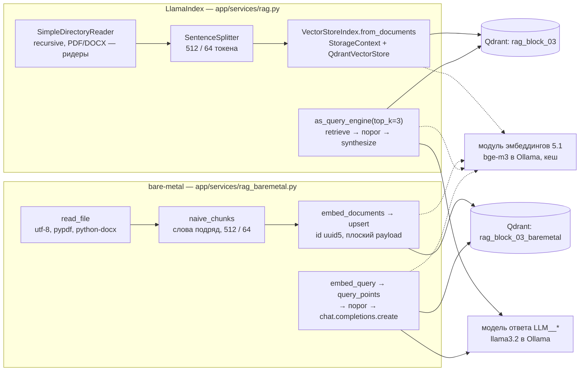

# RAG на LlamaIndex (блок 5.3)

Ответ на вопрос по корпусу из 10 документов: вопрос → эмбеддинг → три ближайших фрагмента из
Qdrant → ответ модели только по ним. Если в базе ответа нет, сервис честно говорит «В базе знаний
ответа нет.». Конвейер собран дважды: на LlamaIndex (`app/services/rag.py`, он же отвечает в
`POST /rag/query`) и без фреймворка (`app/services/rag_baremetal.py`). Обе версии работают с
одним Qdrant и одной моделью эмбеддингов, так что видно, что фреймворк делает за нас и чего это стоит.

## Что где

| Что | Где |
|---|---|
| Корпус: 10 файлов `.md`, `.txt`, `.pdf`, `.docx`, один не по теме | `data/rag-block-03/` |
| Версия на LlamaIndex: `RAGService.build()` / `answer()`, CLI `python -m app.services.rag` | `app/services/rag.py` |
| Версия без фреймворка: `BareMetalRAG.build()` / `answer()`, CLI `python -m app.services.rag_baremetal` | `app/services/rag_baremetal.py` |
| Общее для обеих версий: промпт, фраза отказа, форма ответа, ошибки | `app/services/rag_common.py` |
| Настройки `RAG__*` | `app/core/config.py` (`RagSettings`), `.env.example` |
| `POST /rag/query` | `app/routers/rag.py`, `app/schemas/rag.py`; RAGService создаётся в lifespan (`app/main.py`) |
| Прогон пяти вопросов на обеих версиях и подсчёт строк кода | `scripts/rag_compare.py` |
| Тесты | `tests/unit/test_rag.py` (без сети: Qdrant `:memory:`, модели-заглушки), `tests/integration/test_rag_live.py` (маркер `llm`: настоящие Qdrant, `bge-m3` и `llama3.2`) |

## Версии

| Пакет | Версия | Вышла | Зачем |
|---|---|---|---|
| `llama-index` | 0.14.25 | 21.09.2026 | метапакет: `llama-index-core` 0.14.25, `llama-index-llms-openai` 0.7.10, `llama-index-embeddings-openai` 0.6.0 |
| `llama-index-vector-stores-qdrant` | 0.10.3 | 13.08.2026 | `QdrantVectorStore`; 0.10.4 (08.10.2026) на момент работы слишком свежая |
| `llama-index-readers-file` | 0.7.0 | 31.08.2026 | ридеры PDF (pypdf) и DOCX для `SimpleDirectoryReader` |
| `llama-index-llms-openai-like` | 0.8.0 | 31.08.2026 | `OpenAILike` — любая OpenAI-совместимая модель (Ollama, OpenRouter) |
| `docx2txt` | 0.9 | 24.03.2025 | без него `DocxReader` падает с `ImportError` при чтении `.docx` |

Версии точные в `requirements.txt` и `pyproject.toml`, `uv.lock` обновлён. LlamaIndex добавил 42
пакета (среди них `nltk`, `tiktoken`, `pandas`, `aiohttp`, `sqlalchemy`) и не обновил ни одного из
уже установленных. Данные NLTK (стоп-слова, токенизатор предложений) и кодировка `cl100k_base`
для `tiktoken` лежат внутри `llama_index/core/_static`, поэтому LlamaIndex ничего не скачивает при
первом запуске.

## Корпус

`data/rag-block-03/` — 10 документов о «Личном кабинете», собраны из базы знаний блока 5.2 (справка,
FAQ, заметки о выпусках) и регламента поддержки блока 4.3.

| Файл | Формат | О чём |
|---|---|---|
| `01_account_security.md` | Markdown | пароль, двухфакторная аутентификация, сеансы |
| `02_tariffs_and_payment.md` | Markdown | тарифы и цены: «Старт» 990 ₽, «Команда» 4 900 ₽, «Бизнес» 14 900 ₽, «Бизнес+» 39 900 ₽; оплата |
| `03_refunds_and_card_payments.txt` | текст | возврат в течение 14 дней, если не проходит оплата картой |
| `04_api.md` | Markdown | ключи API, лимиты по тарифам (60 / 300 / 1 200 запросов в минуту), ошибка 429 и `Retry-After`, отключение v1 |
| `05_mobile_app.md` | Markdown | мобильное приложение |
| `06_notifications.txt` | текст | уведомления и письма |
| `07_team_and_data.md` | Markdown | команда, роли, выгрузка и удаление данных |
| `08_integrations_1c.docx` | DOCX | обмен с 1С:Бухгалтерией (каждые 30 минут), календарь сроков |
| `09_support_rules.pdf` | PDF | регламент поддержки: таблица сроков по приоритетам, эскалация |
| `10_houseplants.txt` | текст | **не по теме** — уход за комнатными растениями: проверка, что ответ «нет» не путается с «нашёл что-то похожее» |

## Коллекция: отдельная `rag_block_03`

Решение — **своя коллекция `rag_block_03`** (`RAG__COLLECTION`) в том же Qdrant, а не коллекция
`documents` блока 5.2. У версии без фреймворка тоже своя — `rag_block_03_baremetal`
(`RAG__BAREMETAL_COLLECTION`).

- **Формат точек разный.** LlamaIndex кладёт в payload узел целиком: `_node_content` (JSON с
  текстом и связями), `_node_type`, `doc_id`, `document_id`, `ref_doc_id` и метаданные плоско. Читая
  выдачу, он восстанавливает узлы из `_node_content`, а в `documents` его нет, там плоский payload
  блока 5.2 (`text`, `source`, `created_at`, …).
- **Корпус и нарезка разные.** В `documents` — 110 фрагментов базы знаний, нарезанных по
  статьям, здесь — 10 файлов, нарезанных `SentenceSplitter`. В одной коллекции поиск возвращал бы
  вперемешку фрагменты обоих корпусов, и сравнение версий потеряло бы смысл.
- **Пересборка безопасна.** `--rebuild` удаляет коллекцию целиком; `GET /kb/search` блока 5.2 от
  этого не страдает.
- **Своя коллекция у bare-metal** — потому что у неё своя нарезка (37 фрагментов против 29) и
  свой плоский payload `{text, file_name, chunk_index, embed_model}`. Qdrant и модель эмбеддингов
  те же, что требует задание.

Параметры:

| Параметр | Значение | Откуда |
|---|---|---|
| Размерность | 1024 | `EMBEDDING_DIM` — размер вектора `bge-m3` |
| Метрика | Cosine | векторы модуля 5.1 нормированы: косинус равен скалярному произведению, как в коллекции `documents` |
| Вектор | один безымянный | так создаёт `QdrantVectorStore`; bare-metal — так же |
| HNSW | m=16, ef_construct=100 | значения Qdrant по умолчанию (LlamaIndex создаёт коллекцию сам и HNSW не задаёт) |
| Модель эмбеддингов | `openai:local:11434/bge-m3` | метка модуля 5.1; хранится в payload `embed_model` каждой точки |

Подключаясь к готовой коллекции, обе версии сверяют размерность, метрику и метку модели. Если
коллекцию заполнили другой моделью, они не ищут (вопрос и фрагменты оказались бы в разных
пространствах) и пишут, что сделать: `python -m app.services.rag --rebuild`.

## Конвейер



**Версия на LlamaIndex** — компоненты фреймворка, свои только адаптеры:

- `SimpleDirectoryReader(input_dir, recursive=True)` читает все файлы папки. PDF разбит по
  страницам, у каждой метка `page_label`. Метаданные — только `file_name`: функция `file_metadata`
  заменяет стандартную, которая записала бы полный путь (с именем пользователя Windows) в
  метаданные и в id документа. Id документа — имя файла. В текст для эмбеддинга метаданные не
  идут; модель видит `file_name` (и `page_label`), а метку модели эмбеддингов не видит.
- `SentenceSplitter(chunk_size=512, chunk_overlap=64)`: режет по предложениям, токены считает
  `tiktoken` (`cl100k_base`).
- `QdrantVectorStore` + `StorageContext` → `VectorStoreIndex.from_documents` при первом запуске
  (или `--rebuild`), `VectorStoreIndex.from_vector_store` — когда коллекция уже заполнена:
  корпус заново не читается и не индексируется.
- `ProjectEmbedding` — подкласс `BaseEmbedding` поверх модуля эмбеддингов блока 5.1: те же векторы,
  нормирование и кеш, что у bare-metal и у коллекции `documents`.
- `OpenAILike(is_chat_model=True)` — модель `LLM__DEFAULT_MODEL` (или `RAG__LLM_MODEL`) через тот же
  OpenAI-совместимый провайдер, что у `/chat`, с прокси и сертификатами из `.env`.
- `as_query_engine(similarity_top_k=3, text_qa_template=…, refine_template=…)` — промпты на русском
  из `rag_common` вместо английских по умолчанию. `answer()` зовёт `retrieve` и `synthesize` по
  отдельности, а не `query`: между ними — порог близости.

**Версия без фреймворка** — то же руками: чтение четырёх форматов (`pypdf`, `python-docx`),
наивная нарезка по словам, `embed_documents` модуля 5.1, `create_collection` + `upsert` с id
`uuid5(файл#номер)` (повторная индексация перезаписывает те же точки), `query_points`, промпт из
тех же текстов `rag_common`, `openai.chat.completions.create`. LlamaIndex она не импортирует, это
проверяет тест.

Обе версии возвращают один и тот же словарь (числа — для примера):

```json
{
  "answer": "Тариф «Команда» стоит 4 900 ₽ в месяц.",
  "top_score": 0.71,
  "sources": [
    {"text": "первые 300 символов фрагмента…", "source": "02_tariffs_and_payment.md", "score": 0.71},
    {"text": "…", "source": "04_api.md", "score": 0.55},
    {"text": "…", "source": "07_team_and_data.md", "score": 0.52}
  ]
}
```

## Настройки

Все в `.env` (`RAG__*`), в коде только значения по умолчанию.

| Переменная | По умолчанию | Что делает |
|---|---|---|
| `RAG__DATA_DIR` | `data/rag-block-03` | папка корпуса; относительный путь — от корня проекта |
| `RAG__COLLECTION` | `rag_block_03` | коллекция LlamaIndex |
| `RAG__BAREMETAL_COLLECTION` | `rag_block_03_baremetal` | коллекция bare-metal; совпадать с предыдущей не может |
| `RAG__CHUNK_SIZE` / `RAG__CHUNK_OVERLAP` | 512 / 64 | токенов во фрагменте и в перекрытии; перекрытие меньше фрагмента |
| `RAG__SIMILARITY_TOP_K` | 3 | фрагментов в промпт и в `sources` |
| `RAG__MIN_SCORE` | 0.5 | порог близости лучшего фрагмента: ниже — отказ без вызова модели |
| `RAG__LLM_MODEL` | пусто → `LLM__DEFAULT_MODEL` | модель ответа, если нужна не та, что у `/chat` |
| `RAG__MAX_TOKENS` / `RAG__TEMPERATURE` | 512 / 0.1 | длина и «творчество» ответа: для ответа по фактам — низкая температура |

Qdrant, его ключ, `EMBEDDING_DIM`, модель эмбеддингов и провайдер модели ответа — прежние
`QDRANT_URL`, `QDRANT_API_KEY`, `EMBEDDING_DIM`, `EMBEDDINGS__*`, `LLM__*`.

## Запуск

```powershell
docker compose up -d qdrant
python -m app.services.rag --build              # индексация: «проиндексировано фрагментов — 29»
python -m app.services.rag                      # вопрос по умолчанию; ответ — JSON
python -m app.services.rag "Как часто счета уходят в 1С?"
python -m app.services.rag --rebuild "…"        # сменили корпус, нарезку или модель эмбеддингов
python -m app.services.rag_baremetal --build    # то же без фреймворка: 37 фрагментов
python -m app.services.rag_baremetal "Как часто счета уходят в 1С?"
python scripts/rag_compare.py --out var\rag_compare.md   # пять вопросов на обеих версиях + строки кода
```

**Сервис.** Lifespan создаёт `RAGService` один раз на процесс и подключается к готовой коллекции
(`rag_ready` в логе). Сам сервис корпус не индексирует: на старте это заняло бы минуты на CPU. Если
коллекции ещё нет, сервис всё равно стартует (`rag_not_ready`), `POST /rag/query` отвечает `503
rag_not_indexed` с командой индексации. После `python -m app.services.rag --build` на хосте первый же
запрос подключается к коллекции, перезапуск не нужен. Без `QDRANT_URL` — `503 rag_not_configured`.
Коллекция под другую модель — ошибка старта: лучше понятная ошибка сразу, чем мусорная выдача.

```powershell
curl.exe -s -X POST http://127.0.0.1:8000/rag/query -H "Content-Type: application/json" -d "@examples/requests/rag_query.json"
curl.exe -s -X POST http://127.0.0.1:8000/rag/query -H "Content-Type: application/json" -d "@examples/requests/rag_query_out_of_base.json"

$body = [Text.Encoding]::UTF8.GetBytes((@{question = "Сколько стоит тариф «Команда» в месяц?"} | ConvertTo-Json))
$r = Invoke-RestMethod -Method Post http://127.0.0.1:8000/rag/query -ContentType "application/json; charset=utf-8" -Body $body
$r.answer; $r.sources | Format-Table source, score -AutoSize
```

Тело — байтами UTF-8: строку с кириллицей Windows PowerShell 5.1 отправил бы в ISO-8859-1.

| Код | `error.code` | Когда |
|---|---|---|
| 200 | — | ответ (или отказ «В базе знаний ответа нет.») с `top_score` и `sources` |
| 400 | `input_rejected` | вопрос не прошёл проверку входа блока 3.8 (инъекции, скрытые символы) |
| 422 | `empty_question` / валидация | пустой вопрос, нет поля `question`, длиннее 2000 символов |
| 502 | `llm_unavailable` | модель ответа не ответила (Ollama не запущена, тайм-аут на CPU) |
| 503 | `rag_not_configured`, `rag_not_indexed`, `vector_store_unavailable`, `embeddings_unavailable`, `rag_error` | нет `QDRANT_URL`, корпус не проиндексирован, нет Qdrant, нет модели эмбеддингов, коллекция под другую модель |

Запрос к модели идёт в потоке (`asyncio.to_thread`): `RAGService` синхронный. Одновременных
запросов — не больше `LLM__MAX_CONCURRENCY`, тот же семафор, что у `/chat`.

## Порог «не знаю»

Отказ двухуровневый:

1. **Порог близости.** Лучший фрагмент ближе `RAG__MIN_SCORE` (0.5) не нашёлся — модель не вызывается
   вовсе: ответ «В базе знаний ответа нет.», `sources` — найденные фрагменты, чтобы было видно,
   почему. Это быстро (без модели) и надёжно: 3B-модели трудно удержаться от ответа, если в
   контексте есть что-то похожее.
2. **Промпт.** Порог пройден, но ответа во фрагментах нет — системное сообщение требует ответить
   ровно «В базе знаний ответа нет.» и не придумывать цены, сроки и шаги.

Почему 0.5. В блоке 5.2 у `bge-m3` на этой же базе знаний нужные фрагменты были на 0.60–0.66, а
нерелевантные, которые оставлял фильтр по дате, — на 0.29–0.40 (`docs/vector_store.md`,
«Фильтры»). Порог между ними; проверка на пяти вопросах — ниже.

## LlamaIndex против bare-metal

| Критерий | LlamaIndex | bare-metal |
|---|---|---|
| Строки кода: индексация + запрос, без импортов, docstring-ов, комментариев и пустых строк (`scripts/rag_compare.py --loc`) | **105** = 59 + 46. Из них 15 — адаптер `ProjectEmbedding`, 16 — `build_llm` (прокси, сертификаты), 6 — русские промпты. Минимальный конвейер из документации — около 6 строк (ниже), но без своей модели эмбеддингов, порога, проверки коллекции и чистки путей | **96** = 59 + 37: чтение 9, нарезка 19, индексация 31, клиент OpenAI 7, ответ 30 |
| Форматы из коробки | `SimpleDirectoryReader`: текст (`.md`, `.txt` и любой другой), `.pdf`, `.docx`, `.pptx`, `.csv`, `.xlsx`, `.epub`, `.ipynb`, `.mbox`, `.hwp`, картинки, аудио и видео (часть — с доп. пакетами) | только то, что написано: `.md`, `.txt`, `.pdf`, `.docx`; остальное пропускается |
| PDF / DOCX | по странице на документ с `page_label`; DOCX — через `docx2txt` (отдельный пакет, без него `ImportError` при чтении) | `pypdf` и `python-docx` уже были в проекте (блок 4.3) — по 3 строки; номера страниц не сохраняются |
| Нарезка | `SentenceSplitter`: по предложениям, 29 фрагментов | по словам: 37 фрагментов, начинаются и кончаются посреди фразы, переносы строк и заголовки Markdown теряются. Токены считаются по словам отдельно, а так их выходит на треть больше, чем в тексте целиком (1 900 против 1 388 у `02_tariffs_and_payment.md`): фрагменты не длиннее 390 токенов вместо 512 |
| Батчи и асинхронность | `embed_batch_size`, батчи записи в `QdrantVectorStore`, `num_workers` у ридера, асинхронные `aquery` / `aretrieve`. Но синхронные методы сами крутят цикл событий (ниже, «Подводные камни») | батчи эмбеддингов — модуль 5.1, запись — один `upsert` (для сотен точек — пачками руками), асинхронность — `AsyncQdrantClient` / `AsyncOpenAI` руками |
| Отладка: `top_score`, источники | `response.source_nodes` со `score` и метаданными, `retrieve()` отдельно от ответа, инструментация (`llama_index.core.instrumentation`, Phoenix). Итоговый промпт собирается внутри — увидеть его можно через инструментацию или подменную модель (так в тестах) | всё на виду: `hits` из Qdrant, payload, список `messages` — можно напечатать |
| Замена компонентов | одна строка: `QdrantVectorStore` → `PGVectorStore` / Chroma, `OpenAILike` → другая модель, другой сплиттер или ридер — интерфейсы общие | переписать функцию: для pgvector — SQL поиска (`PgVectorStore` блока 5.2) |
| Цена | 42 пакета, свои подводные камни, промпт и метаданные по умолчанию не подходят для русского корпуса | только то, что уже было в проекте |

Минимальный конвейер LlamaIndex, с которым сравнивают «до пяти строк»:

```python
documents = SimpleDirectoryReader("data/rag-block-03", recursive=True).load_data()
store = QdrantVectorStore(client=client, collection_name="rag_block_03")
index = VectorStoreIndex.from_documents(documents, storage_context=StorageContext.from_defaults(vector_store=store),
                                        embed_model=embed_model, transformations=[SentenceSplitter(chunk_size=512, chunk_overlap=64)])
response = index.as_query_engine(similarity_top_k=3, llm=llm).query(question)
```

С ним в Qdrant попадут полные пути к файлам, модель получит английский промпт и путь к файлу в
контексте, повторный запуск проиндексирует корпус ещё раз, а «не знаю» будет зависеть только от модели.

**Вывод.** В этом проекте LlamaIndex не сократил код: 105 строк против 96. Большая часть кода
обеих версий — не сам RAG, а то, что требуется от сервиса: своя модель эмбеддингов с кешем,
порог «не знаю», проверка коллекции, русские промпты, отсутствие путей пользователя в данных.
Фреймворк выигрывает там, где руками долго: ридеры десятка форматов с номерами страниц, нарезка по
предложениям (29 цельных фрагментов против 37 рваных) и замена хранилища или модели одной строкой.
Проигрывает в прозрачности и весе: промпт и метаданные по умолчанию пришлось переопределять, а 42
пакета принесли свои ловушки (NLTK, `docx2txt`, цикл событий). Для небольшого корпуса с
постоянными форматами bare-metal проще поддерживать. LlamaIndex окупается, когда форматов и хранилищ
становится больше или нужен быстрый прототип. Сервис отвечает через LlamaIndex, но эндпоинт видит
только контракт `answer()`, поэтому замена версии его не затронет.

## Прогон 5 вопросов

Пять вопросов — в `scripts/rag_compare.py` (`QUESTIONS`): три «хороших» (ответ в одном файле), один
средний и один вне базы.

| # | Тип | Вопрос | Где ответ | Что проверяет |
|---|---|---|---|---|
| 1 | хороший | Сколько стоит тариф «Команда» в месяц? | `02_tariffs_and_payment.md` — 4 900 ₽ | Markdown, точная цифра среди похожих (у соседних тарифов свои цены) |
| 2 | хороший | Сколько запросов в минуту можно делать к API и что будет при превышении лимита? | `04_api.md` — лимит по тарифу, 429 и `Retry-After` | ответ из двух частей в одном файле |
| 3 | хороший | Как часто счета и акты выгружаются в 1С? | `08_integrations_1c.docx` — каждые 30 минут | чтение DOCX |
| 4 | средний | Ночью не проходит оплата картой — как быстро ответит поддержка? | `09_support_rules.pdf` — высокий приоритет, первый ответ за 1 час | ответ в таблице PDF (после извлечения текста ячейки перемешаны), а слова «оплата картой» тянут `03_refunds_and_card_payments.txt` |
| 5 | вне базы | Есть ли интеграция с Битрикс24? | нигде | честный отказ; рядом по смыслу — файл об интеграциях с 1С |

Ожидания до прогона: на 1–3 нужный файл первым у обеих версий. На 4 первым может оказаться файл об
оплате картой, а PDF — вторым: от того, попадёт ли он в top-3, зависит ответ. На 5 близость к
файлу об интеграциях может пройти порог 0.5, и тогда отказ — дело промпта.

**Результаты** — вывод `python scripts/rag_compare.py` на Windows (`bge-m3` и `llama3.2` в Ollama):
таблица и гипотезы по каждому вопросу добавляются после прогона.

## Подводные камни

- **Путь к файлу в данных.** `SimpleDirectoryReader` по умолчанию кладёт в метаданные `file_path`
  (полный путь, на Windows — с именем пользователя) и оставляет его в тексте для эмбеддинга и в
  промпте; id документа — тоже полный путь. Отсюда своя `file_metadata` с одним `file_name` и id по
  имени файла.
- **Английский промпт по умолчанию** («Context information is below…») не знает ни языка ответа,
  ни фразы отказа. Шаблоны ответа и уточнения заменены (`text_qa_template`, `refine_template`), и
  обе версии отправляют модели одни и те же тексты из `rag_common`.
- **`OpenAI` из LlamaIndex не принимает `llama3.2`**: класс знает только модели OpenAI и падает,
  не найдя размер контекста. Для Ollama и OpenRouter — `OpenAILike(is_chat_model=True,
  context_window=…)`.
- **DOCX без `docx2txt`** — `ImportError` в момент чтения, а не установки: пакет не в зависимостях
  `llama-index-readers-file`.
- **NLTK и uv.** NLTK 3.10 отказывается читать свои данные, если файл — жёсткая ссылка (защита от
  подмены путей), а uv на Linux и Windows по умолчанию ставит пакеты жёсткими ссылками из кеша. С
  `pip` проблемы нет. С uv — `uv pip install --reinstall --link-mode=copy llama-index-core nltk` или
  `UV_LINK_MODE=copy`. Образ Docker собирается с копированием (`UV_LINK_MODE=copy` в `Dockerfile`).
- **Цикл событий.** Синхронные методы LlamaIndex (`synthesize`, `query`) внутри запускают корутины
  через `asyncio.get_event_loop()`. В главном потоке без цикла Python 3.12–3.13 создаёт его неявно —
  с `DeprecationWarning` и без закрытия (в тестах с `-W error` это падение). В потоке сервиса
  (`asyncio.to_thread`) `get_event_loop` падает, и LlamaIndex берёт `asyncio.run`. CLI и
  `scripts/rag_compare.py` вызывают `no_implicit_event_loop()`, тесты зовут RAG в потоке, как сервис.
  Из работающего цикла синхронные методы звать не стоит: LlamaIndex заведёт отдельный поток с новым
  циклом на каждую оценку числа токенов в промпте.
- **Вес образа.** С LlamaIndex образ сервиса — 705 МБ против 452 МБ в блоке 5.2 (site-packages 444 МБ
  против 258). Больше всех — `pandas` (75 МБ): его требует `llama-index-readers-file` ради CSV и Excel,
  которых в корпусе нет.
- **Словарь токенов в контейнере.** LlamaIndex везёт `cl100k_base` с собой, а модуль 5.1 скачивает его
  при первом подсчёте. Без доступа к `openaipublic.blob.core.windows.net` модуль считает токены
  приблизительно (байты UTF-8 / 4), и bare-metal из контейнера режет корпус иначе: в песочнице без
  интернета — 32 фрагмента вместо 37. У LlamaIndex — 29 везде.
- **Payload-индекс `doc_id`.** `QdrantVectorStore` создаёт его при первой записи; в Qdrant `:memory:`
  (unit-тесты) это предупреждение «Payload indexes have no effect», тесты его фильтруют.
