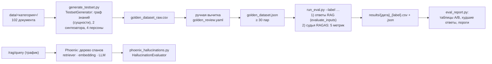

# Оценка качества RAG (блок 5.6)

Насколько RAG-ассистент блока 5.5 отвечает по базе — числами RAGAS 0.4 на golden dataset, а не «глазами на пяти примерах»: faithfulness, answer_relevancy, context_precision, context_recall и своя метрика has_citation, два A/B-эксперимента по одному параметру, разбор худших ответов по матрице retrieval vs generation. Трейсы каждого ответа — в Phoenix, пост-фактум оценка галлюцинаций на вопросах вне golden — `HallucinationEvaluator`.

> **Статус документа.** Методика, код, golden dataset (раздел 2), baseline (раздел 3), эксперименты A и B (разделы 4–5), финальная конфигурация с проверкой порогов (раздел 6), разбор провалов (раздел 7) и известные проблемы (раздел 8) готовы. Phoenix (трейсы и галлюцинации) — после прогона на Windows (Ollama на CPU); таблицы копируются из `tests/eval/results/` скриптом `scripts/eval_report.py`, места для них помечены ⏳.



Воспроизведение (Windows, PowerShell; Ollama с `llama3.2`, `bge-m3`, `qwen3:4b-instruct`, Qdrant с проиндексированным `data/`):

```powershell
pip install -r requirements-eval.txt -r requirements-tracing.txt
python scripts/verify_eval.py --live                         # импорты + один вызов судьи
python scripts/generate_testset.py                           # → tests/eval/golden_dataset_raw.csv
python scripts/build_golden.py                               # вычитка → tests/eval/golden_dataset.json
python scripts/run_eval.py --label baseline
python scripts/run_eval.py --label chunk_128 --chunk-size 128
python scripts/run_eval.py --label rerank --rerank on
python scripts/eval_report.py --labels baseline chunk_128 rerank
```

## 1. Конфигурация

**RAG под оценкой** — сервис блока 5.5 как есть (`RAGService`, `app/services/rag.py`), те же настройки из `.env`, что у `POST /rag/query`:

| Параметр | Значение |
|---|---|
| Корпус | `data/<категория>/` — 66 файлов (PDF, DOCX, HTML, Markdown), 102 документа LlamaIndex по 78–200 токенов (медиана 135) |
| Эмбеддинги | `bge-m3` в Ollama, 1024, косинус; та же модель для вопроса и фрагментов |
| Векторная база | Qdrant, коллекция оценки `kb_docs_recursive_512_64`: корпус и нарезка те же, что у `kb_docs` сервиса, но без загрузок пользователей (`data/uploads/`; в `kb_docs` после проверки блока 5.5 лежат тарифы 2027 года, которых нет в golden). Коллекцию заполняет `run_eval.py`, эмбеддинги — из кеша |
| Нарезка | `SentenceSplitter` (recursive) 512/64 токенов — итог блока 5.4. На этом корпусе документ короче фрагмента: 102 фрагмента = 102 документа |
| Поиск | 10 кандидатов → score-guard 0.5 (ниже — отказ без вызова модели) → re-ranker выключен → top-5 |
| Модель ответа | `llama3.2` (3B) в Ollama, `temperature` 0.1, до 512 токенов; промпт с нумерованными фрагментами и строкой «Источники: [1], [3]» (замер блока 5.5) |

**Судья** — не модель ответа: production-LLM (`llama3.2`) отвечает пользователю, judge-LLM ставит оценки.

| Параметр | Значение | Где задаётся |
|---|---|---|
| Модель судьи | `qwen3:4b-instruct` в той же Ollama (OpenAI-совместимый API) | `RAGAS__JUDGE_MODEL`, `RAGAS__JUDGE_BASE_URL` |
| Клиент | `llm_factory(model, provider="openai", client=AsyncOpenAI(...))` — InstructorLLM, JSON по схеме ответа; `temperature` 0.01, `top_p` 0.1 (по умолчанию RAGAS), `max_tokens` 2048 | `app/eval/metrics.py`, `RAGAS__JUDGE_MAX_TOKENS` |
| Эмбеддинги судьи (answer_relevancy) | `ragas.embeddings.OpenAIEmbeddings` → `bge-m3` в Ollama | `RAGAS__EMBEDDINGS_MODEL` (пусто — модель поиска) |
| Кеш судьи | `DiskCacheBackend`, папка на каждую модель судьи: `var/ragas_cache/<модель>` | `RAGAS__CACHE_*` |
| Параллельность | 2 строки golden одновременно | `RAGAS__CONCURRENCY` |
| Промпт has_citation | вопрос из задания, затем уточнения для 4B-судьи: три вида ссылки списком (маркер, в том числе подряд и в «Источники: …»; имя файла; «согласно …»), номер не проверять, «ссылка из письма» — не ссылка на источник, ответ — в тегах `<ответ>`; схема ответа — сначала цитата `found`, потом `has_citation`; отпечаток промпта — `judge.citation_prompt` в JSON прогона | `app/eval/metrics.py`; проверка на судье — `scripts/verify_eval.py --live` |

Почему `qwen3:4b-instruct`, а не судья блока 3.7 на OpenRouter (`nvidia/nemotron-3-super-120b-a12b:free`): прогон RAGAS — около 10 вызовов судьи на вопрос (faithfulness 2, answer_relevancy 1, context_precision по одному на каждый из 5 фрагментов, context_recall 1, has_citation 1), то есть 300+ на прогон и ~180 на генерацию golden. У бесплатных моделей OpenRouter — 50 запросов в день на ключ. `qwen3:4b-instruct` — судья блока 3.7 «без настроек»: локально, без лимитов, сильнее проверяемой `llama3.2`; цена — время на CPU и шум 4B-судьи (раздел 8). Смена судьи обнуляет сравнение: все прогоны отчёта — одним судьёй, его имя записано в JSON каждого прогона.

Версии: `ragas` 0.4.3, `langchain-community` 0.3.31 (пин `<0.4` — иначе `import ragas` падает), `arize-phoenix` 20.3.0, `openinference-instrumentation-llama-index` 4.5.4, `llama-index-core` 0.14.25 — `requirements-eval.txt`, `requirements-tracing.txt`, `uv.lock`.

## 2. Golden dataset

**Генерация** — `scripts/generate_testset.py`, RAGAS `TestsetGenerator` на корпусе `data/` блока 5.5:

1. Документы — те же, что индексирует сервис (`app/services/ingestion.py`: раздел Markdown, страница PDF, статья HTML, файл DOCX), без `data/uploads/` — загрузки пользователей не проверенная база.
2. Модель генерации — судья (`qwen3:4b-instruct`) через тот же `llm_factory`, что у метрик: JSON-режим Ollama и проверка ответа по схеме с повтором. Ответы — в кеше судьи: после сбоя повторный запуск не платит за готовое.
3. Граф знаний: узел на документ, до 6 именованных сущностей каждого документа (`NERExtractor`, один вызов модели на документ) и связи по общим сущностям (`OverlapScoreBuilder`, без модели). Этого хватает двум синтезаторам — single-hop specific (вопрос по одному документу) и multi-hop specific (по двум документам с общими сущностями). Обобщающие multi-hop abstract — по флагу `--abstract`: им нужны ещё краткие содержания, их эмбеддинги и темы (+2 вызова модели на документ, на CPU — часы), а вопросы «как связаны X и Y?» на справке чаще всего уходят при вычитке как слишком общие. `CustomNodeFilter` (вызов модели на документ: годится ли он для вопроса) не используется — корпус состоит из проверенных статей справки. К инструкциям извлечения добавлено «текст на русском — ответ на русском». Сбой модели на одном документе не обрывает граф (документ остаётся без сущностей); граф, где сущности есть меньше чем у половины документов, не сохраняется. Граф — `var/testset_kg.json`, повторная генерация вопросов его не строит.
4. Синтезаторы: single-hop specific 0.7, multi-hop specific 0.3. Персоны заданы, а не сгенерированы: владелец небольшого бизнеса, бухгалтер, разработчик интеграции, администратор команды. К промпту генерации добавлено требование «вопрос и ответ — на русском»: образцы RAGAS английские, и маленькая модель иначе отвечает по-английски.
5. Порядок узлов. Single-hop RAGAS берёт первые n узлов графа подряд: генерация 1 шла по порядку файлов корпуса, и все 28 вопросов по одному документу пришлись на `account`, `api` и `billing`. Теперь узлы идут по кругу по категориям (внутри категории — в случайном порядке с `--seed`), а недостающие категории добраны генерацией 2: `--append --single-hop-only` по документам, которых в сыром CSV ещё нет (id продолжаются).

Генерация 1 на Windows (`qwen3:4b-instruct`, CPU): граф — 102 документа, сущности у всех, 405 связей по общим сущностям, 25 мин (≈15 с на документ); 40 пар (single-hop 28, multi-hop specific 12) — ещё 106 мин: подбор персон и тем ≈40 с на вопрос, вопрос с эталоном — 70–100 с на вызов. Всего 131 мин. Генерация 2 (`--append --size 12 --single-hop-only`, граф — из файла): 49 ещё не взятых документов, 12 пар по 9 категориям за 15 мин.

Сырой результат — `tests/eval/golden_dataset_raw.csv` (`id`, `user_input`, `reference`, `reference_contexts`, `reference_sources` — файлы корпуса, из которых контексты, `synthesizer_name`), отдельный коммит.

**Ручная вычитка** — `tests/eval/golden_review.yaml`: решение по каждой строке сырого CSV (`keep`, при выбросе — `reason`, при правке — новый `user_input` / `reference` и `note`, что не так). `scripts/build_golden.py` собирает `tests/eval/golden_dataset.json` и не даёт закончить вычитку с пропусками: строка без решения, выброс без причины, повтор вопроса или меньше 30 пар — ошибка. Сырой CSV остаётся как есть — в репозитории видно, что сгенерировала модель и что поправил человек (отдельный коммит после коммита сырого CSV).

| | Генерация 1 (raw_001–040) | Генерация 2 (raw_041–052) | Всего |
|---|---|---|---|
| Сгенерировано | 40 (single-hop 28, multi-hop 12) | 12 (single-hop) | 52 |
| Выброшено | 6: вопрос о метаданных статьи (номер KB, раздел справки, дата обновления) — 4, дубль другой пары по тому же документу — 2 | 1: вопрос о метаданных | 7 |
| Поправлен только вопрос | 8: опечатки и нечитаемый текст, номер статьи в вопросе, инструкция вместо вопроса, слишком общий «что такое…» | 5: перевранный или неестественный вопрос, опечатки | 13 |
| Поправлен только эталон | 4: испорченное число («3-00» вместо 300), лишний пробел, неполный ответ, «<ключ>», потерянный при чтении документа | 2: опечатки, обобщение («данные» вместо «счета и акты») | 6 |
| Поправлены вопрос и эталон | 11: перевод с украинского, испорченные число и адрес («в течение  и рабочих дней», «sandbox.example-  .»), выдуманная связь с «разделом справки», строка метаданных в эталоне, вопрос не о том, что в документе | 2: испорченное время («до -8:00»), вопрос и эталон о дате выпуска вместо цен тарифов | 13 |
| **В golden** | 34 | 11 | **45**: single-hop 36, multi-hop 9; все 11 категорий корпуса (account 12, api 11, billing 6, releases 4, start 4, data-management 3, integrations 3, mobile 3, notifications 1, support 1, team 1 — по файлам-источникам) |

Что показала вычитка генерации 1: модель-генератор на 4 млрд параметров чаще всего не выдумывает факты (эталон — почти дословно документ), но портит форму — опечатки, смесь алфавитов, украинский и болгарский вместо русского, вопросы о служебной строке «Раздел справки 2.6 · статья KB-016 · обновлено …» вместо продукта. Выдуманный эталон — один (raw_033). Без вычитки такие пары дали бы низкие answer_relevancy и faithfulness не по вине RAG.

## 3. Baseline

`python scripts/run_eval.py --label baseline` — конфигурация раздела 1. Два прохода: сначала все ответы RAG по одному вопросу (`RAGService.evaluate_inputs` — тот же путь, что `/rag/query`, плюс полный текст фрагментов, которые видела модель; задержка меряется здесь, без судьи), затем судья — `asyncio.gather` по строкам. Отказ score-guard: faithfulness нет (NaN — проверять не по чему), context_precision и context_recall — 0 (вопрос из golden, ответ в базе есть, поиск не нашёл); пустой ответ или сбой судьи — NaN и текст ошибки в колонке `errors`, прогон не падает.

Строка «Источники: [2][3]» в конце ответа — разметка, а не утверждение о продукте: faithfulness и answer_relevancy получают ответ без неё (`strip_citations`), иначе судья считал бы её неподтверждённым утверждением. has_citation смотрит ответ как есть и считается по всем ответам: отказ «По базе не нашёл, могу эскалировать.» ссылки не содержит и идёт как «no» — на вопросах golden ответ в базе есть, и отказ — тоже провал.

**Время.** Замер перед прогоном — `run_eval.py --label smoke --limit 2` (Windows, всё на CPU): ответ RAG — 39–41 с, судья — 777 и 907 с на строку (две строки параллельно). Оба ответа smoke — faithfulness 1.0, context_precision и context_recall 1.0, answer_relevancy 0.80 и 0.92; has_citation у первого — «no» при «Источники: [2][5]» в ответе: ошибка судьи, после неё изменён промпт (раздел «Подводные камни»). Сам baseline — 21 мин ответов (27 с в среднем) и 7,2 ч судьи: 9,6 мин на вопрос против 7,5 по замеру; эксперимент — около 7,5 ч.

**Результат** — `tests/eval/results/2026-10-12_2147_baseline.csv` и `.json`, таблицы — `python scripts/eval_report.py --labels baseline`:

| Вариант | Изменение | faithfulness | answer_relevancy | context_precision | context_recall | has_citation | latency, мс (ср. / p95) | отказы (порог / модель) | файл |
|---|---|---|---|---|---|---|---|---|---|
| baseline | baseline | 0.902 | 0.791 | 0.909 | 1.000 | 0.911 | 27469 / 33701 | 0 / 0 | `2026-10-12_2147_baseline.csv` |

Судья — `qwen3:4b-instruct` (localhost), эмбеддинги судьи — `bge-m3`; golden: вопросов 45 (`golden_dataset.json`, sha256 c9d036d5eb0cf867). В скобках — сдвиг от первой строки.

Проверки без судьи (по CSV прогона):

| Вариант | hit@5 | MRR@5 | файлов в пятёрке | [N] в ответе | совпадение с has_citation | ссылка на эталон |
|---|---|---|---|---|---|---|
| baseline | 44/45 (0.978) | 0.919 | 4.8 | 41/45 | 45/45 | 18/41 (0.439) |

Пороги чекпоинта 5: faithfulness 0.902 > 0.7 и answer_relevancy 0.791 > 0.7 пройдены, has_citation 0.911 < 0.95 — нет. Строки ниже прочитаны глазами, а не только посчитаны:

- **has_citation 0.911 — правда, а не шум судьи.** Четыре ответа без «Источники: [N]» — raw_005, raw_015, raw_023, raw_038; вердикт судьи совпал с регулярным выражением на всех 45 ответах. Модель ответа иногда пропускает строку источников, хотя промпт её требует; сами ответы верные (в raw_015 — «Bearer .» вместо «Bearer <ключ>»: дефект индексации, раздел 8).
- **Ссылки есть, но часто не туда.** Из 41 ответа со ссылками только 18 указывают на фрагмент файла-источника эталона: raw_001 цитирует [2][5] (удаление аккаунта, сброс пароля) при нужном [1]. Это нижняя граница — тот же факт бывает и в FAQ, — но has_citation проверяет только наличие ссылки, точность она не видит.
- **Поиск почти без промахов:** фрагмент эталона среди пяти у 44 из 45 вопросов, MRR@5 0.919. Единственный промах — raw_014 (раздел 7).
- **context_recall 1.000 — потолок, а не качество.** Даже у raw_014, где фрагмента эталона среди пяти нет, судья счёл эталон выводимым из контекста (соседние статьи о входе и 2FA). На этом golden context_recall варианты не различает — для поиска смотрим hit@5 и MRR@5; подсказка диагноза в `eval_report.py --worst` проверяет промах по файлу первым.
- **Сбои судьи — 3 оценки из 225:** raw_007 — битый JSON в faithfulness (кавычки внутри утверждения), raw_014 (faithfulness) и raw_022 (context_recall) — ответ судьи упёрся в `max_tokens` 2048. Это NaN с причиной в колонке `errors`, средние — по остальным строкам.
- **Ошибки судьи видны глазами:** raw_006 — ответ дословно повторяет фрагмент [1], а faithfulness 0.67; raw_009 — ответ дословно из фрагмента, answer_relevancy 0.00; raw_036 — оба фрагмента эталона на местах [1] и [2], context_precision 0.00. Шум 4B-судьи — несколько строк из 45, поэтому сдвиг меньше 0.05 между вариантами — не результат (раздел 8).
- **Настоящие провалы — в генерации:** у всех трёх ответов с faithfulness < 0.5 (raw_020, raw_026, raw_032) фрагмент эталона — на месте [1]. Разбор — в разделе 7.

## 4. Эксперимент A: нарезка — `chunk_size` 512 → 128

`python scripts/run_eval.py --label chunk_128 --chunk-size 128` — overlap тот же (64), остальное как в baseline. Другая нарезка — другая коллекция (`kb_docs_recursive_128_64` против `kb_docs_recursive_512_64` у baseline, обе заполняет тот же скрипт), коллекцию сервиса оценка не трогает.

Почему не 512 → 1024, как в примере задания: документы корпуса — 78–200 токенов, при 512 каждый уже целиком в одном фрагменте, и 1024 дал бы ту же коллекцию. 128 режет больше половины документов на 2–3 фрагмента (в песочнице 352 фрагмента вместо 102). Гипотеза: в top-5 попадает меньше лишнего текста — context_precision растёт; но ответ на вопрос, который опирается на весь документ (шаги инструкции, таблица тарифов), может разойтись по фрагментам — context_recall и faithfulness падают.

**Результат** — `tests/eval/results/2026-10-13_0644_chunk_128.csv` и `.json` (11 мин ответов и 7,2 ч судьи), `python scripts/eval_report.py --labels baseline chunk_128`:

| Вариант | Изменение | faithfulness | answer_relevancy | context_precision | context_recall | has_citation | latency, мс (ср. / p95) | отказы (порог / модель) | файл |
|---|---|---|---|---|---|---|---|---|---|
| baseline | baseline | 0.902 | 0.791 | 0.909 | 1.000 | 0.911 | 27469 / 33701 | 0 / 0 | `2026-10-12_2147_baseline.csv` |
| chunk_128 | chunk_size 512→128 | 0.787 (-0.116) | 0.791 (-0.000) | 0.705 (-0.204) | 0.737 (-0.263) | 0.978 (+0.067) | 14282 / 18471 | 0 / 1 | `2026-10-13_0644_chunk_128.csv` |

Судья — `qwen3:4b-instruct` (localhost), эмбеддинги судьи — `bge-m3`; golden: вопросов 45 (`golden_dataset.json`, sha256 c9d036d5eb0cf867). В скобках — сдвиг от первой строки.

Проверки без судьи (по CSV прогона):

| Вариант | hit@5 | MRR@5 | файлов в пятёрке | [N] в ответе | совпадение с has_citation | ссылка на эталон |
|---|---|---|---|---|---|---|
| baseline | 44/45 (0.978) | 0.919 | 4.8 | 41/45 | 45/45 | 18/41 (0.439) |
| chunk_128 | 45/45 (1.000) | 0.924 | 3.3 | 44/45 | 45/45 | 32/44 (0.727) |

**Вывод: оставляю 512.** chunk_128 хуже по трём метрикам из пяти — faithfulness −0.116, context_precision −0.204, context_recall −0.263; answer_relevancy та же. По строкам: context_recall ниже в 21 из 45 и ни в одной не выше, context_precision ниже в 19, faithfulness ниже в 9 и выше в 1. Плюсы — задержка вдвое меньше (14 с против 27, p95 18 против 34) и has_citation 0.978. Гипотеза раздела подтвердилась наполовину: context_recall и faithfulness упали, а context_precision не выросла — тоже упала.

Что за числами (строки прочитаны):

- **Мелкий фрагмент без ответа выигрывает поиск.** raw_011 «Что делать, если потерян телефон с приложением-аутентификатором?» — первый фрагмент: «Нет доступа к приложению-аутентификатору / Если телефон с приложением-аутентификатором утерян,» — заголовок и половина фразы, повторяющие вопрос; продолжение (резервный код, отключить 2FA) в пятёрку не попало, и модель собрала ответ из FAQ про SMS — faithfulness 0.33 (baseline 1.00). raw_050 «Где взять счёт и акт для бухгалтерии?» — первый фрагмент (score 0.863) — сам вопрос из FAQ без ответа, ответ — во втором; модель отказалась: «По базе не нашёл, могу эскалировать.» — единственный отказ модели в baseline и A.
- **Фрагмент с середины фразы.** raw_034 — «укажите в ней API-ключ с правами «Чтение и запись» и расписание обмена…» без начала («Интеграции» → «1С», скачайте обработку): модель придумала шаги настройки — faithfulness 0.00 (baseline 0.83).
- **Куски разных документов смешиваются.** raw_041 — рядом FAQ о возврате и обрывок заметки о выпуске «…в течение которого можно вернуть оплату тарифа, увеличен с 7 до 14 дней после списания»; ответ — «тариф будет списан, а сумма вернена только в случае, если вы отключили автопродление за 7-14 дней после списания» — faithfulness 0.00 (baseline 1.00).
- **Пятёрка беднее.** В среднем 3.3 разных файла против 4.8: несколько фрагментов одного документа вытесняют остальные. Поэтому hit@5 по файлу и «ссылка на эталон» выросли (45/45, 32/44): фрагментов файла-источника в пятёрке в среднем почти два, попасть в любой из них легче. Найден файл — ещё не найден фрагмент с ответом, это и показывает context_recall.
- **context_recall наконец меньше 1.** На baseline он стоял на потолке, потому что документ корпуса целиком помещается в один фрагмент; при 128 ответ расходится по фрагментам, и метрика это видит — она различает нарезки, а не варианты без смены нарезки.
- **Короткий контекст — быстрее и аккуратнее с форматом.** Ответы без строки «Источники» — 0 против 4 на baseline (единственное «no» — отказ raw_050). Вероятная причина — промпт короче, и инструкция о строке источников не теряется в тексте фрагментов; это довод в пользу правки промпта, а не мелкой нарезки.
- **Сбои судьи — 5 оценок из 225:** три ответа судьи на faithfulness упёрлись в `max_tokens` (raw_038, raw_045, raw_051), у raw_052 судья не выделил ни одного утверждения, у raw_038 ещё и context_recall — битый JSON.

Если мелкая нарезка понадобится (например, ради задержки), то только вместе с расширением контекста: искать по мелким фрагментам, а модели отдавать соседние фрагменты или документ целиком (sentence window, parent document retrieval в LlamaIndex) — иначе повторятся raw_011 и raw_050.

## 5. Эксперимент B: re-ranker `bge-reranker-v2-m3` — выкл → вкл

`python scripts/run_eval.py --label rerank --rerank on` — нарезка baseline, re-ranker блока 5.4 (cross-encoder `BAAI/bge-reranker-v2-m3` в процессе; нужен `requirements-embeddings.txt`) переупорядочивает 10 кандидатов, в контекст идут 5 лучших. В блоке 5.4 на учебном корпусе он не дал прироста Hit Rate и был выключен; здесь — проверка на корпусе ассистента и на метриках ответа, а не только поиска. Гипотеза: растёт context_precision (нужный фрагмент выше), растёт задержка (секунды на CPU).

**Результат** — `tests/eval/results/2026-10-13_1439_rerank.csv` и `.json` (35 мин ответов и 9,7 ч судьи), `python scripts/eval_report.py --labels baseline rerank`:

| Вариант | Изменение | faithfulness | answer_relevancy | context_precision | context_recall | has_citation | latency, мс (ср. / p95) | отказы (порог / модель) | файл |
|---|---|---|---|---|---|---|---|---|---|
| baseline | baseline | 0.902 | 0.791 | 0.909 | 1.000 | 0.911 | 27469 / 33701 | 0 / 0 | `2026-10-12_2147_baseline.csv` |
| rerank | re-ranker off→on | 0.911 (+0.009) | 0.798 (+0.007) | 0.939 (+0.029) | 1.000 (+0.000) | 0.933 (+0.022) | 46502 / 58660 | 0 / 0 | `2026-10-13_1439_rerank.csv` |

Судья — `qwen3:4b-instruct` (localhost), эмбеддинги судьи — `bge-m3`; golden: вопросов 45 (`golden_dataset.json`, sha256 c9d036d5eb0cf867). В скобках — сдвиг от первой строки.

Проверки без судьи (по CSV прогона):

| Вариант | hit@5 | MRR@5 | файлов в пятёрке | [N] в ответе | совпадение с has_citation | ссылка на эталон |
|---|---|---|---|---|---|---|
| baseline | 44/45 (0.978) | 0.919 | 4.8 | 41/45 | 45/45 | 18/41 (0.439) |
| rerank | 45/45 (1.000) | 0.948 | 4.9 | 42/45 | 45/45 | 20/42 (0.476) |

**Вывод: не беру.** Re-ranker улучшает поиск: фрагмент эталона в пятёрке у 45 из 45 (единственный промах baseline, raw_014, исправлен), MRR@5 0.919 → 0.948, context_precision +0.029; в raw_013, raw_016 и raw_018 фрагмент эталона поднялся со 2-го места на 1-е (в raw_035 — наоборот). Гипотеза раздела подтвердилась. Но ответы почти не меняются: faithfulness +0.009 и answer_relevancy +0.007 — в пределах шума судьи (сдвиг меньше 0.05 — не результат, раздел 8); has_citation +0.022 — тоже шум: строку «Источники» модель пропустила в других вопросах (есть в raw_015, raw_023, raw_038; нет в raw_022 и raw_051). Цена — +19 с на ответ (27 → 46,5 с, p95 34 → 59 с) и `torch` с `sentence-transformers` в образе сервиса, где их сейчас нет (плюс веса модели — 2,3 ГБ; сборка образа на этой машине уже падала от нехватки памяти). Провалы baseline — в генерации (раздел 7), и re-ranker их не лечит.

Что за числами (строки прочитаны):

- **raw_014 — тот случай из раздела 7.** `account/two-factor-auth.html` поднялся в пятёрку (3-е место), и ответ стал верным: «Профиль» → «Безопасность» → «Двухфакторная аутентификация», QR-код, резервные коды, ссылка [3]. Единственный вопрос, где re-ranker исправил ответ.
- **raw_020 — улучшение только на бумаге.** faithfulness 0.00 → 1.00, а ответ по сути тот же: лимиты тарифов («Старт» — 60…) выданы за лимиты тестовой среды. Первый фрагмент — тот же `api/api-sandbox.md`; судья иначе оценил другую формулировку той же ошибки.
- **raw_018, raw_051, raw_052 — хуже без вины поиска.** faithfulness 0.75, 0.75 и 0.50 при фрагменте эталона на том же или более высоком месте: модель ответа при `temperature` 0.1 сформулировала иначе — в raw_052 придумала кнопку «Подключить», в raw_051 потеряла строку источников. Генерация шумит сильнее, чем re-ranker меняет контекст.
- **9 ответов из 45 совпали с baseline дословно** — там порядок фрагментов не изменился или не повлиял на ответ; их оценки взяты из кеша судьи.
- **Сбои судьи — 8 оценок из 225:** шесть таймаутов запросов к Ollama (raw_036, raw_038, четыре answer_relevancy подряд — raw_040–raw_044) и два ответа судьи, упёршихся в `max_tokens`. Вероятная причина таймаутов — память: модель re-ranker остаётся загруженной в процессе оценки рядом с моделями Ollama; в этом же прогоне две строки оценивались по полтора часа.

## 6. Финальный конфиг

**Строка источников — кодом (`RAG__SOURCES_FALLBACK=true`).** На baseline has_citation 0.911 < 0.95: в 4 ответах из 45 llama3.2 не написала «Источники: [N]», хотя напоминание о ней стоит последней строкой промпта, прямо перед ответом (блок 5.5), — промптом больше не выжать. Эксперимент A показал, что с коротким контекстом пропусков нет, но платить за это faithfulness и поиском (раздел 4) незачем. Теперь `/rag/query` дописывает строку сам, если в ответе нет ни одной ссылки [N]: номер — фрагмент с наибольшей долей слов ответа (основы из 5 букв и числа, `rag_common.add_sources_line`, событие `rag_sources_added` в логе). Отказ и ответ, слова которого во фрагментах почти не встречаются (меньше 30 %), не трогаются: ссылка была бы выдумкой. На четырёх ответах baseline без ссылки выбор такой: raw_015 и raw_038 — фрагмент файла-источника эталона, raw_005 и raw_023 — фрагмент, из которого ответ взят почти дословно (FAQ про SMS; `api/api-limits.md` с тем же текстом, что эталонный FAQ). faithfulness и answer_relevancy строку источников не видят (`strip_citations`), на них правка не влияет; точность ссылок (раздел 3) она не лечит — только гарантирует, что ссылка есть. Выключается `RAG__SOURCES_FALLBACK=false` или `run_eval.py --sources-fallback off`; в JSON прогона — `config.sources_fallback`, у прогонов до правки ключа нет (значит, `false`).

**Беру baseline (recursive 512/64, re-ranker выключен) со строкой источников (`RAG__SOURCES_FALLBACK=true`), потому что:**

- нарезка 128 (раздел 4) хуже по faithfulness, context_precision и context_recall — мелкий фрагмент без ответа выигрывает поиск;
- re-ranker (раздел 5) поправил поиск (hit@5 45/45, MRR@5 0.948) и один ответ (raw_014), но метрики ответа сдвинулись в пределах шума, а задержка выросла на 69 % и сервису понадобился бы `torch` в образе;
- провалы baseline — в генерации, и единственный порог, которого baseline не прошёл, — has_citation (0.911): его закрывает строка источников, не трогая ни поиск, ни модель.

Значения финальной конфигурации — это значения по умолчанию `RagSettings` (`app/core/config.py`) и пустые строки `.env.example`: `RAG__CHUNKING=recursive`, `RAG__CHUNK_SIZE=512`, `RAG__CHUNK_OVERLAP=64`, `RAG__CANDIDATES_TOP_K=10`, `RAG__SIMILARITY_TOP_K=5`, `RAG__SCORE_THRESHOLD=0.5`, `RERANK__ENABLED=false`, `RAG__SOURCES_FALLBACK=true`; в JSON финального прогона — те же значения (`config`).

**Результат** — `tests/eval/results/2026-10-14_0056_final.csv` и `.json` (40 мин ответов и 3,5 ч судьи: 21 ответ совпал с baseline дословно, их оценки — из кеша), `python scripts/eval_report.py --labels baseline final`:

| Вариант | Изменение | faithfulness | answer_relevancy | context_precision | context_recall | has_citation | latency, мс (ср. / p95) | отказы (порог / модель) | файл |
|---|---|---|---|---|---|---|---|---|---|
| baseline | baseline | 0.902 | 0.791 | 0.909 | 1.000 | 0.911 | 27469 / 33701 | 0 / 0 | `2026-10-12_2147_baseline.csv` |
| final | sources_fallback False→True | 0.868 (-0.034) | 0.792 (+0.001) | 0.909 (+0.000) | 1.000 (+0.000) | 1.000 (+0.089) | 53567 / 65372 | 0 / 0 | `2026-10-14_0056_final.csv` |

Судья — `qwen3:4b-instruct` (localhost), эмбеддинги судьи — `bge-m3`; golden: вопросов 45 (`golden_dataset.json`, sha256 c9d036d5eb0cf867). В скобках — сдвиг от первой строки.

Проверки без судьи (по CSV прогона):

| Вариант | hit@5 | MRR@5 | файлов в пятёрке | [N] в ответе | совпадение с has_citation | ссылка на эталон |
|---|---|---|---|---|---|---|
| baseline | 44/45 (0.978) | 0.919 | 4.8 | 41/45 | 45/45 | 18/41 (0.439) |
| final | 44/45 (0.978) | 0.919 | 4.8 | 45/45 | 45/45 | 22/45 (0.489) |

`python scripts/eval_report.py --check tests/eval/results/2026-10-14_0056_final.json`:

```
Пороги прогона final (2026-10-14_0056_final.json):
OK   faithfulness = 0.868 (нужно > 0.7)
OK   answer_relevancy = 0.792 (нужно > 0.7)
OK   has_citation = 1.000 (нужно > 0.95)
```

Что за числами:

- **has_citation 1.000** — ссылка есть во всех 45 ответах. У raw_015, raw_023 и raw_038 текст ответа дословно тот же, что на baseline, где строки «Источники» не было, — её дописал сервис, с теми же номерами, что в проверке выше.
- **faithfulness 0.868 против 0.902 — шум генерации, а не правки.** На 40 строках, оценённых в обоих прогонах, — 0.899 и 0.868. Разница — от четырёх ответов, которые модель сформулировала иначе (raw_005, raw_016, raw_036, raw_051: `temperature` 0.1 — не ноль); где текст совпал, совпали и оценки (raw_015, raw_023, raw_038). Строку источников faithfulness не видит (`strip_citations`). Сдвиг меньше 0.05 — не результат (раздел 8).
- **answer_relevancy, context_precision, context_recall — как у baseline**, поиск тот же: та же коллекция и настройки, hit@5 44/45, MRR@5 0.919.
- **Сбои судьи — 11 оценок из 225:** десять таймаутов запросов к Ollama и битый JSON у raw_007 (как на baseline). В ту ночь машина работала медленнее — это видно и по задержке.
- **Задержка — 28 с, а не 53,6.** В JSON финального прогона — 53,6 с в среднем, но код ответа тот же, что у baseline (строка источников — операция над строкой за доли миллисекунды). Повторный замер днём при тех же условиях, что у baseline (контейнеры сервиса остановлены): `python scripts/run_eval.py --label latency_final --answers-only --out-dir var\latency` (18.10.2026) — 28,4 с в среднем, медиана 27,8 с, p95 36,4 с, у baseline — 27,5 / 27,0 / 33,7 с. 53,6 с — нагрузка машины в ту ночь, а не конфигурация.

**Итог:** финальная конфигурация проходит все три порога чекпоинта 5 — faithfulness 0.868 > 0.7, answer_relevancy 0.792 > 0.7, has_citation 1.000 > 0.95. Если лучшие изменения A и B независимы и оба дали прирост — четвёртый прогон с обоими, финальный CSV — его. Финальная конфигурация записывается в `.env.example` и в значения по умолчанию `RagSettings` (`app/core/config.py`) — сервис отвечает с ней же; `scripts/eval_report.py --check <финальный JSON>` проверяет пороги чекпоинта 5: faithfulness > 0.7, answer_relevancy > 0.7, has_citation > 0.95.

## 7. Failure analysis

`python scripts/eval_report.py --worst <финальный CSV>`: 3–5 худших ответов по faithfulness (отказы без фрагментов — без faithfulness — в выборку не входят), для каждого — вопрос, найденные файлы и начало фрагментов, ответ, эталон, метрики и подсказка диагноза по матрице 2×2:

| | фрагмент эталона найден, context_recall высокий | фрагмента эталона нет среди пяти или context_recall низкий |
|---|---|---|
| **faithfulness низкий** | generation: контекст был, модель от него отошла — промпт, модель ответа | retriever: нужного фрагмента не было — нарезка, эмбеддинги, top-K, re-ranker |

Диагноз ставится после чтения фрагментов и ответа, подсказка скрипта — отправная точка. Промах по файлу проверяется раньше context_recall: на baseline судья ставит context_recall 1.0 и там, где фрагмента эталона нет (raw_014). Трейс того же вопроса в Phoenix показывает, какие фрагменты пришли с какими scores и что ушло модели в промпте.

**Разбор baseline** (`--worst tests/eval/results/2026-10-12_2147_baseline.csv` и строки со сбоями судьи; если финальная конфигурация другая — её худшие ответы сверяются с этими):

1. **raw_020 — поиск ✓, генерация ✗: числа из соседнего фрагмента.** «Есть ли ограничения на запросы в тестовой среде API?» Фрагмент эталона `api/api-sandbox.md` — на месте [1]: «Лимиты запросов в тестовой среде ниже, чем на тарифе». Ответ: «Лимит запросов в минуту для тарифа "Старт" составляет 60, для тарифа "Команда" — 300, а для тарифа "Бизнес" — 1 200» со ссылками [2], [3] — числа из FAQ о лимитах тарифов выданы за лимиты песочницы. faithfulness 0.00, context_recall 1.00. Причина — модель ответа: рядом конкретные числа про «лимиты» и расплывчатое «ниже, чем на тарифе», 3B-модель берёт конкретику. Поиском не лечится — нужный фрагмент и так первый; лечится промптом («если фрагмент отвечает на похожий, но другой вопрос, не переноси его числа») или моделью сильнее.
2. **raw_026 и raw_032 — поиск ✓, генерация ✗: придуманная деталь интерфейса.** Путь в меню верный и есть во фрагменте [1] («Биллинг» → «Тариф»; «Профиль» → «Безопасность» → «Способы входа»), но модель дописывает то, чего в справке нет: «снять флажку «Автопродление»», «выбрать «Отвязать вход через Яндекс ID»». faithfulness 0.00 строже, чем ответ заслуживает (главное утверждение подтверждено), но направление верное: пользователь будет искать несуществующий флажок. Ссылки — не на основной фрагмент: [4] (смена тарифа) вместо [1] и [2] (FAQ — только про пароль) вместо [1]. Что делать: в промпт — «не называй кнопок и полей, которых нет во фрагментах».
3. **raw_014 — поиск ✗, генерация ✗.** «Как настроить вход с кодом из приложения-аутентификатора?» `account/two-factor-auth.html` не попал в пятёрку — единственный промах hit@5; пришли статьи о проблемах входа в приложение, потере аутентификатора, биометрии, входе в кабинет и заметка о выпуске. Модель пересказала то, что было, — как войти с кодом, а не как настроить 2FA — со ссылкой на [5] (`start/login.html`). faithfulness — NaN (ответ судьи упёрся в лимит токенов), context_recall 1.00 — судья вывел эталон из соседних статей: подсказка по context_recall здесь ошиблась бы, промах виден по файлу. Что делать: re-ranker по 10 кандидатам (эксперимент B) — по эмбеддингам в вопросе «вход с кодом» перевешивают статьи о входе.
4. **raw_036 — поиск ✓, генерация ✗: двойной вопрос, ответ на соседний.** «Как использовать офлайн-режим … и что делать, если не удаётся войти?» (multi-hop). Оба фрагмента эталона — на местах [1] и [2], но модель ответила по [3] — FAQ «приложение не синхронизируется» — и сослалась на [4][5] (выход на чужом компьютере, потеря аутентификатора). faithfulness 0.67 (шаги из [3] подтверждаются), context_precision 0.00 — ошибка судьи: два нужных фрагмента наверху. Что делать: на двойных вопросах 3B-модель отвечает на одну половину; промпт «ответь на каждую часть вопроса» или разбиение вопроса на части.
5. **raw_006 — поиск ✓, генерация ✓, метрика ✗: шум судьи.** Ответ дословно повторяет фрагмент [1] и эталон, ссылка [1] верная, а faithfulness 0.67: одно из трёх утверждений, которое во фрагменте стоит слово в слово, судья не подтвердил. Того же рода raw_009 — answer_relevancy 0.00 у дословного ответа. Четвёртая клетка матрицы — «поиск промахнулся, ответ всё равно верный» — на baseline пуста: единственный промах (raw_014) дал и неверный ответ.

Итог baseline: поиск почти безупречен (44 из 45), провалы — в генерации: перенос чисел из соседнего фрагмента, придуманные элементы интерфейса, ответ на половину двойного вопроса, пропущенная или неверная ссылка. Поэтому эксперимент B (re-ranker) скорее поправит единичный промах поиска, чем faithfulness.

## 8. Известные проблемы и план улучшений

Известно до прогонов:

- **Судья на 4 млрд параметров.** В блоке 3.7 ручная проверка нашла ошибки `qwen3:4b-instruct`-судьи в обе стороны. RAGAS и так шумит на ±5–10 % между прогонами; разница между вариантами меньше 0.05 на 30 вопросах — не результат. План: спорные строки (большие расхождения между вариантами) смотреть глазами; при доступе к сильному судье (пополненный ключ OpenRouter — 1000 запросов в день) — пересчитать все прогоны им.
- **Модель ответа на 3 млрд параметров.** `llama3.2` путает части фраз из документа (блок 5.5, «Condense (Windows)») — это generation-ошибки, которые настройками поиска не лечатся.
- **Время на CPU.** Прогон — около 10 вызовов судьи на вопрос: по замеру smoke — 7,5 мин судьи на вопрос, около 6 ч на прогон из 45 вопросов. Поэтому два прохода с журналом `{…}.partial.jsonl` (`--resume` после сбоя), кеш судьи и `--answers-only`.
- **Промпты RAGAS — английские,** вопросы и ответы — русские. Судья выделяет утверждения и выносит вердикты по-английски; на числа это не влияет, но причины (`reason`) в отладке — на английском.

Найдено при вычитке golden:

- **Индексация теряет `<ключ>` в Markdown.** В `api/api-error-401.md` — «Authorization: Bearer <ключ>», а в индексе — «Bearer .»: `MarkdownReader` с `remove_hyperlinks=True` (по умолчанию LlamaIndex) вырезает `<…>` как автоссылку. Модель ответа не может подсказать формат заголовка. План: `MarkdownReader(remove_hyperlinks=False)` или экранирование в корпусе и переиндексация Markdown (`scripts/ingest.py` пересчитает только изменённые документы).
- **Противоречия в корпусе.** Адрес тестовой среды API: `https://sandbox.example.com/v2` в `api-sandbox.md` и `sandbox.api.example.com` в `faq-api.md`; путь к ключам: «API-ключи» в `api-keys.md` и «API» → «Ключи» в `faq-api.md`. Ответ RAG зависит от того, какой фрагмент найдётся первым. План: исправить справку — это задача владельца корпуса, а не RAG.
Найдено на baseline:

- **has_citation 0.911 < 0.95.** Четыре ответа из 45 без строки «Источники» — модель её пропускает, судья прав. Решение — строка источников кодом, если модель её не написала (`RAG__SOURCES_FALLBACK`, раздел 6); на финальном прогоне — 1.000.
- **Ссылки мимо эталона.** Из 41 ответа со ссылками на фрагмент файла-источника эталона указывают 18 (`eval_report.py`, «ссылка на эталон»). has_citation этого не видит. План: считать точность ссылок в `run_eval.py` (номер [N] → файл фрагмента → источник эталона) и подсказать в промпте «ссылайся на фрагмент, из которого взят факт».
- **context_recall на потолке (1.000).** 4B-судья выводит эталон из соседних статей, даже когда фрагмента эталона нет среди пяти. Для поиска в отчёте — hit@5 и MRR@5 по файлам; при доступе к сильному судье — пересчитать.
- **Лимит токенов судьи.** Два ответа судьи из 225 упёрлись в `RAGAS__JUDGE_MAX_TOKENS` 2048 (raw_014, raw_022). Поднять до 4096 можно, но это меняет оценки: только вместе с пересчётом всех прогонов.
После экспериментов и финального прогона:

- **Пороги пройдены,** но has_citation — за счёт кода, а не модели: точность ссылок не выросла — на фрагмент файла-источника эталона указывают 22 из 45 ответов. План — метрика точности ссылок в `run_eval.py` и правило в промпте «ссылайся на фрагмент, из которого взят факт».
- **Провалы генерации — одни и те же во всех прогонах:** числа из соседнего фрагмента (raw_020), придуманные элементы интерфейса (raw_026, raw_032), ответ на половину двойного вопроса (raw_036). Ни нарезка, ни re-ranker их не лечат. План — правила в промпте («не называй кнопок и полей, которых нет во фрагментах», «ответь на каждую часть вопроса») и модель сильнее `llama3.2` (3B); каждое изменение — отдельным прогоном против baseline.
- **Шум 4B-судьи сравним с эффектами.** Ответы с `temperature` 0.1 между прогонами меняются, и faithfulness по строкам прыгает на 0.25–0.5 при одинаковых фрагментах (раздел 5, raw_018/raw_051/raw_052; раздел 6, raw_005/raw_016). Сдвиги средних меньше 0.05 не различимы. План: `temperature` 0 для прогонов оценки, повтор прогона для разброса, сильный судья.
- **Сбои судьи — от 3 до 11 оценок из 225 за прогон:** таймауты под нагрузкой (прогон B — модель re-ranker в памяти рядом с Ollama; ночь финального прогона), лимит `max_tokens` 2048, битый JSON. Это NaN с причиной, средние — по остальным строкам. План: досчёт только сбойных оценок по готовому CSV вместо нового прогона, `RAGAS__JUDGE_TIMEOUT` больше, освобождать модель re-ranker перед проходом судьи.
- **Время.** Прогон на CPU — 3,5–10 ч судьи (с кешем и без); четыре прогона подряд — около 30 часов. План — сильный судья по API или GPU: эксперименты станут дешевле, и их можно будет повторять для оценки разброса.

## Phoenix: трейсы и галлюцинации

**Трейсинг.** Phoenix — сервис `phoenix` в `compose.yaml` (`arizephoenix/phoenix:latest`, порт 6006, том `phoenix-data` с базой трейсов — с блока 3.6), адрес OTLP — `${PHOENIX_COLLECTOR_ENDPOINT}/v1/traces` из `.env` (в compose — `http://phoenix:6006`). В lifespan `setup_tracing()` один раз регистрирует `LlamaIndexInstrumentor` на тот же `TracerProvider`, что и инструментация OpenAI SDK (блок 3.6); флаг `PHOENIX_LLAMA_INDEX` (по умолчанию включён). Методы `RAGService.answer`, `retrieve` и `evaluate_inputs` — спаны диспетчера LlamaIndex (`@dispatcher.span`), поэтому трейс — одно дерево:

```
POST /rag/query                         вопрос и ответ (маскированные) — колонки input/output списка трейсов
├─ RAGService.answer                    вопрос → answer, sources, top_score, confident
│  ├─ RAGService.retrieve
│  │  └─ VectorIndexRetriever.retrieve  [RETRIEVER] 10 кандидатов: текст, метаданные, document.score
│  │     └─ ProjectEmbedding.get_query_embedding  [EMBEDDING] bge-m3
│  └─ OpenAILike.chat                   [LLM] промпт (system + фрагменты + вопрос), ответ, токены
└─ ChatCompletion                       [LLM] тот же вызов модели глазами инструментации OpenAI SDK (блок 3.6)
```

Отказ score-guard виден по дереву сразу: под `RAGService.answer` нет LLM-спана, а `document.score` лучшего кандидата ниже порога.

`scripts/trace_queries.py` — 22 запроса в `/rag/query`: 10 из golden и 12 свободных (по базе, но сформулированных иначе — по-английски, разговорно, с опечаткой; о продукте без ответа в базе; посторонние). В конце скрипт сам спрашивает Phoenix, пришли ли трейсы и есть ли в них retriever-спаны со score и LLM-спаны с токенами.

⏳ скриншот раскрытого трейса — `docs/screenshots/phoenix_trace.png`

**Галлюцинации на свободных вопросах.** `scripts/phoenix_hallucinations.py`: спаны — `phoenix.client.Client().spans.get_spans_dataframe()` (в arize-phoenix 20 так называется `px.Client().get_spans_dataframe()` из материалов курса), из каждого трейса — LLM-спан модели ответа (вход — промпт целиком, выход — ответ), `phoenix.evals.HallucinationEvaluator` с тем же судьёй, метка `grounded` / `hallucinated` пишется аннотацией на корневой span трейса. Отказы score-guard модель не вызывали — оценивать нечего, они считаются отдельно.

⏳ доля hallucinated на свободных вопросах и на golden, скриншот списка трейсов с колонкой hallucination — `docs/screenshots/phoenix_hallucination.png`

## Подводные камни

- **`openinference-instrumentation-llama-index` 3.x несовместим с `llama-index-core` 0.14.** Задание называет `>=3,<4`, но последняя 3.x (3.3.3) импортирует `llama_index.core.base.agent`, которого в 0.14 нет: сервис падал при старте с `ModuleNotFoundError`. Взята ветка 4.x (4.5.4, поддерживает `llama-index-core>=0.14.19`).
- **`@discrete_metric` глотает исключения.** Сбой судьи внутри has_citation не поднимается наружу: `ascore` возвращает `value=None` и текст ошибки в `reason`. Без отдельной проверки он посчитался бы ответом «no» и занизил долю цитат. `score_row` пишет такой случай как NaN с ошибкой.
- **`rapidfuzz` не в зависимостях ragas,** а `OverlapScoreBuilder` графа знаний без него падает на `ImportError` — добавлен в группу eval.
- **`graphql-core` 3.3 ломает локальный сервер Phoenix 20.3:** трейс с аннотацией не открывается — «Int cannot represent non-integer value: <int64 instance>» (счётчики аннотаций приходят как `numpy.int64`). В группе eval — `graphql-core<3.3`. Phoenix в Docker ставит свои версии; если ошибка появится и там — скриншот дерева снимать до записи аннотаций.
- **Генератор без JSON-режима — часы впустую.** Первая версия `generate_testset.py` шла через `LlamaIndexLLMWrapper` (обычный текстовый вызов): на Windows `qwen3:4b-instruct` отвечал краткими содержаниями простым текстом, каждый вызов `SummaryExtractor` падал с `Invalid json output`, а RAGAS дожидается всех задач преобразования и только потом поднимает первое исключение — полтора часа на CPU без единого результата. Теперь модель генератора — `llm_factory` (JSON-режим, проверка по схеме), как у метрик; `TestsetGenerator` 0.4 его принимает. Сбой на одном документе не обрывает граф, ответы — в кеше.
- **has_citation: 4B-судья не увидел «Источники: [2][5]».** На прогоне smoke ответ с этой строкой получил «no». Первая версия промпта — вопрос из задания, «Ответь yes или no.» и текст после «Ответ:»; вероятные причины — «Ответ:» похоже на место для вердикта, а маркеры подряд и неверный номер источника (в этом ответе верный — [1]) судья принял за «не ссылку». `verify_eval.py --live` теперь проверяет судью на ответах с известным вердиктом (хоть одно расхождение — код 1): все три вида ссылки из задания, этот ответ из smoke, ответы без ссылки — в том числе со словом «ссылка» в значении «ссылка из письма», которого в корпусе много. Вторая версия — тот же вопрос, затем примеры ([1], [2][5], «Источники: …»), «номер не проверяй» и ответ в тегах `<ответ>`: маркеры судья увидел, а «согласно разделу 2.4 справки» и «см. файл account/change-email.html» оценил как «no» — 4 из 6: похоже, ссылкой он считал только [N]. Третья версия — три вида ссылки нумерованным списком с примерами, оговорка про «ссылку из письма» и поле `found` в схеме ответа: судья сначала выписывает найденную ссылку дословно, потом ставит вердикт; проверка — на восьми ответах. Вопрос из задания стоит в промпте первой строкой дословно во всех версиях. Отпечаток промпта пишется в JSON, и `eval_report.py` помечает прогоны с другим промптом: smoke с первой версией с baseline не сравнивается.
- **Коллекция сервиса — не корпус golden.** Первая версия `run_eval.py` при нарезке сервиса брала `kb_docs`: туда же `POST /documents/upload` кладёт загрузки пользователей (в проверке блока 5.5 — тарифы 2027 года), а docstore у сервиса в Docker и у локального скрипта свои — smoke переписал 66 файлов в `kb_docs` как «changed». Теперь у оценки своя коллекция для любой нарезки, `kb_docs` она не читает и не пишет.
- **AnswerRelevancy с `strictness=1`.** По умолчанию судья трижды восстанавливает вопрос по ответу, но при `temperature` 0.01 три вызова дают один и тот же вопрос — на CPU это два лишних вызова на строку.
- **Кеш RAGAS не знает имени модели** — ключ строится по тексту запроса. После смены судьи прогон взял бы оценки прежнего, поэтому у каждого судьи своя папка кеша.
