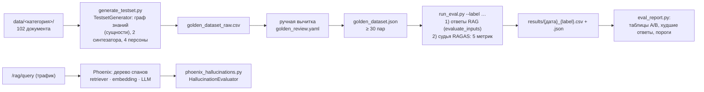

# Оценка качества RAG (блок 5.6)

Насколько RAG-ассистент блока 5.5 отвечает по базе — числами RAGAS 0.4 на golden dataset, а не «глазами на пяти примерах»: faithfulness, answer_relevancy, context_precision, context_recall и своя метрика has_citation, два A/B-эксперимента по одному параметру, разбор худших ответов по матрице retrieval vs generation. Трейсы каждого ответа — в Phoenix, пост-фактум оценка галлюцинаций на вопросах вне golden — `HallucinationEvaluator`.

> **Статус документа.** Методика, код и проверка механики в песочнице готовы. Числа разделов 2–7 появляются после прогонов на Windows (Ollama на CPU) и копируются из `tests/eval/results/` скриптом `scripts/eval_report.py` — места для них помечены ⏳.



Воспроизведение (Windows, PowerShell; Ollama с `llama3.2`, `bge-m3`, `qwen3:4b-instruct`, Qdrant с проиндексированным `data/`):

```powershell
pip install -r requirements-eval.txt -r requirements-tracing.txt
python scripts/verify_eval.py --live                         # импорты + один вызов судьи
python scripts/generate_testset.py                           # → tests/eval/golden_dataset_raw.csv
python scripts/build_golden.py                               # вычитка → tests/eval/golden_dataset.json
python scripts/run_eval.py --label baseline
python scripts/run_eval.py --label chunk_128 --chunk-size 128
python scripts/run_eval.py --label rerank --rerank on
python scripts/eval_report.py --labels baseline chunk_128 rerank
```

## 1. Конфигурация

**RAG под оценкой** — сервис блока 5.5 как есть (`RAGService`, `app/services/rag.py`), те же настройки из `.env`, что у `POST /rag/query`:

| Параметр | Значение |
|---|---|
| Корпус | `data/<категория>/` — 66 файлов (PDF, DOCX, HTML, Markdown), 102 документа LlamaIndex по 78–200 токенов (медиана 135) |
| Эмбеддинги | `bge-m3` в Ollama, 1024, косинус; та же модель для вопроса и фрагментов |
| Векторная база | Qdrant, коллекция `kb_docs` |
| Нарезка | `SentenceSplitter` (recursive) 512/64 токенов — итог блока 5.4. На этом корпусе документ короче фрагмента: 102 фрагмента = 102 документа |
| Поиск | 10 кандидатов → score-guard 0.5 (ниже — отказ без вызова модели) → re-ranker выключен → top-5 |
| Модель ответа | `llama3.2` (3B) в Ollama, `temperature` 0.1, до 512 токенов; промпт с нумерованными фрагментами и строкой «Источники: [1], [3]» (замер блока 5.5) |

**Судья** — не модель ответа: production-LLM (`llama3.2`) отвечает пользователю, judge-LLM ставит оценки.

| Параметр | Значение | Где задаётся |
|---|---|---|
| Модель судьи | `qwen3:4b-instruct` в той же Ollama (OpenAI-совместимый API) | `RAGAS__JUDGE_MODEL`, `RAGAS__JUDGE_BASE_URL` |
| Клиент | `llm_factory(model, provider="openai", client=AsyncOpenAI(...))` — InstructorLLM, JSON по схеме ответа; `temperature` 0.01, `top_p` 0.1 (по умолчанию RAGAS), `max_tokens` 2048 | `app/eval/metrics.py`, `RAGAS__JUDGE_MAX_TOKENS` |
| Эмбеддинги судьи (answer_relevancy) | `ragas.embeddings.OpenAIEmbeddings` → `bge-m3` в Ollama | `RAGAS__EMBEDDINGS_MODEL` (пусто — модель поиска) |
| Кеш судьи | `DiskCacheBackend`, папка на каждую модель судьи: `var/ragas_cache/<модель>` | `RAGAS__CACHE_*` |
| Параллельность | 2 строки golden одновременно | `RAGAS__CONCURRENCY` |

Почему `qwen3:4b-instruct`, а не судья блока 3.7 на OpenRouter (`nvidia/nemotron-3-super-120b-a12b:free`): прогон RAGAS — около 10 вызовов судьи на вопрос (faithfulness 2, answer_relevancy 1, context_precision по одному на каждый из 5 фрагментов, context_recall 1, has_citation 1), то есть 300+ на прогон и ~180 на генерацию golden. У бесплатных моделей OpenRouter — 50 запросов в день на ключ. `qwen3:4b-instruct` — судья блока 3.7 «без настроек»: локально, без лимитов, сильнее проверяемой `llama3.2`; цена — время на CPU и шум 4B-судьи (раздел 8). Смена судьи обнуляет сравнение: все прогоны отчёта — одним судьёй, его имя записано в JSON каждого прогона.

Версии: `ragas` 0.4.3, `langchain-community` 0.3.31 (пин `<0.4` — иначе `import ragas` падает), `arize-phoenix` 20.3.0, `openinference-instrumentation-llama-index` 4.5.4, `llama-index-core` 0.14.25 — `requirements-eval.txt`, `requirements-tracing.txt`, `uv.lock`.

## 2. Golden dataset

**Генерация** — `scripts/generate_testset.py`, RAGAS `TestsetGenerator` на корпусе `data/` блока 5.5:

1. Документы — те же, что индексирует сервис (`app/services/ingestion.py`: раздел Markdown, страница PDF, статья HTML, файл DOCX), без `data/uploads/` — загрузки пользователей не проверенная база.
2. Модель генерации — судья (`qwen3:4b-instruct`) через тот же `llm_factory`, что у метрик: JSON-режим Ollama и проверка ответа по схеме с повтором. Ответы — в кеше судьи: после сбоя повторный запуск не платит за готовое.
3. Граф знаний: узел на документ, до 6 именованных сущностей каждого документа (`NERExtractor`, один вызов модели на документ) и связи по общим сущностям (`OverlapScoreBuilder`, без модели). Этого хватает двум синтезаторам — single-hop specific (вопрос по одному документу) и multi-hop specific (по двум документам с общими сущностями). Обобщающие multi-hop abstract — по флагу `--abstract`: им нужны ещё краткие содержания, их эмбеддинги и темы (+2 вызова модели на документ, на CPU — часы), а вопросы «как связаны X и Y?» на справке чаще всего уходят при вычитке как слишком общие. `CustomNodeFilter` (вызов модели на документ: годится ли он для вопроса) не используется — корпус состоит из проверенных статей справки. К инструкциям извлечения добавлено «текст на русском — ответ на русском». Сбой модели на одном документе не обрывает граф (документ остаётся без сущностей); граф, где сущности есть меньше чем у половины документов, не сохраняется. Граф — `var/testset_kg.json`, повторная генерация вопросов его не строит.
4. Синтезаторы: single-hop specific 0.7, multi-hop specific 0.3. Персоны заданы, а не сгенерированы: владелец небольшого бизнеса, бухгалтер, разработчик интеграции, администратор команды. К промпту генерации добавлено требование «вопрос и ответ — на русском»: образцы RAGAS английские, и маленькая модель иначе отвечает по-английски.
5. Порядок узлов. Single-hop RAGAS берёт первые n узлов графа подряд: генерация 1 шла по порядку файлов корпуса, и все 28 вопросов по одному документу пришлись на `account`, `api` и `billing`. Теперь узлы идут по кругу по категориям (внутри категории — в случайном порядке с `--seed`), а недостающие категории добраны генерацией 2: `--append --single-hop-only` по документам, которых в сыром CSV ещё нет (id продолжаются).

Генерация 1 на Windows (`qwen3:4b-instruct`, CPU): граф — 102 документа, сущности у всех, 405 связей по общим сущностям, 25 мин (≈15 с на документ); 40 пар (single-hop 28, multi-hop specific 12) — ещё 106 мин: подбор персон и тем ≈40 с на вопрос, вопрос с эталоном — 70–100 с на вызов. Всего 131 мин. Генерация 2 — ⏳.

Сырой результат — `tests/eval/golden_dataset_raw.csv` (`id`, `user_input`, `reference`, `reference_contexts`, `reference_sources` — файлы корпуса, из которых контексты, `synthesizer_name`), отдельный коммит.

**Ручная вычитка** — `tests/eval/golden_review.yaml`: решение по каждой строке сырого CSV (`keep`, при выбросе — `reason`, при правке — новый `user_input` / `reference` и `note`, что не так). `scripts/build_golden.py` собирает `tests/eval/golden_dataset.json` и не даёт закончить вычитку с пропусками: строка без решения, выброс без причины, повтор вопроса или меньше 30 пар — ошибка. Сырой CSV остаётся как есть — в репозитории видно, что сгенерировала модель и что поправил человек (отдельный коммит после коммита сырого CSV).

| | Генерация 1 (raw_001–040) | Генерация 2 | Всего |
|---|---|---|---|
| Сгенерировано | 40 (single-hop 28, multi-hop 12) | ⏳ | ⏳ |
| Выброшено | 6: вопрос о метаданных статьи (номер KB, раздел справки, дата обновления) — 4, дубль другой пары по тому же документу — 2 | ⏳ | ⏳ |
| Поправлен только вопрос | 8: опечатки и нечитаемый текст, номер статьи в вопросе, инструкция вместо вопроса, слишком общий «что такое…» | ⏳ | ⏳ |
| Поправлен только эталон | 4: испорченное число («3-00» вместо 300), лишний пробел, неполный ответ, «<ключ>», потерянный при чтении документа | ⏳ | ⏳ |
| Поправлены вопрос и эталон | 11: перевод с украинского, испорченные число и адрес («в течение  и рабочих дней», «sandbox.example-  .»), выдуманная связь с «разделом справки», строка метаданных в эталоне, вопрос не о том, что в документе | ⏳ | ⏳ |
| **В golden** | 34 | ⏳ | ⏳ |

Что показала вычитка генерации 1: модель-генератор на 4 млрд параметров чаще всего не выдумывает факты (эталон — почти дословно документ), но портит форму — опечатки, смесь алфавитов, украинский и болгарский вместо русского, вопросы о служебной строке «Раздел справки 2.6 · статья KB-016 · обновлено …» вместо продукта. Выдуманный эталон — один (raw_033). Без вычитки такие пары дали бы низкие answer_relevancy и faithfulness не по вине RAG.

## 3. Baseline

`python scripts/run_eval.py --label baseline` — конфигурация раздела 1. Два прохода: сначала все ответы RAG по одному вопросу (`RAGService.evaluate_inputs` — тот же путь, что `/rag/query`, плюс полный текст фрагментов, которые видела модель; задержка меряется здесь, без судьи), затем судья — `asyncio.gather` по строкам. Отказ score-guard: faithfulness нет (NaN — проверять не по чему), context_precision и context_recall — 0 (вопрос из golden, ответ в базе есть, поиск не нашёл); пустой ответ или сбой судьи — NaN и текст ошибки в колонке `errors`, прогон не падает.

Строка «Источники: [2][3]» в конце ответа — разметка, а не утверждение о продукте: faithfulness и answer_relevancy получают ответ без неё (`strip_citations`), иначе судья считал бы её неподтверждённым утверждением. has_citation смотрит ответ как есть и считается по всем ответам: отказ «По базе не нашёл, могу эскалировать.» ссылки не содержит и идёт как «no» — на вопросах golden ответ в базе есть, и отказ — тоже провал.

⏳ таблица `python scripts/eval_report.py --labels baseline`

## 4. Эксперимент A: нарезка — `chunk_size` 512 → 128

`python scripts/run_eval.py --label chunk_128 --chunk-size 128` — overlap тот же (64), остальное как в baseline. Другая нарезка — другая коллекция (`kb_docs_recursive_128_64`, индексируется тем же скриптом), коллекция сервиса не трогается.

Почему не 512 → 1024, как в примере задания: документы корпуса — 78–200 токенов, при 512 каждый уже целиком в одном фрагменте, и 1024 дал бы ту же коллекцию. 128 режет больше половины документов на 2–3 фрагмента (в песочнице 352 фрагмента вместо 102). Гипотеза: в top-5 попадает меньше лишнего текста — context_precision растёт; но ответ на вопрос, который опирается на весь документ (шаги инструкции, таблица тарифов), может разойтись по фрагментам — context_recall и faithfulness падают.

⏳ таблица A/B (baseline → chunk_128), вывод

## 5. Эксперимент B: re-ranker `bge-reranker-v2-m3` — выкл → вкл

`python scripts/run_eval.py --label rerank --rerank on` — нарезка baseline, re-ranker блока 5.4 (cross-encoder `BAAI/bge-reranker-v2-m3` в процессе; нужен `requirements-embeddings.txt`) переупорядочивает 10 кандидатов, в контекст идут 5 лучших. В блоке 5.4 на учебном корпусе он не дал прироста Hit Rate и был выключен; здесь — проверка на корпусе ассистента и на метриках ответа, а не только поиска. Гипотеза: растёт context_precision (нужный фрагмент выше), растёт задержка (секунды на CPU).

⏳ таблица A/B (baseline → rerank), вывод

## 6. Финальный конфиг

⏳ «Беру вариант X, потому что …» — по числам разделов 3–5. Если лучшие изменения A и B независимы и оба дали прирост — четвёртый прогон с обоими, финальный CSV — его. Финальная конфигурация записывается в `.env.example` и в значения по умолчанию `RagSettings` (`app/core/config.py`) — сервис отвечает с ней же; `scripts/eval_report.py --check <финальный JSON>` проверяет пороги чекпоинта 5: faithfulness > 0.7, answer_relevancy > 0.7, has_citation > 0.95.

## 7. Failure analysis

`python scripts/eval_report.py --worst <финальный CSV>`: 3–5 худших ответов по faithfulness (отказы без фрагментов — без faithfulness — в выборку не входят), для каждого — вопрос, найденные файлы и начало фрагментов, ответ, эталон, метрики и подсказка диагноза по матрице 2×2:

| | context_recall высокий | context_recall низкий |
|---|---|---|
| **faithfulness низкий** | generation: контекст был, модель от него отошла — промпт, модель ответа | retriever: нужного фрагмента не было — нарезка, эмбеддинги, top-K |

Диагноз ставится после чтения фрагментов и ответа, подсказка скрипта — отправная точка. Трейс того же вопроса в Phoenix показывает, какие фрагменты пришли с какими scores и что ушло модели в промпте.

⏳ 3–5 разборов

## 8. Известные проблемы и план улучшений

Известно до прогонов:

- **Судья на 4 млрд параметров.** В блоке 3.7 ручная проверка нашла ошибки `qwen3:4b-instruct`-судьи в обе стороны. RAGAS и так шумит на ±5–10 % между прогонами; разница между вариантами меньше 0.05 на 30 вопросах — не результат. План: спорные строки (большие расхождения между вариантами) смотреть глазами; при доступе к сильному судье (пополненный ключ OpenRouter — 1000 запросов в день) — пересчитать все прогоны им.
- **Модель ответа на 3 млрд параметров.** `llama3.2` путает части фраз из документа (блок 5.5, «Condense (Windows)») — это generation-ошибки, которые настройками поиска не лечатся.
- **Время на CPU.** Прогон — около 10 вызовов судьи на вопрос; на ноутбуке без видеокарты — часы. Поэтому два прохода с журналом `{…}.partial.jsonl` (`--resume` после сбоя), кеш судьи и `--answers-only`.
- **Промпты RAGAS — английские,** вопросы и ответы — русские. Судья выделяет утверждения и выносит вердикты по-английски; на числа это не влияет, но причины (`reason`) в отладке — на английском.

Найдено при вычитке golden:

- **Индексация теряет `<ключ>` в Markdown.** В `api/api-error-401.md` — «Authorization: Bearer <ключ>», а в индексе — «Bearer .»: `MarkdownReader` с `remove_hyperlinks=True` (по умолчанию LlamaIndex) вырезает `<…>` как автоссылку. Модель ответа не может подсказать формат заголовка. План: `MarkdownReader(remove_hyperlinks=False)` или экранирование в корпусе и переиндексация Markdown (`scripts/ingest.py` пересчитает только изменённые документы).
- **Противоречия в корпусе.** Адрес тестовой среды API: `https://sandbox.example.com/v2` в `api-sandbox.md` и `sandbox.api.example.com` в `faq-api.md`; путь к ключам: «API-ключи» в `api-keys.md` и «API» → «Ключи» в `faq-api.md`. Ответ RAG зависит от того, какой фрагмент найдётся первым. План: исправить справку — это задача владельца корпуса, а не RAG.
- ⏳ по итогам прогонов: какие метрики ниже порога, гипотезы, план.

## Phoenix: трейсы и галлюцинации

**Трейсинг.** Phoenix — сервис `phoenix` в `compose.yaml` (`arizephoenix/phoenix:latest`, порт 6006, том `phoenix-data` с базой трейсов — с блока 3.6), адрес OTLP — `${PHOENIX_COLLECTOR_ENDPOINT}/v1/traces` из `.env` (в compose — `http://phoenix:6006`). В lifespan `setup_tracing()` один раз регистрирует `LlamaIndexInstrumentor` на тот же `TracerProvider`, что и инструментация OpenAI SDK (блок 3.6); флаг `PHOENIX_LLAMA_INDEX` (по умолчанию включён). Методы `RAGService.answer`, `retrieve` и `evaluate_inputs` — спаны диспетчера LlamaIndex (`@dispatcher.span`), поэтому трейс — одно дерево:

```
POST /rag/query                         вопрос и ответ (маскированные) — колонки input/output списка трейсов
├─ RAGService.answer                    вопрос → answer, sources, top_score, confident
│  ├─ RAGService.retrieve
│  │  └─ VectorIndexRetriever.retrieve  [RETRIEVER] 10 кандидатов: текст, метаданные, document.score
│  │     └─ ProjectEmbedding.get_query_embedding  [EMBEDDING] bge-m3
│  └─ OpenAILike.chat                   [LLM] промпт (system + фрагменты + вопрос), ответ, токены
└─ ChatCompletion                       [LLM] тот же вызов модели глазами инструментации OpenAI SDK (блок 3.6)
```

Отказ score-guard виден по дереву сразу: под `RAGService.answer` нет LLM-спана, а `document.score` лучшего кандидата ниже порога.

`scripts/trace_queries.py` — 22 запроса в `/rag/query`: 10 из golden и 12 свободных (по базе, но сформулированных иначе — по-английски, разговорно, с опечаткой; о продукте без ответа в базе; посторонние). В конце скрипт сам спрашивает Phoenix, пришли ли трейсы и есть ли в них retriever-спаны со score и LLM-спаны с токенами.

⏳ скриншот раскрытого трейса — `docs/screenshots/phoenix_trace.png`

**Галлюцинации на свободных вопросах.** `scripts/phoenix_hallucinations.py`: спаны — `phoenix.client.Client().spans.get_spans_dataframe()` (в arize-phoenix 20 так называется `px.Client().get_spans_dataframe()` из материалов курса), из каждого трейса — LLM-спан модели ответа (вход — промпт целиком, выход — ответ), `phoenix.evals.HallucinationEvaluator` с тем же судьёй, метка `grounded` / `hallucinated` пишется аннотацией на корневой span трейса. Отказы score-guard модель не вызывали — оценивать нечего, они считаются отдельно.

⏳ доля hallucinated на свободных вопросах и на golden, скриншот списка трейсов с колонкой hallucination — `docs/screenshots/phoenix_hallucination.png`

## Подводные камни

- **`openinference-instrumentation-llama-index` 3.x несовместим с `llama-index-core` 0.14.** Задание называет `>=3,<4`, но последняя 3.x (3.3.3) импортирует `llama_index.core.base.agent`, которого в 0.14 нет: сервис падал при старте с `ModuleNotFoundError`. Взята ветка 4.x (4.5.4, поддерживает `llama-index-core>=0.14.19`).
- **`@discrete_metric` глотает исключения.** Сбой судьи внутри has_citation не поднимается наружу: `ascore` возвращает `value=None` и текст ошибки в `reason`. Без отдельной проверки он посчитался бы ответом «no» и занизил долю цитат. `score_row` пишет такой случай как NaN с ошибкой.
- **`rapidfuzz` не в зависимостях ragas,** а `OverlapScoreBuilder` графа знаний без него падает на `ImportError` — добавлен в группу eval.
- **`graphql-core` 3.3 ломает локальный сервер Phoenix 20.3:** трейс с аннотацией не открывается — «Int cannot represent non-integer value: <int64 instance>» (счётчики аннотаций приходят как `numpy.int64`). В группе eval — `graphql-core<3.3`. Phoenix в Docker ставит свои версии; если ошибка появится и там — скриншот дерева снимать до записи аннотаций.
- **Генератор без JSON-режима — часы впустую.** Первая версия `generate_testset.py` шла через `LlamaIndexLLMWrapper` (обычный текстовый вызов): на Windows `qwen3:4b-instruct` отвечал краткими содержаниями простым текстом, каждый вызов `SummaryExtractor` падал с `Invalid json output`, а RAGAS дожидается всех задач преобразования и только потом поднимает первое исключение — полтора часа на CPU без единого результата. Теперь модель генератора — `llm_factory` (JSON-режим, проверка по схеме), как у метрик; `TestsetGenerator` 0.4 его принимает. Сбой на одном документе не обрывает граф, ответы — в кеше.
- **AnswerRelevancy с `strictness=1`.** По умолчанию судья трижды восстанавливает вопрос по ответу, но при `temperature` 0.01 три вызова дают один и тот же вопрос — на CPU это два лишних вызова на строку.
- **Кеш RAGAS не знает имени модели** — ключ строится по тексту запроса. После смены судьи прогон взял бы оценки прежнего, поэтому у каждого судьи своя папка кеша.
